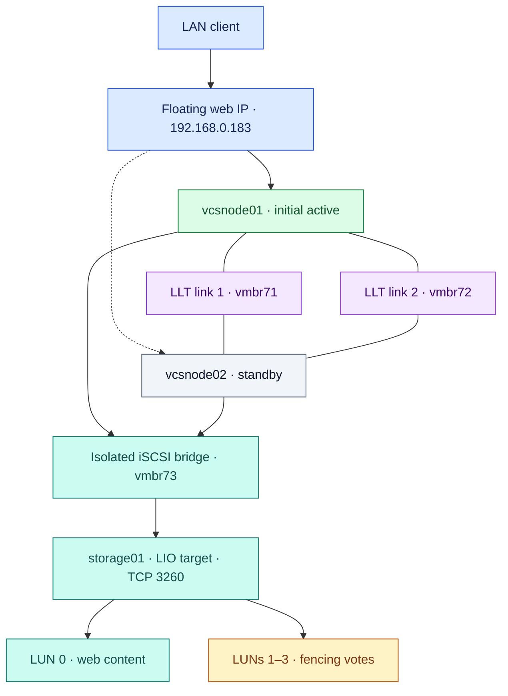
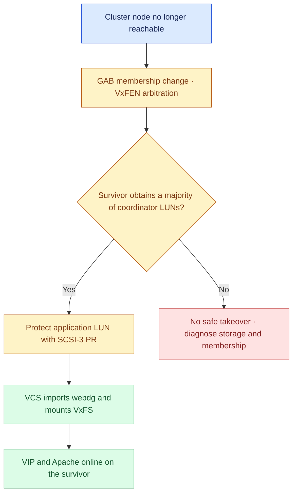
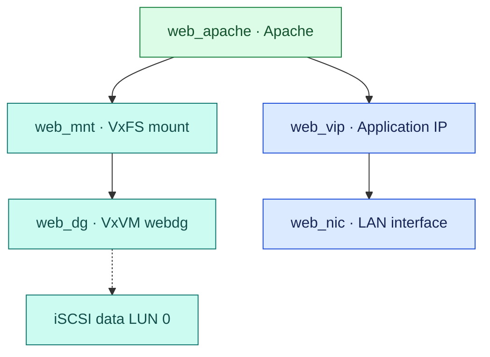

# Two-node Apache failover with InfoScale on Proxmox

**Hands-on lab for RHEL 9.8 x86_64, iSCSI shared block storage, VxVM, VxFS and Veritas Cluster Server**  
Compatibility and licensing references checked on 25 November 2026.

You will build three VMs. `storage01` exports four iSCSI LUNs to `vcsnode01` and `vcsnode02`. VCS moves an Apache service, its virtual IP and its VxFS document root between the two cluster nodes. You will verify the move by checking both the node that answered and the checksum of a file served from shared storage.

**Contents**

1. [Compatibility and downloads](#1-compatibility-and-what-to-download)
2. [Architecture and terminology](#2-architecture-and-vocabulary)
3. [Proxmox VMs, networks and RHEL](#3-create-the-proxmox-vms-and-networks)
4. [iSCSI target, LUNs and initiators](#4-build-the-shared-iscsi-target)
5. [InfoScale installation and VCS](#5-install-infoscale-enterprise-and-form-the-vcs-cluster)
6. [SCSI-3 persistent reservations and fencing](#6-qualify-the-iscsi-luns-and-enable-fencing)
7. [VxVM, VxFS and Apache](#7-build-the-vxvm-volume-vxfs-filesystem-and-apache-configuration)
8. [VCS service group and resources](#8-create-the-apache-service-group-in-vcs)
9. [Failover exercises and verification](#9-exercises-and-expected-results)
10. [Startup, shutdown and maintenance](#10-startup-shutdown-and-maintenance)
11. [Troubleshooting](#11-troubleshooting-by-layer)
12. [Completion checklist](#12-completion-checklist)

## 1. Compatibility and what to download

| Item | Use for this lab |
| --- | --- |
| Guest OS | RHEL **9.8 x86_64** on all three VMs. Download the **Binary DVD ISO** for this exact minor release. |
| InfoScale | **InfoScale Enterprise for Linux, 9.2.0 with the applicable RHEL 9.8 platform patch**, or a vendor-confirmed build that includes the same enablement. Use the same build and patches on both VCS nodes. |
| Kernel | The 9.2.0 Linux compatibility list names `5.14.0-687.15.1.el9_8.x86_64` for RHEL 9.8. Check the running kernel in **Qualified Kernel** and the patch README. Choose a vendor-qualified build for the lab. The kernel on your DVD ISO can differ. |
| InfoScale entitlement | Get the Linux installer, the platform patch and a valid evaluation or subscription license file for both nodes from InfoScale. Request access before starting the cluster portion. |
| Proxmox | The vendor lists KVM configurations with specific versions and conditions. Proxmox VE has no explicit entry in the published list. Treat this as a learning lab and validate the exact storage path with the fencing test below. |

See the [RHEL 9.8 release notes][rhel98], [InfoScale 9.2.0 Linux compatibility list][scl], [November 2026 certification matrix][autocert] and [Qualified Kernel][kernel].

1. Use the [Red Hat download page][rhel-download] and pick **9.8**, since the default download may point to a later minor. For an eligible personal lab, the [Red Hat Developer Subscription for Individuals FAQ][rhel-dev] covers access and use terms. Check your entitlement if you need a maintained 9.8 repository stream.
2. Ask [InfoScale sales][sales] for a **two-node Linux InfoScale Enterprise evaluation**, RHEL 9.8 x86_64 platform enablement and access to the package and patch in the [InfoScale Download Center][downloads]. Ask which kernel, patch build, and evaluation dates apply. Suggested request: “I want to evaluate two-node SFHA with VxVM, VxFS, VCS, iSCSI and SCSI-3 fencing on RHEL 9.8 x86_64 guests. Please provide the 9.2 Linux media, required platform patch and two-node evaluation entitlement.”
3. The older [Veritas trialware form][legacy-trial] advertises 60 days. Confirm the offer, media access and term for **9.2 Linux** with InfoScale. The current 9.2 installer documentation says licensed services remain offline until you apply a valid key. Use the entitlement and dates you actually receive. See the [9.2 installation guide][cpi-install] and [licensing FAQ][lic-faq].
4. Compare the downloaded ISO, installer and patch checksums with their published values. Keep the license file in a root-only directory and outside Git.

**Proceed in stages.** You can build the RHEL VMs and verify iSCSI while waiting for the InfoScale download. Complete the InfoScale precheck and patch verification before initializing VxVM disks. Complete the two-node reservation tests and fencing checks before putting Apache under cluster control.

## 2. Architecture and vocabulary



The solid path from the VIP is the initial traffic path. After failover the VIP belongs to `vcsnode02`. The client uses the same IP and URL. Both nodes log in to the iSCSI target, and the active node alone imports the application disk group and mounts the filesystem.

| Term | What it does here |
| --- | --- |
| iSCSI target and initiator | `storage01` runs the Linux LIO target, and the two cluster VMs run initiators. SCSI commands travel over TCP. The initiators see block devices. |
| IQN, portal and LUN | The IQN identifies a target or initiator, the portal is the listening IP and port, and the LUN is one numbered block device exported by the target. |
| LVM on `storage01` | Divides one dedicated virtual disk into four backing devices. The target exports those devices. |
| VxVM and DMP on the VCS nodes | VxVM initializes and groups block storage and creates a volume on it. DMP identifies the underlying SCSI devices. This lab has a single path per LUN. |
| VxFS | The filesystem created on the VxVM volume. The Apache document root is a mount of this filesystem. This is an exclusive, non-clustered mount. |
| VCS and HAD | VCS groups application resources and manages their startup, monitoring and recovery. HAD is the VCS engine. |
| LLT and GAB | Low Latency Transport (LLT) carries private cluster traffic across two links. Group Membership and Atomic Broadcast (GAB) identifies cluster members and delivers messages to cluster components. |
| VIP | A floating IP controlled by VCS. DNS points to the VIP. The two guest management IPs stay fixed. |
| SCSI-3 PR and fencing | Persistent reservations let the cluster arbitrate ownership and prevent an evicted node from writing to shared disks. The three coordinator LUNs are for arbitration. The data LUN also needs functional reservations. |

In a **planned switchover**, VCS stops Apache and unmounts VxFS before releasing the source node's resources. In an **unplanned failure**, the surviving node must establish cluster membership and acquire safe storage ownership before serving the site. If the two nodes lose contact while both still see the storage, they could each think the other has failed. This is **split brain**. Fencing is what makes a takeover safe in that case. Giving both VMs iSCSI access establishes visibility only.

All three VMs and their disks depend on one physical Proxmox server. The LUNs also share one target and one backing disk. This setup demonstrates application and guest failover with disposable storage. A host or target outage takes down the lab regardless of which VCS node was active.

## 3. Create the Proxmox VMs and networks

### 3.1. Address plan

The example uses the `192.168.0.0/24` LAN from the lab. Reserve `.181`–`.184` outside the DHCP pool, or replace them consistently with unused addresses. Verify existing VM and bridge names before creating anything. `192.168.0.30` is an example DNS resolver if your IPA DNS is available.

| Role | VM | LAN via `vmbr0` | Storage via `vmbr73` | Heartbeats |
| --- | --- | --- | --- | --- |
| Cluster node 1 | `vcsnode01` | `192.168.0.181/24` | `10.77.30.11/24` | `vmbr71` + `vmbr72` |
| Cluster node 2 | `vcsnode02` | `192.168.0.182/24` | `10.77.30.12/24` | `vmbr71` + `vmbr72` |
| iSCSI target | `storage01` | `192.168.0.184/24` | `10.77.30.10/24` | — |
| Apache VIP | `web-vcs.kubinfra.com` | `192.168.0.183/24` | — | — |

The default gateway `192.168.0.1` and DNS apply to the LAN NIC only. Layer 2 LLT requires link connectivity and uses Ethernet frames directly, so the two heartbeat NICs have no IP addresses. VCS assigns the VIP after the cluster is built. Leave it out of every NetworkManager profile.

### 3.2. Proxmox setup

1. Open **Node → System → Network**. Confirm the LAN bridge, typically `vmbr0`. Create Linux Bridges `vmbr71`, `vmbr72` and `vmbr73`. For each, leave **Bridge ports**, **IPv4/CIDR**, **Gateway** and **IPv6** empty. Enable **Autostart**. Use these only for this lab. Apply the network changes from the Proxmox console if a reload could interrupt your management connection. Existing bridges can also be used if they are dedicated to the same purpose.
2. Upload the RHEL 9.8 DVD ISO to a Proxmox storage location that accepts ISO images. Create the VMs from the table below. Use an x86-64-v2 or newer compatible CPU model, or `host` on a single Proxmox server with a compatible CPU. Use a VirtIO SCSI controller and VirtIO NICs. SeaBIOS is sufficient for these lab guests. For UEFI Secure Boot, follow the vendor's [kernel module signing and key enrollment guidance][secureboot].
3. Give `vcsnode01` and `vcsnode02` four NICs in the same order. Assign `net0` to the LAN, `net1` to `vmbr71`, `net2` to `vmbr72` and `net3` to `vmbr73`. Give `storage01` `net0` on the LAN and `net1` on `vmbr73`. Record the MAC addresses. Linux NIC names depend on the VM hardware layout. If Proxmox firewalling is enabled, allow the required lab traffic on the relevant NICs, including LLT Layer 2 traffic on the private bridges. On this isolated lab you can leave the per-NIC Proxmox firewall option off for the two LLT adapters.
4. Add the **32 GiB extra disk on `storage01` only**. The VCS guests access the four LUNs over their own iSCSI sessions. Keep the guest OS disks separate from the storage backing disk.
5. Boot the RHEL ISO on each guest. Select **Install Red Hat Enterprise Linux**, choose **Minimal Install**, select only the VM's own 48 GiB OS disk in **Installation Destination**, set the static LAN IP, gateway and DNS, and create a local admin with sudo. On `storage01`, leave the extra 32 GiB disk untouched in the installer. Finish the install, eject the ISO as the boot device and boot from the OS disk. You can leave the DVD connected for offline packages.

| VM | vCPU | RAM | Disks |
| --- | ---: | ---: | --- |
| `vcsnode01` | 4 | 8 GiB | 48 GiB OS |
| `vcsnode02` | 4 | 8 GiB | 48 GiB OS |
| `storage01` | 2 | 4 GiB | 48 GiB OS + 32 GiB dedicated iSCSI backing disk |

Suggested starting RAM is 20 GiB total across the guests. If OpenShift is running on the same Proxmox host, check free RAM and disk capacity before starting all three. See the [Proxmox VE administration guide][pve].

### 3.3. Register and confirm the OS

Unless marked **Proxmox** or **client**, run commands in a root shell (`sudo -i`) on the guest named in the heading. Examples use fresh lab VMs.

**All three RHEL VMs.** Check the OS and architecture. If you are using CDN packages, register with the Red Hat account or approved activation key that has content access. With Simple Content Access you typically register and enable repositories directly. Use release-specific content where your entitlement permits it. If you are using offline DVD packages, skip the subscription commands and use the DVD instructions below.

```bash
cat /etc/redhat-release
uname -r
uname -m
subscription-manager register
subscription-manager release --list
```

If `9.8` is available, set it and check the repositories before installing or upgrading RPMs.

```bash
subscription-manager release --set=9.8
subscription-manager release --show
subscription-manager repos --list-enabled
dnf --releasever=9.8 repolist
dnf --releasever=9.8 --showduplicates list kernel-core
```

Use the enabled BaseOS and AppStream streams that actually expose 9.8 packages. On the VCS nodes, compare the available and running kernels with the vendor's exact qualification and patch instructions. Avoid a general upgrade that moves the guests to 9.9. If the qualified build is installed but you booted a different build, inspect `grubby --info=ALL`, select the approved entry for the next boot, and verify `uname -r` after reboot. Package and kernel selection must match on the two nodes.

If your CDN entitlement lacks the required minor stream, use the **RHEL 9.8 DVD** for baseline RPMs. For example, mount an attached DVD at `/mnt/rhel98` and define two disabled repos that you enable only for lab installs. A DVD supplies its release packages. Obtain any required kernel erratum and platform patch through authorized sources.

```bash
install -d /mnt/rhel98
lsblk -o NAME,TYPE,SIZE,LABEL
mount -o ro /dev/sr0 /mnt/rhel98
ls /mnt/rhel98/{BaseOS,AppStream}/repodata/repomd.xml
tee /etc/yum.repos.d/vcs-rhel98-dvd.repo >/dev/null <<'EOF'
[vcs-rhel98-baseos]
name=RHEL 9.8 DVD BaseOS
baseurl=file:///mnt/rhel98/BaseOS
enabled=0
gpgcheck=1
gpgkey=file:///etc/pki/rpm-gpg/RPM-GPG-KEY-redhat-release

[vcs-rhel98-appstream]
name=RHEL 9.8 DVD AppStream
baseurl=file:///mnt/rhel98/AppStream
enabled=0
gpgcheck=1
gpgkey=file:///etc/pki/rpm-gpg/RPM-GPG-KEY-redhat-release
EOF
dnf --disablerepo='*' --enablerepo='vcs-rhel98-*' repolist
```

Verify `/dev/sr0` is the RHEL DVD before mounting. In subsequent `dnf` commands, DVD users replace `--releasever=9.8` with `--disablerepo='*' --enablerepo='vcs-rhel98-*'`. Resolve any installer-reported dependency from the matching RHEL repositories and rerun the precheck.

### 3.4. Name the VMs and configure their interfaces

**All three VMs.** Run the one `hostnamectl` command for the VM you're on. Add the three example host entries to `/etc/hosts` if you are using local resolution. Put each hostname on its LAN address, including the local VM's hostname. Keep the loopback lines and reconcile duplicate name entries if any exist.

```text
192.168.0.181 vcsnode01 vcsnode01.kubinfra.com
192.168.0.182 vcsnode02 vcsnode02.kubinfra.com
192.168.0.184 storage01 storage01.kubinfra.com
```

```bash
# Pick one hostname command per VM.
hostnamectl set-hostname vcsnode01
# hostnamectl set-hostname vcsnode02
# hostnamectl set-hostname storage01

hostname -s
getent hosts vcsnode01 vcsnode02 storage01
ip -br addr
ip -br link
ip route
nmcli -f NAME,UUID,DEVICE,TYPE,AUTOCONNECT connection show
```

Use the Proxmox MAC addresses to match guest interfaces to network roles. The next blocks assume `ens18` is LAN on all three VMs, with `ens19` and `ens20` as LLT and `ens21` as iSCSI on the cluster VMs. On `storage01`, `ens19` is the iSCSI NIC. Substitute the actual names. If NetworkManager auto-created a profile on any private NIC, disable autoconnect on that **profile UUID** before adding its replacement. Use `nmcli connection modify uuid ACTUAL_UUID connection.autoconnect no` and retain the working LAN profile.

**Both VCS nodes.** Use `10.77.30.11/24` on `vcsnode01` and `10.77.30.12/24` on `vcsnode02`.

```bash
# On vcsnode02 use 10.77.30.12/24 instead.
STORAGE_CIDR=10.77.30.11/24

nmcli connection add type ethernet con-name vcs-llt1 ifname ens19 \
  ipv4.method disabled ipv6.method disabled
nmcli connection add type ethernet con-name vcs-llt2 ifname ens20 \
  ipv4.method disabled ipv6.method disabled
nmcli connection add type ethernet con-name vcs-iscsi ifname ens21 \
  ipv4.method manual ipv4.addresses "$STORAGE_CIDR" ipv4.never-default yes \
  ipv6.method disabled connection.zone block
nmcli connection up vcs-llt1
nmcli connection up vcs-llt2
nmcli connection up vcs-iscsi

ip -br link
ip -br addr
ip route get 10.77.30.10
```

The two LLT interfaces should show carrier. `ip route get 10.77.30.10` should show the storage NIC and the node's `10.77.30.x` source. The `block` zone on the initiator's storage NIC denies new incoming connections while allowing the initiator to open connections to the target.

**`storage01`.** Install the target tools and create a firewall zone for iSCSI. The two source rules allow TCP/3260 from the cluster nodes on the storage NIC. Keep the target off the LAN.

```bash
dnf --releasever=9.8 install -y lvm2 targetcli lsscsi chrony firewalld nmap-ncat
systemctl enable --now firewalld chronyd

firewall-cmd --permanent --new-zone=vcs-storage
firewall-cmd --permanent --zone=vcs-storage \
  --add-rich-rule='rule family="ipv4" source address="10.77.30.11/32" port port="3260" protocol="tcp" accept'
firewall-cmd --permanent --zone=vcs-storage \
  --add-rich-rule='rule family="ipv4" source address="10.77.30.12/32" port port="3260" protocol="tcp" accept'
firewall-cmd --reload

nmcli connection add type ethernet con-name vcs-target ifname ens19 \
  ipv4.method manual ipv4.addresses 10.77.30.10/24 ipv4.never-default yes \
  ipv6.method disabled connection.zone vcs-storage
nmcli connection up vcs-target
firewall-cmd --get-active-zones
firewall-cmd --zone=vcs-storage --list-all
ip -br addr
chronyc tracking
```

**Both VCS nodes.** Install prerequisites and identify each iSCSI initiator. Leave SELinux enforcing. Record the complete IQN after the `InitiatorName=` field. The two IQNs must be different. If you cloned a VM and they match, generate a new IQN on one node with `iscsi-iname`, update `/etc/iscsi/initiatorname.iscsi` before the first discovery/login and restart `iscsid` if already running.

```bash
dnf --releasever=9.8 install -y iscsi-initiator-utils sg3_utils lsscsi \
  httpd curl chrony firewalld nmap-ncat net-tools iputils ethtool \
  tcpdump lsof policycoreutils-python-utils perl openssh-clients
systemctl enable --now firewalld chronyd
chronyc tracking
getenforce
cat /etc/iscsi/initiatorname.iscsi
```

**Checkpoint.** All three VMs have their own management IPs, can resolve the node names, and run the intended RHEL minor. `chronyc tracking` should indicate synchronized clocks, typically `Leap status: Normal`. If synchronization is pending, check `chronyc sources -v` and set a reachable time source before InfoScale installation. The storage path stays on `10.77.30.0/24`. Save the IQNs for the next section.

## 4. Build the shared iSCSI target

### 4.1. Create the backing logical volumes

| Target LUN | LIO backstore | LVM LV on `storage01` | Size | Use |
| ---: | --- | --- | ---: | --- |
| 0 | `webdata` | `lv_webdata` | 20 GiB | VxVM application disk group and web content |
| 1 | `fence1` | `lv_fence1` | 1 GiB | Coordinator disk |
| 2 | `fence2` | `lv_fence2` | 2 GiB | Coordinator disk |
| 3 | `fence3` | `lv_fence3` | 3 GiB | Coordinator disk |

Each backstore exports a distinct block device. The different sizes help you spot mapping mistakes, and the SCSI identifiers confirm identity. The VxVM disk group runs inside the cluster nodes. On `storage01`, the LVM LVs are raw backing devices.

**`storage01` only.** Identify the empty dedicated 32 GiB disk. Match it to the Proxmox Hardware view and confirm that the device has no partitions, filesystem, LVM membership or mounts. Use its stable `/dev/disk/by-id/` path if available, or confirm its `/dev/disk/by-path/` path.

```bash
lsblk -o NAME,PATH,TYPE,SIZE,MODEL,SERIAL,FSTYPE,MOUNTPOINTS
ls -l /dev/disk/by-id/ /dev/disk/by-path/
pvs -o pv_name,vg_name,pv_size
findmnt -n -o SOURCE /
read -r -p 'Verified path of the empty 32 GiB disk: ' ISCSI_BACKING
readlink -e -- "$ISCSI_BACKING"
lsblk -o NAME,PATH,TYPE,SIZE,FSTYPE,MOUNTPOINTS "$ISCSI_BACKING"
wipefs --no-act "$ISCSI_BACKING"
```

`pvcreate` writes metadata. Run the following block only after the previous output positively identifies the disposable backing disk. Stop if `wipefs` reports existing signatures or the disk has child partitions. If you open a new shell, re-identify the disk and set `ISCSI_BACKING` again.

```bash
pvcreate "$ISCSI_BACKING" &&
vgcreate vg_iscsi "$ISCSI_BACKING" &&
lvcreate -L 20G -n lv_webdata vg_iscsi &&
lvcreate -L 1G -n lv_fence1 vg_iscsi &&
lvcreate -L 2G -n lv_fence2 vg_iscsi &&
lvcreate -L 3G -n lv_fence3 vg_iscsi &&
lvs --units g -o vg_name,lv_name,lv_size,lv_path vg_iscsi
```

### 4.2. Publish the LUNs and allow the two initiators

**`storage01` only.** Use LIO's `block` backstore. The target portal listens only on `10.77.30.10`. Turn off dynamic ACL generation and map each LUN to both known initiator IQNs. This isolated exercise uses IQN ACLs and firewall rules. IQN strings alone do not authenticate a client. Keep the bridge private and use CHAP or stronger controls when sharing a storage network. See the [RHEL iSCSI target guide][target].

```bash
TARGET_IQN=iqn.2026-11.com.kubinfra:storage01.vcs
read -r -p 'Complete vcsnode01 initiator IQN: ' NODE1_IQN
read -r -p 'Complete vcsnode02 initiator IQN: ' NODE2_IQN
printf 'Target=%s\nNode 1=%s\nNode 2=%s\n' "$TARGET_IQN" "$NODE1_IQN" "$NODE2_IQN"
```

Verify both IQNs begin with `iqn.`, match the initiator files and differ from each other. Use the same shell for the following configuration blocks. Start with a fresh LIO configuration and stop on any command error before doing the next block.

```bash
targetcli ls
targetcli set global auto_add_default_portal=false
targetcli set global auto_add_mapped_luns=false

targetcli /backstores/block create name=webdata dev=/dev/vg_iscsi/lv_webdata
targetcli /backstores/block create name=fence1 dev=/dev/vg_iscsi/lv_fence1
targetcli /backstores/block create name=fence2 dev=/dev/vg_iscsi/lv_fence2
targetcli /backstores/block create name=fence3 dev=/dev/vg_iscsi/lv_fence3
targetcli /iscsi create "$TARGET_IQN"
TPG="/iscsi/$TARGET_IQN/tpg1"
targetcli "$TPG/portals" ls
```

`TPG` is LIO's **Target Portal Group**, which owns the portal, LUNs and ACLs. If your version created an IPv4 wildcard portal despite the setting, remove that portal from this lab target before adding the private portal. Run `targetcli "$TPG/portals" delete 0.0.0.0 3260` only if listing shows it. Remove an IPv6 wildcard portal in the same way if present.

```bash
targetcli "$TPG" set attribute generate_node_acls=0 authentication=0
targetcli "$TPG/portals" create 10.77.30.10 3260

targetcli "$TPG/luns" create storage_object=/backstores/block/webdata lun=0
targetcli "$TPG/luns" create storage_object=/backstores/block/fence1 lun=1
targetcli "$TPG/luns" create storage_object=/backstores/block/fence2 lun=2
targetcli "$TPG/luns" create storage_object=/backstores/block/fence3 lun=3

targetcli "$TPG/acls" create "$NODE1_IQN"
targetcli "$TPG/acls" create "$NODE2_IQN"
targetcli "$TPG/acls" ls
```

With `auto_add_mapped_luns=false`, the ACLs start empty. Map each LUN read/write. If your tool auto-mapped a LUN anyway, verify the existing mapping and omit that duplicate `create` command.

```bash
for LAB_IQN in "$NODE1_IQN" "$NODE2_IQN"; do
  targetcli "$TPG/acls/$LAB_IQN" create mapped_lun=0 \
    tpg_lun_or_backstore=/backstores/block/webdata write_protect=0 || break
  targetcli "$TPG/acls/$LAB_IQN" create mapped_lun=1 \
    tpg_lun_or_backstore=/backstores/block/fence1 write_protect=0 || break
  targetcli "$TPG/acls/$LAB_IQN" create mapped_lun=2 \
    tpg_lun_or_backstore=/backstores/block/fence2 write_protect=0 || break
  targetcli "$TPG/acls/$LAB_IQN" create mapped_lun=3 \
    tpg_lun_or_backstore=/backstores/block/fence3 write_protect=0 || break
done

targetcli ls
targetcli saveconfig
systemctl enable target.service
systemctl is-enabled target.service
ss -lnt 'sport = :3260'
```

`targetcli` applies settings immediately. `saveconfig` makes the configuration persistent, typically in `/etc/target/saveconfig.json` on RHEL. Confirm the listener is `10.77.30.10:3260` and that each ACL lists four writable LUN mappings. On this fresh target, reboot `storage01` once **before** building the cluster and confirm `systemctl status target.service`, `targetcli ls` and the listener after boot. This proves that the LVM backing devices and the target configuration return together.

If the journal shows the restore ran before `10.77.30.10` became available, check that the `vcs-target` profile autoconnects with `nmcli` and inspect `systemctl cat target.service`. If the packaged unit lacks network-online ordering, use `systemctl edit target.service` to add this local drop-in. Confirm that `NetworkManager-wait-online.service` is enabled. Reboot the unused target again to verify the fix before any initiator uses its LUNs.

```ini
[Unit]
Wants=network-online.target
After=network-online.target
```

### 4.3. Connect both iSCSI initiators

**Both VCS nodes.** The following commands discover the target, save the node record, log in, and set up automatic login on subsequent boots.

```bash
TARGET_IQN=iqn.2026-11.com.kubinfra:storage01.vcs
PORTAL=10.77.30.10:3260

ncat -zv -w 3 10.77.30.10 3260
systemctl enable --now iscsid.service
iscsiadm -m discovery -t sendtargets -p "$PORTAL"
iscsiadm -m node -T "$TARGET_IQN" -p "$PORTAL" --login
iscsiadm -m node -T "$TARGET_IQN" -p "$PORTAL" --op update \
  -n node.startup -v automatic
systemctl enable iscsi.service

iscsiadm -m session -P 3
lsscsi -t
lsblk -d -o NAME,SIZE,TRAN,MODEL,SERIAL,WWN
ls -l /dev/disk/by-path/*-iscsi-*-lun-*
```

On each node record the disk reached through the four stable by-path names. `/dev/sdX` letters can differ and change at reboot. The path contains the portal, target IQN and LUN number. Compare SCSI device IDs for each LUN across both nodes. `sg_vpd` reads the device ID page and `sg_persist --in` is a read-only preliminary check.

```bash
for LUN in 0 1 2 3; do
  LUN_PATH="/dev/disk/by-path/ip-${PORTAL}-iscsi-${TARGET_IQN}-lun-${LUN}"
  printf '\nLUN %s\n' "$LUN"
  readlink -e -- "$LUN_PATH" || break
  lsblk -d -o NAME,SIZE,SERIAL,WWN "$LUN_PATH" || break
  sg_vpd --page=di "$LUN_PATH" || break
  sg_persist --in --report-capabilities "$LUN_PATH" || break
done
```

Compare the **logical unit** identifier in the VPD output for the same LUN on both nodes. The four LUNs must have four different identifiers. The sizes should be 20, 1, 2 and 3 GiB in that order. If udev uses a different link format, use the actual by-path links and issue `sg_vpd` and `sg_persist --in` for each. See the [RHEL iSCSI initiator guide][initiator].

**Checkpoint.** Both cluster nodes have one session to the same target and can identify all four LUNs. `sg_persist --in` proves that the target answers a PR query. The cross-node InfoScale test in §6 verifies the reservation operations needed for fencing. Leave the LUNs blank and keep both sessions logged in.

## 5. Install InfoScale Enterprise and form the VCS cluster

### 5.1. Prepare installation access

The **Common Product Installer (CPI)** can install and configure both nodes from one root session. It needs working SSH between the nodes, reliable name resolution and synchronized clocks. Keep the temporary access scoped to these lab VMs.

**Both VCS nodes.** Enable `sshd` and generate a dedicated key as root. Give it an empty passphrase for the installer. Use a new filename, and decline any overwrite prompt.

```bash
systemctl enable --now sshd
install -d -m 0700 /root/.ssh
ssh-keygen -t ed25519 -f /root/.ssh/vcs-lab-installer -C "vcs-lab-$(hostname -s)"
cat /root/.ssh/vcs-lab-installer.pub
```

Append each node's **public** key to the other node's `/root/.ssh/authorized_keys`. If the vendor utility also logs in to the node on which it runs, authorize each node's own public key on that node too. You can prefix the lines with `from="192.168.0.181"` for the key generated on `vcsnode01` and `from="192.168.0.182"` for `vcsnode02` when SSH always uses the fixed LAN addresses. Add this block to `/root/.ssh/config` on both nodes, reconciling it with any existing `Host` settings.

```ssh-config
Host vcsnode01 vcsnode02 vcsnode01.kubinfra.com vcsnode02.kubinfra.com
    User root
    IdentityFile /root/.ssh/vcs-lab-installer
    IdentitiesOnly yes
```

```bash
chmod 0600 /root/.ssh/config /root/.ssh/authorized_keys
restorecon -RFv /root/.ssh
sshd -T | grep -E '^(permitrootlogin|pubkeyauthentication) '
```

Check the console's SSH host key fingerprint against the first connection prompt before accepting it. `PermitRootLogin prohibit-password` permits keys and blocks root password login. If your lab image uses `PermitRootLogin no`, change it temporarily to `prohibit-password` in the effective SSH configuration on these VMs only. Run `sshd -t` before `systemctl reload sshd`. Keep access within the trusted lab LAN and check that the LAN firewall allows SSH from the peer. If an SSH policy already permits a vendor-supported installation method, you can use that method instead.

```bash
# On the VM console, compare this with the fingerprint presented by SSH.
ssh-keygen -lf /etc/ssh/ssh_host_ed25519_key.pub
ssh root@vcsnode01 'hostname -s; id -u'
ssh root@vcsnode02 'hostname -s; id -u'
ssh -o BatchMode=yes root@vcsnode01 'hostname -s; id -u; uname -r'
ssh -o BatchMode=yes root@vcsnode02 'hostname -s; id -u; uname -r'
```

Expect the intended hostname and UID `0` without a password or passphrase prompt on the batch runs. Keep this access until the fencing installer and any initial diagnostics finish. Afterwards remove the temporary public-key entries and the temporary SSH settings you added. Local `ha*` commands continue to work from each node's console.

### 5.2. Stage the installer, patch and license

**`vcsnode01` only.** Create private directories and copy the vendor downloads here using your admin session. Use the actual file paths and patch README from your download. The patch package can contain updated RPMs and a separate CPI patch. The filename and required installer flags depend on the build provided by InfoScale.

```bash
install -d -m 0700 /root/infoscale/{media,patches,license}
read -r -p 'Full path of the vendor Linux .tar.gz installer: ' INFO_MEDIA
sha256sum "$INFO_MEDIA"
```

Compare the checksum to the vendor value before extracting. For archive media use the commands below. For vendor ISO media, use a read-only loop mount and `cd` to the directory containing `installer`.

```bash
tar -xzf "$INFO_MEDIA" -C /root/infoscale/media
find /root/infoscale/media -type f -name installer -print
read -r -p 'Directory containing the main installer: ' INFO_INSTALL_DIR
cd "$INFO_INSTALL_DIR"
./installer -help
```

Restrict the license file to root (`chmod 0600` on that file). Verify the patch checksum as well, extract it under `/root/infoscale/patches`, and read the README before running CPI. Keep the base media, the patch, and the `.slf` or other delivered license file in their separate directories.

### 5.3. Run precheck and install both nodes

From the media directory on `vcsnode01`, use the invocation from the patch README. The unadorned commands are for a build with the RHEL 9.8 enablement already included. Run `-precheck` first and resolve reported OS, SSH, RPM, space or kernel issues on the node indicated.

```bash
./installer -precheck vcsnode01 vcsnode02
./installer vcsnode01 vcsnode02
```

If the README instead calls for an integrated `-patch_path` install, the command pattern is below. Paste the directory specified in the README. If it calls for a separate installer patch file via `-require`, include that flag with its actual patch file path as directed. Some packages use separate install or upgrade steps. Follow that package's installation sequence and apply the patch on both nodes before configuration. See [CPI options][cpi-options].

```bash
read -r -p 'Full integrated patch directory from the README: ' INFO_PATCH_DIR
./installer -precheck -patch_path "$INFO_PATCH_DIR" vcsnode01 vcsnode02
./installer -patch_path "$INFO_PATCH_DIR" vcsnode01 vcsnode02
```

Use the invocation that matches your media and choose the following installer options.

| CPI prompt | Answer for this lab |
| --- | --- |
| Task and product | **Install a product** → **InfoScale Enterprise**. Select the product by name. |
| Packages | Use the installer-recommended RPM set for Enterprise. Confirm the resulting install includes VxVM, VxFS, VCS, bundled agents and VxFEN. |
| Configure after installation | Choose **no** to install and validate the patch and license first. |
| License | Choose **yes** and supply the full license file path on `vcsnode01`. Confirm successful registration on both nodes. |
| REST server | Leave it off for the local CLI lab. |

Save the CPI log and summary paths, normally under `/opt/VRTS/install/logs`. Resolve any error or missing patch before configuring. A precheck that still says the OS is unsupported is a stop condition. Get the matching platform enablement rather than editing OS release files or forcing installation.

**Both VCS nodes.** Confirm kernel, installed packages and license. The exact version strings depend on the delivered patch.

```bash
uname -r
rpm -q VRTSvxvm VRTSvxfs VRTSvcs VRTSvcsag VRTSllt VRTSgab VRTSvxfen
/opt/VRTS/bin/vxlicrep
```

On `vcsnode01`, `./installer -version vcsnode01 vcsnode02` from the applicable media also reports installed versions. Compare with the patch README and check entitlement and expiry in `vxlicrep`. Archive the installation summary without credentials or license contents.

### 5.4. Configure SFHA and the private VCS links

**`vcsnode01` only.** Start the interactive configuration after both packages and licenses are ready.

```bash
/opt/VRTS/install/installer -configure
```

Use the prompts below and the [SFHA configuration guide][sfha] for the installed build. CPI writes the LLT, GAB and VCS configuration files for both nodes.

| Configuration | Enter or select |
| --- | --- |
| Product/component | **InfoScale Enterprise → Storage Foundation and High Availability (SFHA)** for single-owner VxVM and VxFS with VCS. |
| Systems | `vcsnode01 vcsnode02`. |
| Cluster name and ID | `vcs-web-lab`, ID `71`. Use a unique numeric ID if any clusters share the heartbeat networks. |
| LLT transport | **Ethernet**. Use the `vmbr71` and `vmbr72` guest interfaces in the same order on both nodes. In the example they are `ens19` and `ens20`. |
| Optional low-priority public heartbeat | Skip for this isolated lab with two dedicated LLT links. The iSCSI NIC has its own bridge. |
| Global Cluster, ClusterService or management virtual IP | Skip these optional services. The Apache VIP will be an `IP` resource in §8. |
| Cluster secure mode, SMTP/SNMP and REST | The local-root CLI example can use the simple configuration on an isolated lab LAN. If you choose secure mode, follow the version's authentication setup before issuing administrative CLI commands. Skip notifications and REST unless you are configuring them separately. |
| Enable fencing during this first configuration | If prompted, defer with **no** so the four empty LUNs can be tested first. This intermediate cluster has no application or shared filesystem online. Configure and verify disk-based fencing immediately in §6. |

**Both VCS nodes.** Set the tool path in every new root shell used for VCS/VxVM commands. The installer sets up startup services. Use the following read-only checks after configuration.

```bash
export PATH=/opt/VRTS/bin:/opt/VRTSvcs/bin:/opt/VRTSvcs/vxfen/bin:/etc/vx/bin:$PATH
hasys -list
hastatus -sum
lltstat -nvv
gabconfig -a
vxdctl mode
vxdisk list
lsmod | grep -E '^(llt|gab|vxfen|vxfs|vxio|vxdmp)[[:space:]]'
```

Verify the cluster and storage stack before configuring the application.

- `hasys -list` contains the two intended VCS node names and `hastatus -sum` shows both `RUNNING`. Use the exact names that `hasys -list` reports for all service-group commands.
- `lltstat -nvv` shows the peer available over both private links. `gabconfig -a` shows both node IDs in port `a` (membership) and port `h` (HAD).
- `vxdctl mode` shows `enabled`. Both nodes see the iSCSI LUNs in VxVM after discovery. A VxFS module can load on first use of the filesystem depending on the build. Verify the installed module with `modinfo vxfs` if needed.

If VxVM does not report enabled, check the installer logs, license and kernel module messages before continuing. If the VxVM configuration daemon is running and an already logged-in LUN has not appeared, run `vxdisk scandisks` and check again. Avoid selecting guest OS disks for initialization. See [LLT heartbeat setup][llt].

## 6. Qualify the iSCSI LUNs and enable fencing

With two data-capable nodes, storage arbitration needs a majority of coordinator points. Here the two nodes can each reach three separate coordinator LUNs. A winning partition takes a majority and VxFEN coordinates protection of the application disk. All three LUNs live behind one lab target, so they share its failure domain. Keep their disk group separate from the web data disk group. See [coordinator disk requirements][coord].



### 6.1. Map LUN numbers to VxVM DMP device names

**Both VCS nodes.** Combine the stable by-path links from §4.3 with VxVM's view.

```bash
vxdisk scandisks
vxdisk path
vxdisk -e list
vxdmpadm listenclosure all
```

For each `/dev/sdX` identified from the by-path link, find its VxVM DMP device in `vxdisk path` (subpath to DMP/DANAME) or `vxdisk -e list`. Use `vxdisk list DEVICE_NAME` to inspect an individual device. Compare the VPD/WWID with §4.3. Names can differ between nodes, so fill the table for both. Record only whole LUNs. Leave local guest disks outside this table.

| LUN | Size | Purpose | DMP name on `vcsnode01` | DMP name on `vcsnode02` |
| ---: | ---: | --- | --- | --- |
| 0 | 20 GiB | `webdata` | Fill from command output | Fill from command output |
| 1 | 1 GiB | `fence1` | Fill from command output | Fill from command output |
| 2 | 2 GiB | `fence2` | Fill from command output | Fill from command output |
| 3 | 3 GiB | `fence3` | Fill from command output | Fill from command output |

### 6.2. Test reservations on all four empty LUNs

**`vcsnode01` only.** With the target online, both nodes logged in, and all four LUNs still disposable, run the hardware fencing test. See [vxfentsthdw procedure][pr-test].

> **Destructive test.** The full test writes to a disk. Run it once per verified blank lab LUN before creating any disk group or filesystem on it. Read the device prompt carefully and cross-check each selected name with the table above. This is also why a read-only `sg_persist --report-capabilities` check is not enough.

```bash
command -v vxfentsthdw
vxfentsthdw
```

At the prompts, acknowledge the destructive test for the selected disposable device. Enter `vcsnode01` and `vcsnode02` as the node names. Enter the device the prompt requests. For DMP raw-device prompts, use the node's corresponding `/dev/vx/rdmp/DEVICE_NAME`. For OS-device prompts, use the mapped `/dev/sdX` on that node. If prompted for a remote device, use the mapping from the **second** node. Confirm the disk ID matches across the nodes. Keep the reported result for that LUN, then repeat for the next LUN. Test only the four recorded LUNs and require a pass on both nodes for each.

If the tool cannot see the same LUN on both nodes, or a registration, reservation or preemption check fails, correct the LIO, DMP or storage path and rerun the test while the LUNs are still blank. Switch to a proven PR-capable target if this path cannot pass. Stop before building shared-disk failover if the result is unresolved.

### 6.3. Create the coordinator disk group with CPI

**`vcsnode01` only.** Keep the target online. Prepare the three coordinator LUNs in `cdsdisk` format with VxVM. This writes VxVM metadata. The 20 GiB data LUN stays out of this operation. Confirm the DMP names and sizes before running the second block.

```bash
read -r -p 'Verified DMP name for 1 GiB LUN 1: ' FENCE1_DMP
read -r -p 'Verified DMP name for 2 GiB LUN 2: ' FENCE2_DMP
read -r -p 'Verified DMP name for 3 GiB LUN 3: ' FENCE3_DMP
vxdisk list "$FENCE1_DMP"
vxdisk list "$FENCE2_DMP"
vxdisk list "$FENCE3_DMP"
```

```bash
vxdisksetup -i "$FENCE1_DMP" format=cdsdisk
vxdisksetup -i "$FENCE2_DMP" format=cdsdisk
vxdisksetup -i "$FENCE3_DMP" format=cdsdisk
vxdisk list
/opt/VRTS/install/installer -fencing
```

Use the following selections in the [disk-based fencing installer][fencing].

1. Enter `vcsnode01` as a member of the cluster to configure, and confirm the two-node cluster.
2. Choose **Configure disk based fencing**. The 9.2.0 SFHA guide shows this as choice `2`. Follow the displayed menu label if the build changes the numbering.
3. Choose **Create a new disk group**. Select the three verified DMP devices for LUNs 1, 2 and 3 only. Name the group `vxfencoorddg`. Use the DMP disk policy if asked. iSCSI coordination devices require DMP.
4. Confirm your successful SCSI-3 PR tests and review the summary. CPI creates the coordinator group, writes configuration and restarts the relevant components. Save the log path and wait for both nodes to come back into membership.

**Both VCS nodes.** Check the result.

```bash
vxfenadm -d
vxfenconfig -l
cat /etc/vxfenmode
cat /etc/vxfendg
haclus -display -attribute UseFence
gabconfig -a
hastatus -sum
```

**Checkpoint.** Look for `Fencing Mode: SCSI3`, disk policy `dmp`, both cluster members running, and three correctly identified coordinator devices. `/etc/vxfendg` names `vxfencoorddg`. The cluster `UseFence` attribute is `SCSI3`, and GAB port `b` shows both node IDs along with the expected `a` and `h` memberships. If any of these checks fail, keep the web service offline and troubleshoot fencing before using the application LUN. See [fencing verification][fence-verify].

## 7. Build the VxVM volume, VxFS filesystem and Apache configuration

### 7.1. Prepare each Apache node

Apache binaries and settings are local to each VM. Only the website content lives on shared storage. The separate Apache configuration binds to the **floating IP** and sets a node-specific response header. The header tells you where the request landed. VCS will control this Apache instance through its bundled `Apache` agent.

**Both VCS nodes.** Stop the default `httpd` unit on these dedicated VMs and leave it disabled. The VCS agent will start `/usr/sbin/httpd` with its own `-f` configuration file. Create the mount point and the runtime directory. The package's tmpfiles configuration recreates `/run/httpd` after reboot. Check for it with `rpm -ql httpd | grep tmpfiles`, or inspect `systemd-tmpfiles --cat-config` if your build packages it separately. If neither supplies `/run/httpd`, add the local tmpfiles entry shown below.

```bash
systemctl disable --now httpd.service
install -d -m 0755 /var/www/vcsweb
install -d -m 0710 -o root -g apache /run/httpd
restorecon -v /run/httpd /var/www/vcsweb
rpm -ql httpd | grep tmpfiles
```

**Only if the packaged tmpfiles rules do not create `/run/httpd`:**

```bash
printf 'd /run/httpd 0710 root apache -\n' > /etc/tmpfiles.d/vcs-httpd.conf
systemd-tmpfiles --create /etc/tmpfiles.d/vcs-httpd.conf
restorecon -v /run/httpd
```

**Both VCS nodes.** Paste the Apache config. Keep the unquoted `EOF` here so the two nodes get their own `X-Served-By` values. The web FQDN and VIP are examples from §3.1.

```bash
WEB_NODE=$(hostname -s)
tee /etc/httpd/conf/vcs-httpd.conf >/dev/null <<EOF
ServerRoot "/etc/httpd"
IncludeOptional conf.modules.d/*.conf
ServerName web-vcs.kubinfra.com:80
Listen 192.168.0.183:80
PidFile "/run/httpd/vcs-web.pid"

User apache
Group apache
DocumentRoot "/var/www/vcsweb"
DirectoryIndex index.html
EnableSendfile Off

<Directory "/">
    AllowOverride None
    Require all denied
</Directory>
<Directory "/var/www/vcsweb">
    Options None
    AllowOverride None
    Require all granted
</Directory>

ErrorLog "/var/log/httpd/vcs-error_log"
LogLevel warn
CustomLog "/var/log/httpd/vcs-access_log" "%h %l %u %t %r %>s %b"
Header always set X-Served-By "$WEB_NODE"
EOF

restorecon -v /etc/httpd/conf/vcs-httpd.conf
/usr/sbin/httpd -t -f /etc/httpd/conf/vcs-httpd.conf
/usr/sbin/httpd -M -f /etc/httpd/conf/vcs-httpd.conf | grep -E 'headers_module|mpm_'
systemctl is-enabled httpd.service
```

`Syntax OK` is expected on both nodes. `httpd -t` checks configuration without binding the VIP. The RPM's module includes supply the MPM and `mod_headers`. Leave Apache stopped and the VIP unassigned. The service group brings up Apache after both prerequisites are ready.

Allow LAN HTTP to the VIP. The commands assume the LAN NIC is in `public`. Use the zone reported for your LAN interface, or the default zone if the interface has no explicit assignment. Run on both nodes.

```bash
firewall-cmd --get-active-zones
firewall-cmd --get-zone-of-interface=ens18
firewall-cmd --get-default-zone

LAN_ZONE=public
firewall-cmd --permanent --zone="$LAN_ZONE" \
  --add-rich-rule='rule family="ipv4" source address="192.168.0.0/24" destination address="192.168.0.183/32" service name="http" accept'
firewall-cmd --reload
firewall-cmd --zone="$LAN_ZONE" --list-rich-rules
```

Reserve the VIP in the LAN plan. For instance, `arping -D -I ens18 -c 3 192.168.0.183` from one node before creating the resource can reveal an existing ARP responder, though a silent address still needs verification against DHCP and static allocations. A client can use the VIP directly, or you can add an IPA A record. The optional IPA commands below run on a host with the IPA CLI and the DNS administrator's valid Kerberos ticket. Check any existing record before adding or changing it.

```bash
ipa dnszone-show kubinfra.com
ipa dnsrecord-show kubinfra.com web-vcs
# Run only if the name has no existing record and the VIP is reserved for this lab.
ipa dnsrecord-add kubinfra.com web-vcs --a-rec=192.168.0.183
# From a client with dig installed, confirm the result.
dig @192.168.0.30 +short web-vcs.kubinfra.com A
```

### 7.2. Create the application disk group and filesystem

**`vcsnode01` only.** Confirm §6 passed and there is no `webdg` resource or mount. Identify the 20 GiB `webdata` LUN from your §6.1 worksheet. The OS disk and fencing LUNs are outside this operation. Verify the device before the metadata-writing commands.

```bash
read -r -p 'Verified vcsnode01 DMP name for LUN 0, 20 GiB: ' WEB_DMP
vxdisk list "$WEB_DMP"
vxdisk path
vxdg list
findmnt --mountpoint /var/www/vcsweb
```

**Initialize once**, after confirming the selected DMP name matches LUN 0 and is not in any disk group. Create a **local/failover** VxVM disk group using ordinary `vxdg init`. The two guests see the underlying LUN, and only the owner imports the group. `autoimport=no` lets VCS decide ownership after boot. Use the raw VxVM device for `mkfs` and the block VxVM device for mounting.

```bash
vxdisksetup -i "$WEB_DMP" format=cdsdisk &&
vxdg init webdg "webdisk01=$WEB_DMP" &&
vxdg -g webdg set autoimport=no &&
vxassist -g webdg make webvol 10g layout=concat webdisk01 &&
vxprint -g webdg -ht &&
vxdg list webdg
```

After confirming `vxprint` lists `webvol` in `webdg`, create the filesystem.

```bash
ls -l /dev/vx/rdsk/webdg/webvol /dev/vx/dsk/webdg/webvol
/opt/VRTS/bin/mkfs -t vxfs /dev/vx/rdsk/webdg/webvol
```

`webdisk01` is the VxVM name within `webdg`. `webvol` is a 10 GiB logical volume on the 20 GiB data LUN. The remaining capacity is available for later volume exercises. `mkfs` creates a new VxFS filesystem and erases prior filesystem metadata on that volume. See [VxFS creation][vxfs] and [VxVM autoimport control][noautoimport].

### 7.3. Seed the shared website and release the disk group

**`vcsnode01` only.** Mount once to create the demo files. SELinux remains enforcing. `context=` gives this dedicated static-content filesystem the `httpd_sys_content_t` label at mount time, which allows Apache reads. Use the same mount option in the agent later. The underlying path and file modes also need to permit reads. See [VxFS mount options][vxfs-mount].

```bash
mount -t vxfs -o rw,context=system_u:object_r:httpd_sys_content_t:s0 \
  /dev/vx/dsk/webdg/webvol /var/www/vcsweb
findmnt --mountpoint /var/www/vcsweb -o TARGET,SOURCE,FSTYPE,OPTIONS
ls -Zd /var/www/vcsweb
getenforce
```

Only proceed if the mount is `vxfs`, the source is the intended `webdg/webvol`, and the label is `httpd_sys_content_t`. A failed mount leaves an ordinary local directory at the same path.

```bash
tee /var/www/vcsweb/index.html >/dev/null <<'EOF'
<!doctype html>
<html lang="en">
<meta charset="utf-8">
<title>VCS shared website</title>
<h1>Apache on Veritas Cluster Server</h1>
<p>This page lives on the webdg/webvol VxFS filesystem.</p>
</html>
EOF
printf '%s\n' 'Shared VxFS data survives a VCS switchover.' \
  > /var/www/vcsweb/proof.txt
chmod 0644 /var/www/vcsweb/index.html /var/www/vcsweb/proof.txt
ls -lZ /var/www/vcsweb/{index.html,proof.txt}
sha256sum /var/www/vcsweb/proof.txt
sync

cd /
umount /var/www/vcsweb && vxvol -g webdg stopall && vxdg deport webdg
```

**Both VCS nodes.** Confirm `findmnt --mountpoint /var/www/vcsweb` returns no mount and `vxdg list` does not show `webdg` as imported. The data disk may appear with `(webdg)` in `vxdisk list` because it carries disk group metadata. An exported disk group is ready for VCS to import. Leave this mount out of `/etc/fstab` on both nodes.

## 8. Create the Apache service group in VCS

All five resources belong to one failover group, `web_sg`. An arrow in the diagram means **requires**. VCS brings the child resources online before their parents and reverses the order during a planned shutdown. The `DiskGroup` agent also starts and stops the group's VxVM volumes, so the mount can depend directly on the disk group.



The dotted edge shows the storage underneath the resource group. VxFEN and the Linux iSCSI sessions are prerequisites outside `web_sg`. The `NIC` resource observes the LAN device. The `IP` agent manages the floating address and announces its new location when it moves.

### 8.1. Check that the agent types are loaded

**`vcsnode01` only.** Run commands as root with the `PATH` from §5.4. VCS replicates a live configuration change to the other member, so run the configuration on **one** node. Check the results before continuing. See [VCS live configuration][vcs-cli], [DiskGroup attributes][diskgroup-agent], [Mount attributes][mount-agent], [IP attributes][ip-agent] and [Apache attributes][apache-agent].

```bash
hatype -list
hatype -display DiskGroup
hatype -display Mount
hatype -display Apache
hastatus -sum
haclus -display -attribute UseFence
hagrp -list
```

Confirm `DiskGroup`, `Mount`, `NIC`, `IP` and `Apache` are present. If `Apache` is missing, verify the bundled agents package (`VRTSvcsag`) and the live types included by the installer. Resolve the missing agent or type definition for your installed build before continuing. Use the initial configuration while `web_sg` does not yet exist. For a retry after a partial run, inspect `hagrp -list` and `hares -list` and finish only the missing configuration.

### 8.2. Define the group and resources

Run this section one block at a time. `haconf -makerw` opens the configuration. Save it and close it with `haconf -dump -makero` after completing the definitions. If a command fails, resolve the cause before enabling the resources.

```bash
haconf -makerw
hagrp -add web_sg
hagrp -modify web_sg SystemList vcsnode01 0 vcsnode02 1
hagrp -modify web_sg Parallel 0
hagrp -modify web_sg AutoFailOver 1

hares -add web_dg DiskGroup web_sg
hares -modify web_dg DiskGroup webdg
hares -modify web_dg StartVolumes 1
hares -modify web_dg StopVolumes 1
hares -modify web_dg Reservation SCSI3
hares -modify web_dg MonitorReservation 1
hares -modify web_dg ForceImport 0
hares -modify web_dg ClearClone 0

hares -add web_mnt Mount web_sg
hares -modify web_mnt MountPoint /var/www/vcsweb
hares -modify web_mnt BlockDevice /dev/vx/dsk/webdg/webvol
hares -modify web_mnt FSType vxfs
hares -modify web_mnt MountOpt 'rw,context=system_u:object_r:httpd_sys_content_t:s0'
hares -modify web_mnt FsckOpt %-n
```

`Parallel 0` makes the group single-owner. The numeric `SystemList` values give the nodes a priority order. `Reservation SCSI3` uses the cluster's enabled I/O fencing for this disk group. `ForceImport 0` and `ClearClone 0` keep ordinary import behavior. `FsckOpt %-n` sets `-n` with the VCS CLI escape. If mounting still fails after normal VxFS handling, the fallback check runs without approving repair changes. Diagnose the storage or filesystem with the group offline before attempting repair.

```bash
hares -add web_nic NIC web_sg
hares -modify web_nic Device ens18

hares -add web_vip IP web_sg
hares -modify web_vip Device ens18
hares -modify web_vip Address 192.168.0.183
hares -modify web_vip NetMask 255.255.255.0

hares -add web_apache Apache web_sg
hares -modify web_apache httpdDir /usr/sbin/httpd
hares -modify web_apache ConfigFile /etc/httpd/conf/vcs-httpd.conf
hares -modify web_apache PidFile /run/httpd/vcs-web.pid
hares -modify web_apache Critical 1
```

When LAN device names differ, localize `Device` on both resources **before enabling them**. For example, if node 1 uses `ens18` and node 2 uses `enp6s18`, substitute the actual devices in this block. If both use `ens18`, skip it.

```bash
hares -local web_nic Device
hares -modify web_nic Device ens18 -sys vcsnode01
hares -modify web_nic Device enp6s18 -sys vcsnode02
hares -local web_vip Device
hares -modify web_vip Device ens18 -sys vcsnode01
hares -modify web_vip Device enp6s18 -sys vcsnode02
```

Link resources as `hares -link PARENT CHILD`. These links ensure Apache cannot start before both the mount and VIP are available. They also ensure a planned move stops Apache before the mount disappears.

```bash
hares -link web_mnt web_dg
hares -link web_vip web_nic
hares -link web_apache web_mnt
hares -link web_apache web_vip

hares -modify web_dg Enabled 1
hares -modify web_mnt Enabled 1
hares -modify web_nic Enabled 1
hares -modify web_vip Enabled 1
hares -modify web_apache Enabled 1
haconf -dump -makero

hacf -verify /etc/VRTSvcs/conf/config
hares -dep
hagrp -display web_sg -attribute Probed
hastatus -sum
```

Wait for `Probed` on both systems. A probed resource has been checked by its agent and has a known state. The NIC monitor can report the underlying interface operational while the group is offline. At this point the VIP, VxFS mount and Apache should still be offline. Confirm there are no probe errors or unexpected faults.

### 8.3. Bring the web service online

**Either VCS node.** Start the group on `vcsnode01` and watch it settle.

```bash
hagrp -online web_sg -sys vcsnode01
hastatus -sum
hagrp -state web_sg
hares -state
```

**`vcsnode01` should own the group.** Verify each layer on the owning node. On `vcsnode02`, verify the VIP and exact mount are absent and that `webdg` is not imported. The iSCSI session remains logged in on both nodes.

```bash
vxdg list
vxprint -g webdg -ht
findmnt --mountpoint /var/www/vcsweb -o TARGET,SOURCE,FSTYPE,OPTIONS
ls -lZ /var/www/vcsweb/proof.txt
ip -br -4 addr show dev ens18
ss -lntp 'sport = :80'
```

On the owner, confirm that the application LUN reports an active reservation. This is a read-only query. Compare the LUN path to §4.3 before running it. If there is no reservation while the group is online, verify the DiskGroup `Reservation` setting, ownership and fencing logs before attempting an abrupt failure.

```bash
DATA_LUN=/dev/disk/by-path/ip-10.77.30.10:3260-iscsi-iqn.2026-11.com.kubinfra:storage01.vcs-lun-0
sg_persist --in --read-reservation "$DATA_LUN"
```

**Client on the LAN.** Test the VIP first. The response should be `200 OK`, have `X-Served-By: vcsnode01`, and show the page created in §7.3. `--resolve` tests the FQDN even before DNS is configured.

```bash
curl --noproxy '*' -fsSi --max-time 5 http://192.168.0.183/
curl --noproxy '*' -fsSi --max-time 5 \
  --resolve web-vcs.kubinfra.com:80:192.168.0.183 \
  http://web-vcs.kubinfra.com/
```

After the functional tests, set `AutoStartList` if you want the group to start automatically when the cluster starts. Run this once from either node. This gives both nodes permission to start the group at cluster start. Existing ownership and membership still govern placement. Use a planned switch if you want to move the already-running group.

```bash
haconf -makerw
hagrp -modify web_sg AutoStartList vcsnode01 vcsnode02
haconf -dump -makero
hagrp -display web_sg -attribute AutoStartList
```

**Checkpoint.** The client has HTTP service on the VIP, the active node owns `webdg`, and the standby has neither the application mount nor the VIP. VCS owns all five application resources.

An abbreviated healthy `hastatus -sum` after first startup would look like this.

```text
-- SYSTEM STATE
-- System       State     Frozen
A  vcsnode01    RUNNING   0
A  vcsnode02    RUNNING   0

-- GROUP STATE
-- Group      System       Probed   AutoDisabled   State
B  web_sg     vcsnode01    Y        N              ONLINE
B  web_sg     vcsnode02    Y        N              OFFLINE
```

## 9. Exercises and expected results

### Exercise A. Verify shared content and perform a planned switchover

**Client.** In one shell, capture the HTTP response headers and body for the same file before and after the switch. A Linux shell, the bastion shell if it can reach the VIP, or WSL with LAN access works.

```bash
WEB_URL=http://192.168.0.183
PROOF_DIR=$(mktemp -d)
curl --noproxy '*' -fsS --max-time 5 -D "$PROOF_DIR/before.headers" \
  -o "$PROOF_DIR/before.txt" "$WEB_URL/proof.txt"
grep -i '^X-Served-By:' "$PROOF_DIR/before.headers"
sha256sum "$PROOF_DIR/before.txt"
```

**Either VCS node.** Check both nodes are `RUNNING` with healthy fencing, and switch the group to `vcsnode02`.

```bash
hastatus -sum
vxfenadm -d
hagrp -switch web_sg -to vcsnode02
hastatus -sum
hagrp -state web_sg
```

After the group is `ONLINE` on `vcsnode02`, use the same client shell.

```bash
curl --noproxy '*' -fsS --max-time 5 -D "$PROOF_DIR/after.headers" \
  -o "$PROOF_DIR/after.txt" "$WEB_URL/proof.txt"
grep -i '^X-Served-By:' "$PROOF_DIR/after.headers"
sha256sum "$PROOF_DIR/before.txt" "$PROOF_DIR/after.txt"
cmp "$PROOF_DIR/before.txt" "$PROOF_DIR/after.txt"
```

`X-Served-By` changes from `vcsnode01` to `vcsnode02`. The hashes match and `cmp` exits `0`. Verify `findmnt --mountpoint /var/www/vcsweb`, `vxdg list` and `ip -br -4 addr show dev ens18` on **both** nodes. Only the new owner has the mount and VIP. Requests can briefly fail while Apache moves. To move the group back, run `hagrp -switch web_sg -to vcsnode01` and repeat the same checks.

### Exercise B. Verify heartbeat redundancy

With both nodes healthy and only disposable data in the lab, use the Proxmox UI to disconnect the **`vmbr71` NIC on one cluster VM only**. Leave `vmbr72`, the storage NIC and the LAN NIC connected. On the connected console run `lltstat -nvv` and `gabconfig -a`. The first link should stop carrying peer traffic, the other should remain available, both members should remain present, and the web group should stay with its current owner. Restore the disconnected NIC before doing anything else. Confirm both LLT links are healthy again.

### Exercise C. Observe automatic takeover after an active VM failure

Perform this exercise only after Exercises A and B pass, §6 shows working disk-based fencing, the active data LUN has a reservation from §8.3, and the standby is ready with both heartbeat links and all four LUNs. Use only this lab's disposable VMs and data. Identify the active VM by `hagrp -state web_sg` and confirm its Proxmox name and ID before stopping it.

1. On the client, start the probe below and record the timestamps. It shows HTTP failures during the transition and the node that replies afterward.
2. In Proxmox select **only the VM that owns `web_sg`** and use **Stop** for an abrupt power loss. A normal **Shutdown** exercises graceful guest behavior instead. Keep `storage01` and the standby VM running.
3. On the survivor, observe cluster state with `gabconfig -a`, `vxfenadm -d`, `hastatus -sum` and `hagrp -state web_sg`. Wait for the group to be `ONLINE` there. Verify an HTTP `200` from the survivor on the same VIP. Check the volume, reservation and mount on that node. Compare the file hash to Exercise A. An unplanned failure can take longer than a switch because VCS must detect it and establish ownership.
4. Start the stopped VM from Proxmox. Verify that iSCSI reconnects, the two LLT links come up, and the node rejoins GAB and VCS. Confirm the rejoined node has no application mount or VIP while the survivor owns the group. Switch back manually if you want to restore the original placement.

```bash
while true; do
  date -Is
  curl --noproxy '*' -sS --max-time 3 -D - -o /dev/null \
    http://192.168.0.183/proof.txt | grep -Ei '^HTTP/|^X-Served-By:'
  sleep 2
done
```

Stop the probe with `Ctrl+C`. If the group stays offline, troubleshoot membership, reservations and agent status on the survivor. A forced import can bypass ownership checks. Keep the filesystem offline until you can establish safe ownership.

### Exercise D. Check persistence through a clean restart

After testing failover, switch the group off the node you intend to reboot. Cleanly reboot **one** standby node, with the owner and storage target still running. Confirm the rebooted node gets four iSCSI devices, returns to both LLT links and joins VCS. Check that it can take the group in another planned switch. Repeat for the other node only after the first is healthy.

| Test | What a pass looks like |
| --- | --- |
| Planned switch | VIP unchanged, header changes to the new owner, hashes match, and there is one mount. |
| One LLT link disconnected | The second link carries membership and the owning node remains online. |
| Active VM stopped | The surviving node forms membership and safely takes over `web_sg`. The VIP returns with the same data. |
| Guest rejoin | iSCSI and fencing return, both VCS nodes are members, and the existing service owner keeps the mount. |

## 10. Startup, shutdown and maintenance

For a full lab startup, bring up `storage01` first and confirm `target.service`, TCP/3260 and all LUN mappings. Boot both VCS nodes, confirm the sessions, then verify GAB, fencing and the application resources in that order. After a full shutdown, the initial cluster start may expect both configured members to join.

Optional Proxmox **VM → Options → Start at boot / Start/Shutdown order** settings can start `storage01` at order `1` with a startup delay of about 60 seconds, `vcsnode01` at `2` and `vcsnode02` at `3`. A timer gives the target time to start and is only a convenience. Verify that the portal is actually ready and that all four LUNs appear on both guests before relying on unattended startup.

**If iSCSI login is late on a rebooted VCS node**, first confirm the target from the `storage01` console. On the rebooted guest check the local startup order and session. `iscsi.service` can return before the disks appear, depending on the RHEL unit's login flags. Keep the peer serving if it is healthy. Bring the guest back with the instructions for the installed build once LUNs are visible.

```bash
systemctl cat iscsi.service
systemctl list-unit-files | grep -Ei 'vxfen|vcs|vxvm|llt|gab'
journalctl -b -u iscsi.service -u iscsid.service -u vxfen.service --no-pager -n 100
iscsiadm -m session -P 3
ls -l /dev/disk/by-path/*-iscsi-*-lun-*
```

On the affected node, if the lab session is missing while the portal is ready, log in using the **known** target record. If the VCS stack is still stopped on that node, use the vendor installer to start it on that **specific** node after LUNs are visible. The example uses `vcsnode02`.

```bash
iscsiadm -m node -T iqn.2026-11.com.kubinfra:storage01.vcs \
  -p 10.77.30.10:3260 --login
udevadm settle
ls -l /dev/disk/by-path/*-iscsi-*-lun-*
# Use this only if InfoScale is stopped on vcsnode02 and all four LUNs are visible.
/opt/VRTS/install/installer -start vcsnode02
```

Recheck `vxdctl mode`, `vxdisk list`, `lltstat -nvv`, `gabconfig -a`, `vxfenadm -d` and `hastatus -sum`. If there is a repeatable boot-order issue, inspect the service dependencies for your installed InfoScale build before enabling unattended starts. A node must see its storage and rejoin fencing before it is considered ready as a standby. Fix the dependency or continue with the verified manual startup order.

**For a full lab shutdown**, take `web_sg` offline on its current owner. In the example below it is `vcsnode02`. Confirm both nodes have released the mount and no longer have `webdg` imported, then shut down both VCS guests cleanly before `storage01`.

```bash
hagrp -offline web_sg -sys vcsnode02
hagrp -state web_sg
hastatus -sum
findmnt --mountpoint /var/www/vcsweb
vxdg list
```

Before any RHEL kernel update, check kernel qualification again. Plan changes while you can move the service or take it offline. Keep an approved kernel bootable until the updated node passes the full verification. For backups, copy the application content and configuration while coordinating with VCS. If taking whole-VM snapshots of this lab, quiesce and shut down the stack in the documented order so target disks and cluster state are consistent. Reverting one VM independently can restore old cluster or storage metadata.

## 11. Troubleshooting by layer

Start at the lowest layer that fails. Commands read state unless clearly identified as a remediation. Verify both nodes before changing ownership.

| Symptom | Check and next action |
| --- | --- |
| RHEL reports 9.9, or CPI rejects the 9.8 kernel | `cat /etc/redhat-release`, `uname -r`, `subscription-manager release --show`, vendor patch README and CPI logs. Keep both nodes on the approved 9.8 kernel and InfoScale build. |
| VxVM reports an inaccessible configuration daemon | Check `vxdctl mode`, `vxlicrep`, and `journalctl -k -b`. Check secure boot with `mokutil --sb-state` if installed. Validate signed modules or required key enrollment and the supported kernel before troubleshooting disks. |
| CPI SSH precheck fails | `getent hosts vcsnode02`, `sshd -T`, and `ssh -vv -o BatchMode=yes root@vcsnode02 true`. Check host key, identity selection, authorized-key permissions and the VM firewalls. |
| Target discovery times out | `ip route get 10.77.30.10`, `ncat -zv -w 3 10.77.30.10 3260`, and `ss -lnt 'sport = :3260'` on the target. Check `vmbr73`, its firewall zone and the private portal. |
| Session connects but one or more LUNs are absent | Compare `targetcli ls`, initiator IQNs, both ACL mapping lists and `iscsiadm -m session -P 3`. Inspect the backing LVs on `storage01`. Regenerate duplicate initiator IQNs only as part of a controlled fresh setup or maintenance window. |
| DMP has no entry for a Linux SCSI device | Compare `sg_vpd --page=di`, `vxdisk path`, `vxdisk -e list` and `vxdmpadm listenclosure all`. Run `vxdisk scandisks` when VxVM is enabled. Check enclosure device support and SCSI visibility. Leave the OS disks untouched. |
| PR test or fencing setup fails | Compare by-path and VPD identifiers on both nodes. Verify the LIO backstores and that the initiator ACLs are writable. Use CPI logs, `vxfenadm -d` and `vxfenconfig -l`. Change the target/storage path if the official cross-node test cannot pass. |
| Second LLT link missing, or HAD unreachable | `ip -br link`, `tcpdump -eni ens19 ether proto 0xcafe`, `lltstat -nvv`, `gabconfig -a`, `/etc/llttab`, and `/etc/llthosts`. Confirm both guest NICs map to the correct separate bridges. Keep the other working link connected. |
| DiskGroup faults after an abrupt VM stop | Verify membership, fencing, reservation, data path and that the previous owner is actually off or fenced. Inspect the `DiskGroup` and engine logs. Do not clear locks or force import as a first response. |
| VxFS mount fails | Check `vxdg list`, `vxprint -g webdg -ht`, the block device path, `modinfo vxfs` and `journalctl -k -b`. Check Mount agent messages for the full options, keep one owner and investigate offline if filesystem repair is indicated. |
| VIP exists, but Apache never listens | `hares -state`, `httpd -t -f /etc/httpd/conf/vcs-httpd.conf`, `ss -lntp 'sport = :80'`, `/var/log/httpd/vcs-error_log`, and the Apache agent log. Check the PID directory and that the VIP matches `Listen`. |
| HTTP returns `403` | Confirm the shared mount and `ls -lZ` of the directory and content, the Apache `<Directory>` block and POSIX modes. Look for AVCs with `ausearch -m AVC,USER_AVC -ts recent`. Correct the label or configuration with SELinux enforcing. |
| HTTP works locally on the VIP but not from the client | Check the LAN-zone rich rule and source subnet, the Proxmox NIC firewall, and duplicate IP or stale ARP. Try `curl --noproxy '*'` to the VIP from the same LAN. |

Read the engine, agent and Apache logs on the affected VCS node.

```bash
ls -l /opt/VRTS/install/logs /var/VRTSvcs/log
tail -n 80 /var/VRTSvcs/log/engine_A.log
ls -l /var/VRTSvcs/log/*_A.log
tail -n 80 /var/log/httpd/vcs-error_log
journalctl -k -b --no-pager | grep -Ei 'iscsi|scsi|reservation|vxfen|vxdmp|vxfs'
```

For a resource fault, fix the underlying cause before clearing it. For example, if `web_apache` faulted on `vcsnode01`, use `hares -clear web_apache -sys vcsnode01` once the configuration is corrected and you have confirmed ownership. Group faults can be inspected with `hagrp -state web_sg`. Use `hagrp -clear web_sg -sys vcsnode01` only once the failed resources are understood and the node is ready. Never start a second Apache and manually mount the data volume for troubleshooting while the peer is still serving it.

## 12. Completion checklist

- [ ] All three guests are RHEL 9.8 and the two VCS nodes run matching qualified kernels, InfoScale builds and valid licenses.
- [ ] The target restores its configuration on reboot and exposes four uniquely identified LUNs only on the private storage network.
- [ ] Both initiators reconnect after reboot, and all four blank LUNs passed the vendor PR test before their use.
- [ ] Both LLT links work, GAB sees both members and VxFEN shows SCSI3 fencing with the DMP policy and three coordinator devices.
- [ ] Only the group owner imports `webdg`, mounts VxFS, owns the VIP and serves Apache.
- [ ] A planned switch and a tested active VM failure move the service to the peer. The client sees the same VIP and checksum, and the responder header changes.
- [ ] The restored VM rejoins without a second mount, and your saved records include the kernel, patch, LUN/WWID map, switch results and VCS configuration.

## Source references

- **Platform and entitlement.** [RHEL 9.8 release notes][rhel98], [InfoScale Linux 9.2.0 compatibility list][scl], [November auto-certification matrix][autocert], [Qualified Kernel lookup][kernel], [license enforcement FAQ][lic-faq].
- **VM and storage plumbing.** [Proxmox VE documentation][pve], [RHEL 9 target configuration][target], [RHEL 9 initiator configuration][initiator].
- **Install and fencing.** [InfoScale 9.2 product installation][cpi-install], [CPI command options][cpi-options], [SFHA configuration][sfha], [LLT heartbeats][llt], [coordinator disk requirements][coord], [SCSI-3 PR testing][pr-test], [disk-based fencing installer][fencing], [verify fencing][fence-verify].
- **VxVM, VxFS and VCS resources.** [VxFS creation][vxfs], [VxFS mount options][vxfs-mount], [DiskGroup attributes][diskgroup-agent], [Mount attributes][mount-agent], [IP attributes][ip-agent], [Apache agent attributes][apache-agent], [sample VCS live configuration][vcs-cli]. Installed agent type definitions are the authority for the available attributes on your patched build.

[rhel98]: https://docs.redhat.com/en/documentation/red_hat_enterprise_linux/9/html-single/9.8_release_notes/index
[rhel-download]: https://developers.redhat.com/products/rhel/download
[rhel-dev]: https://developers.redhat.com/articles/faqs-no-cost-red-hat-enterprise-linux
[scl]: https://docs.infoscale.com/content/dam/infoscale/us/en/infoscale/downloads/pdf/infoscale_920_scl_lin.pdf
[autocert]: https://docs.infoscale.com/content/dam/infoscale/us/en/infoscale/downloads/pdf/infoscale_autocert_cadence_matrix.pdf
[kernel]: https://downloads.infoscale.com/tools/qualified-kernel-sru-tl
[downloads]: https://downloads.infoscale.com/
[sales]: https://www.infoscale.com/get/contact-us
[legacy-trial]: https://origin-www.veritas.com/en/aa/form/trialware/infoscale-solutions
[lic-faq]: https://supportinfoscale.cloud.com/external/article/1000766077/infoscale-license-enforcement-feature-an.html
[cpi-install]: https://docs.infoscale.com/us/en/infoscale/installation-and-configuration/linux/infoscale-installation-guide-linux/9-2-0/section-ii-infoscale-product-installation/installing-infoscale-infoscale-using-the-installer/installing-infoscale-infoscale-using-the-installer.html
[cpi-options]: https://docs.infoscale.com/us/en/infoscale/installation-and-configuration/linux/infoscale-storage-foundation-cluster-file-system-h/9-2-0/section-vii-configuration-and-upgrade-reference/appendix-a-installation-scripts/installation-script-options.html
[secureboot]: https://docs.infoscale.com/us/en/infoscale/installation-and-configuration/linux/infoscale-installation-guide-linux/9-2-0/section-i-planning-and-preparation/preparing-to-install/preparing-for-deployment-in-a-secure-boot-environm/considerations-for-working-with-infoscale-in-a-sec.html
[pve]: https://pve.proxmox.com/pve-docs/pve-admin-guide.html
[target]: https://docs.redhat.com/en/documentation/red_hat_enterprise_linux/9/html/managing_storage_devices/configuring-an-iscsi-target_managing-storage-devices
[initiator]: https://docs.redhat.com/en/documentation/red_hat_enterprise_linux/9/html/managing_storage_devices/configuring-an-iscsi-initiator_managing-storage-devices
[sfha]: https://docs.infoscale.com/us/en/infoscale/installation-and-configuration/linux/storage-foundation-and-high-availability-configura/9-2-0/section-ii-configuration-of-sfha/configuring-sfha/configuring-storage-foundation-high-availability-u.html
[llt]: https://docs.infoscale.com/us/en/infoscale/installation-and-configuration/linux/storage-foundation-and-high-availability-configura/9-2-0/section-ii-configuration-of-sfha/configuring-sfha/configuring-storage-foundation-high-availability-u/configuring-private-heartbeat-links.html
[coord]: https://docs.infoscale.com/us/en/infoscale/installation-and-configuration/linux/storage-foundation-for-oracle-rac-configuration-an/9-2-0/section-i-configuring-sf-for-oracle-rac/preparing-to-configure-sf-oracle-rac/i-o-fencing-requirements/coordinator-disk-requirements-for-i-o-fencing.html
[pr-test]: https://docs.infoscale.com/us/en/infoscale/installation-and-configuration/linux/cluster-server-configuration-and-upgrade-guide-lin/9-2-0/section-i-configuring-cluster-server-using-the-scr/configuring-vcs-clusters-for-data-integrity/setting-up-disk-based-i-o-fencing-using-installer/checking-shared-disks-for-i-o-fencing/testing-the-disks-using-vxfentsthdw-utility.html
[fencing]: https://docs.infoscale.com/us/en/infoscale/installation-and-configuration/linux/storage-foundation-and-high-availability-configura/9-2-0/section-ii-configuration-of-sfha/configuring-sfha-clusters-for-data-integrity/setting-up-disk-based-i-o-fencing-using-installer/configuring-disk-based-i-o-fencing-using-installer.html
[fence-verify]: https://docs.infoscale.com/us/en/infoscale/installation-and-configuration/linux/infoscale-storage-foundation-cluster-file-system-h/9-1/section-ii-configuration-of-sfcfsha/manually-configuring-sfcfsha-clusters-for-data-int/setting-up-disk-based-i-o-fencing-manually/verifying-i-o-fencing-configuration.html
[vxfs]: https://docs.infoscale.com/us/en/infoscale/product-guides/linux/storage-foundation-administrator-s-guide-linux/9-2-0/section-ii-provisioning-storage/creating-and-mounting-vxfs-file-systems/creating-a-vxfs-file-system.html
[vxfs-mount]: https://docs.infoscale.com/us/en/infoscale/product-guides/linux/storage-foundation-cluster-file-system-high-142209/8-0-2/section-ii-provisioning-storage/creating-and-mounting-vxfs-file-systems/mounting-a-vxfs-file-system.html
[noautoimport]: https://docs.infoscale.com/us/en/infoscale/product-guides/linux/cluster-server-bundled-agents-reference-guide-linu/7-3-1/storage-agents/diskgroup-agent/notes-for-diskgroup-agent/setting-the-noautoimport-flag-for-a-disk-group.html
[vcs-cli]: https://docs.infoscale.com/us/en/infoscale/product-guides/linux/veritas-infoscale-replication-administrator-s-guide/7-0/section-i-getting-started-with-volume-replicator/configuring-vvr-in-a-vcs-environment/example-setting-up-vvr-in-a-vcs-environment/configuring-the-vvr-agents-for-failover-applicatio/configuring-the-agents-when-vcs-is-running.html
[diskgroup-agent]: https://docs.infoscale.com/us/en/infoscale/product-guides/linux/cluster-server-bundled-agents-reference-guide-linu/9-1/storage-agents/diskgroup-agent/attributes-for-diskgroup-agent.html
[mount-agent]: https://docs.infoscale.com/us/en/infoscale/product-guides/linux/cluster-server-bundled-agents-reference-guide-linu/7-4/storage-agents/mount-agent/attributes-for-mount-agent.html
[ip-agent]: https://docs.infoscale.com/us/en/infoscale/product-guides/linux/cluster-server-bundled-agents-reference-guide-linu/9-0/network-agents/ip-agent/attributes-for-ip-agent.html
[apache-agent]: https://docs.infoscale.com/us/en/infoscale/product-guides/linux/cluster-server-bundled-agents-reference-guide-linu/9-1/service-and-application-agents/apache-http-server-agent/attributes.html


