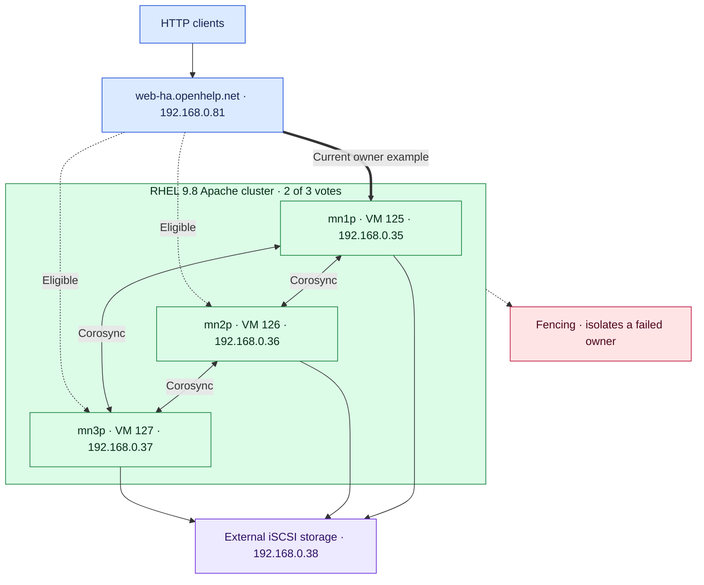
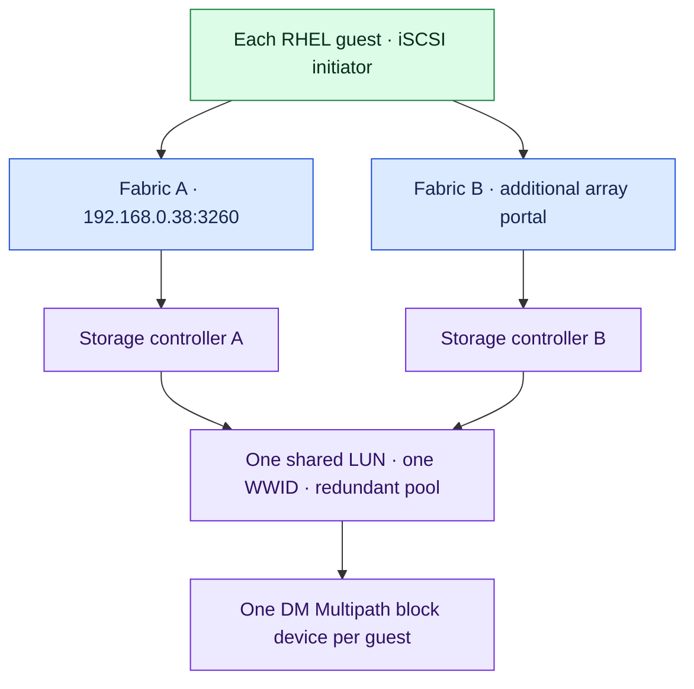
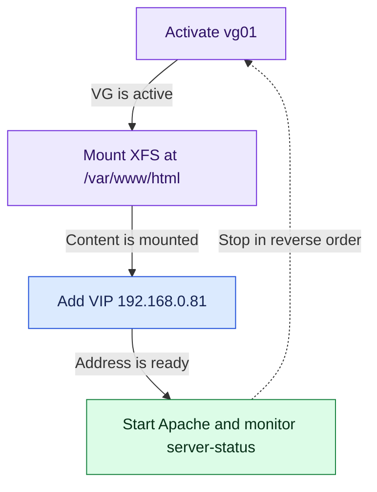
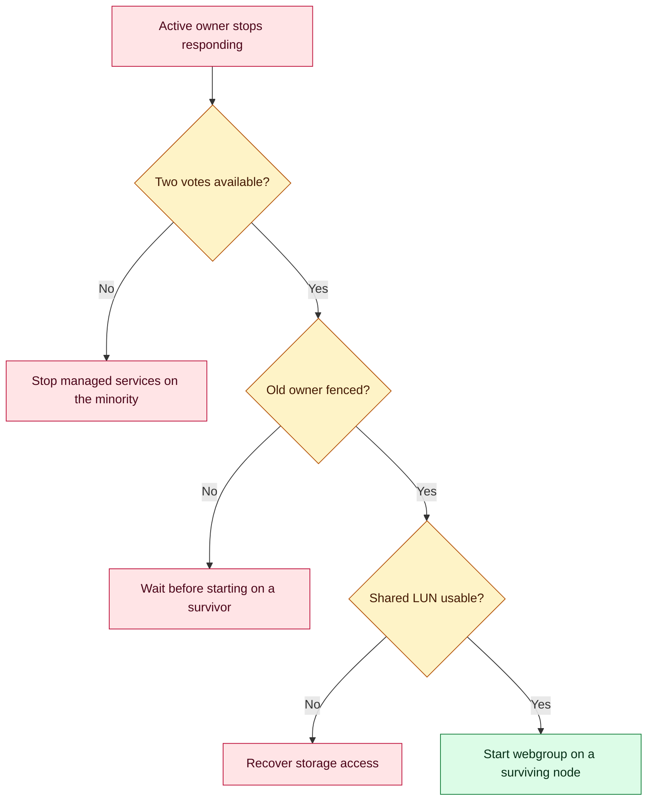

# Three-node Apache and iSCSI storage HA on RHEL 9.8 and Proxmox VE

This runbook builds an active/passive Apache service on three full RHEL 9.8 Pacemaker members. Clients use `http://web-ha.openhelp.net/` at `192.168.0.81`. Pacemaker moves Apache, the VIP, and the mount of a shared XFS filesystem together. In production, the storage system independently keeps the same iSCSI LUN available when a controller or a storage path fails.

Run the commands by hand in the named location. Use a root shell on RHEL and the Proxmox host console for `qm` commands. Use an editor for configuration files and replace capitalized sample values with the actual values identified in the step. Use fresh VMs and a newly allocated LUN for initialization. For an existing cluster or data-bearing LUN, take verified backups and plan the migration before applying changes.

## 1. Address plan and architecture

| System | Address | Purpose |
| --- | --- | --- |
| `mn1p.openhelp.net`, VM 125 | `192.168.0.35/24` | Cluster node, one vote |
| `mn2p.openhelp.net`, VM 126 | `192.168.0.36/24` | Cluster node, one vote |
| `mn3p.openhelp.net`, VM 127 | `192.168.0.37/24` | Cluster node, one vote |
| `storage.openhelp.net` | `192.168.0.38/24` | Separate iSCSI service, TCP 3260. Primary data portal for the production storage system |
| `web-ha.openhelp.net` | `192.168.0.81/24` | Apache VIP, TCP 80 |
| Home router | `192.168.0.1` | Example default gateway |

The supplied addresses all belong to `192.168.0.0/24`. Reserve `.35`, `.36`, `.37`, `.38`, and `.81` outside the DHCP pool. Add DNS A records for the three guests, the storage portal, and the VIP. Keep `.81` free on every guest until Pacemaker assigns it. A client on the same subnet reaches the VIP directly. Routed clients rely on their gateway and network being available.

**Production storage at `.38`.** Use an external dual-controller iSCSI array or a vendor-supported HA iSCSI system that presents one shared LUN. Keep `.38` as a data portal. Obtain the additional data portal addresses and storage NIC configuration from the array design so DM Multipath can use independent paths. The array controls LUN ownership and controller failover. The three Apache guests remain iSCSI initiators.

**Lab storage at `.38`.** A separate RHEL LIO server can export both the website LUN and a small fencing LUN. It supports testing Apache moves among the three VMs while `.38` is up. An outage of that server, its backing disks, or its only network path interrupts access to both LUNs. Use the lab storage and fencing procedures in sections 4 and 6 if this is your current hardware.



| Diagram block | Role during normal operation and failure |
| --- | --- |
| Clients and VIP | Clients use the same address and DNS name when the service moves. The new owner advertises the VIP on the LAN. |
| Three RHEL nodes | Corosync exchanges cluster messages. Each node has one vote. With two connected votes, Pacemaker can manage the group after any required fencing. |
| External iSCSI storage | All three nodes discover the same LUN. Only the group owner activates its HA-LVM volume group and mounts XFS. |
| Fencing | The surviving cluster isolates an unresponsive owner before recovering its resources. A node can become unresponsive while it still has access to the LUN. |

| Available cluster members in one partition | Quorum | Apache behavior |
| --- | --- | --- |
| 3 of 3 | Yes | One active owner, two eligible peers |
| 2 of 3 | Yes | Service can run if fencing and storage are available |
| 1 of 3 | No | Pacemaker stops the managed group under `no-quorum-policy=stop` |

This three-vote configuration uses ordinary majority quorum. `storage.openhelp.net` and the router contribute zero votes. The Proxmox host cluster, if used, has its own quorum and fencing rules. Red Hat's RHEL 9 High Availability guide documents the Apache pattern and the fencing requirements. Red Hat publishes a separate support policy for Proxmox guests. Its detailed conditions require a subscription. Confirm that policy for your Proxmox version and exact fencing method before a production deployment. [RHEL HA concepts][rh-ha] · [Red Hat Proxmox guest support policy][rh-proxmox] · [Red Hat fencing requirements][rh-stonith-policy]

## 2. Create the guests and configure RHEL

### 2.1 Build virtual machines 125, 126, and 127

In Proxmox, upload the RHEL 9.8 x86_64 ISO. Run `pveversion` on each host and verify that the platform release is maintained. In **Create VM**, create VM 125 `mn1p`, VM 126 `mn2p`, and VM 127 `mn3p`. Give each its own OS disk, MAC address, and RHEL installation. For practice, start with 2 vCPUs, 4 GiB RAM, and a 32 GiB OS disk per VM. Size production guests for the application workload.

Use a **VirtIO** NIC on the bridge for `192.168.0.0/24`, commonly `vmbr0`. The service interfaces on all three hosts must share a Layer 2 network so the VIP can move. Allow the fixed IP plus `192.168.0.81` in each VM's Proxmox IP filter, if enabled, and allow gratuitous ARP from the guests. The examples call the RHEL NIC `ens18`. Verify the name on each guest. The iSCSI LUNs are accessed by the RHEL guests over the network and do not require additional Proxmox VM disks.

For physical-host HA, distribute the three guests across **three independent Proxmox hosts**, with one voting guest per host. Keep their power and network failure domains as independent as possible. Use redundant service uplinks and independent Corosync paths in production. Keep the addresses in section 1 on the primary link. Add a second KNET link using the site-assigned per-node addresses, VLAN, interfaces, and switch path. The shared LAN is sufficient for the single-link runbook example. One Proxmox host can run all three VMs for practice, and loss of that host takes all three votes offline. [Proxmox network configuration][pve-network] · [RHEL cluster links][rh-links]

### 2.2 Assign the addresses and hostnames

Set the static addresses from section 1 during installation or through `nmtui` from the VM console. Use the appropriate site DNS servers and the example gateway `192.168.0.1` if it is your actual gateway. Set only the node's fixed address on its OS network profile.

**On VM 125.**

```bash
hostnamectl set-hostname mn1p.openhelp.net
```

**On VM 126.**

```bash
hostnamectl set-hostname mn2p.openhelp.net
```

**On VM 127.**

```bash
hostnamectl set-hostname mn3p.openhelp.net
```

**On all three guests.** Use DNS or add the following lines to `/etc/hosts`. Keep the existing localhost entries. For a client without DNS, add the VIP line to its hosts file as well.

```text
192.168.0.35 mn1p.openhelp.net mn1p
192.168.0.36 mn2p.openhelp.net mn2p
192.168.0.37 mn3p.openhelp.net mn3p
192.168.0.38 storage.openhelp.net storage
192.168.0.81 web-ha.openhelp.net web-ha
```

```bash
hostname -f
ip -br -4 address
ip -4 route
nmcli device status
getent ahostsv4 mn1p.openhelp.net mn2p.openhelp.net mn3p.openhelp.net storage.openhelp.net web-ha.openhelp.net
ping -c 3 192.168.0.35
ping -c 3 192.168.0.36
ping -c 3 192.168.0.37
ip route get 192.168.0.38
getenforce
cat /etc/redhat-release
```

Check the node's unique hostname and MAC and confirm `Enforcing` and the RHEL 9.8 release. Ensure the three guests and the storage platform use reliable time sources. Consistent time makes fencing and storage incident logs easier to correlate. [RHEL 9.8 release notes][rh-release] · [RHEL SELinux guide][rh-selinux]

### 2.3 Install the HA and storage packages

**On all three guests.** Register if necessary. The example uses x86_64 CDN repositories. On Satellite, use your approved activation key and content view. Check that the High Availability Add-On is available on all three and that they track the same RHEL and HA package level. Apply current applicable errata from your approved content source. If your change plan pins 9.8, check `subscription-manager release --list` and the available errata before using `subscription-manager release --set=9.8`.

```bash
subscription-manager register
subscription-manager identity
subscription-manager repos --enable=rhel-9-for-x86_64-baseos-rpms --enable=rhel-9-for-x86_64-appstream-rpms --enable=rhel-9-for-x86_64-highavailability-rpms
dnf repolist --enabled
dnf upgrade --refresh
dnf install pcs pacemaker corosync resource-agents lvm2 xfsprogs iscsi-initiator-utils lsscsi httpd httpd-tools wget curl firewalld chrony iputils
```

Reboot before cluster creation if needed for the updates. Use `passwd hacluster` on each guest to set a strong shared initial credential for `pcs host auth`. Keep `pcsd` up for management. Pacemaker will manage Apache after the resource is created.

```bash
cat /etc/redhat-release
rpm -q pcs pacemaker corosync resource-agents lvm2 iscsi-initiator-utils httpd
systemctl enable --now chronyd firewalld pcsd
chronyc tracking
chronyc sources -v
passwd hacluster
```

### 2.4 Allow cluster and HTTP traffic

**On all three guests.** Check the active firewalld zone. This example uses `public` for the primary LAN. Substitute the actual zone if different. Use Red Hat's `high-availability` service definition with peer-specific source rules. Permit the web service to the VIP from the listed LAN. For routed clients, add a rule for their approved source subnet. Keep existing administrator access scoped to the appropriate network.

```bash
firewall-cmd --get-active-zones
firewall-cmd --info-service=high-availability
firewall-cmd --permanent --zone=public --add-rich-rule='rule family="ipv4" source address="192.168.0.35/32" service name="high-availability" accept'
firewall-cmd --permanent --zone=public --add-rich-rule='rule family="ipv4" source address="192.168.0.36/32" service name="high-availability" accept'
firewall-cmd --permanent --zone=public --add-rich-rule='rule family="ipv4" source address="192.168.0.37/32" service name="high-availability" accept'
firewall-cmd --permanent --zone=public --add-rich-rule='rule family="ipv4" source address="192.168.0.0/24" destination address="192.168.0.81/32" service name="http" accept'
firewall-cmd --reload
firewall-cmd --zone=public --list-all
```

TCP 2224 is used by `pcsd`. Corosync requires peer-to-peer UDP on its KNET links. Red Hat lists UDP 5404–5412 for Corosync traffic. Extend peer rules to the second cluster network if deployed. The guests initiate TCP 3260 sessions outbound to storage. Scope the corresponding inbound rules at the target and any intervening firewall. [Red Hat cluster setup and ports][rh-setup]

## 3. Provision production HA iSCSI storage

Skip to section 4 if you are building the single-server lab. For production, perform the following steps through your storage system's supported management interface. The array model determines the menu labels, portal layout, ALUA settings, and supported NIC design.



| Diagram block | What to configure or verify |
| --- | --- |
| iSCSI initiator | One unique IQN per RHEL VM. Each initiator logs in to the data portals that the vendor design assigns to it. |
| Fabrics A and B | Different guest uplinks and switch paths carry iSCSI traffic. The vendor may provide several portals per fabric. Two sessions through one NIC or switch share that NIC or switch failure. |
| Controllers and storage pool | Both controllers can serve or take over the same LUN on redundant backing storage. The array defines preferred paths and controller takeover behavior. |
| WWID and multipath map | The WWID identifies the logical disk. RHEL folds the paths with that WWID into one local block device and reroutes I/O when a path fails. |

1. **Identify the three initiators.** On each guest run the following command. Record the value after `InitiatorName=`. Compare all three before presenting storage. Regenerate any duplicated IQN from a cloned image and restart the initiator before creating any sessions.

   ```bash
   cat /etc/iscsi/initiatorname.iscsi
   ```

2. **Prepare both storage controllers and backing storage.** Verify controller health, redundant power, cache protection, and the vendor-approved RAID or redundant pool. Use an array design that can survive loss of one controller with current writes preserved. If a replicated appliance pair supplies the service, require vendor-managed ownership arbitration, consistent LUN identity and writes across failover, and a tested recovery procedure. A dual-controller array can still have a shared chassis, disk shelf, or site. Cover that larger failure domain with a supported replicated system if it is part of the availability requirement.
3. **Configure portal and network paths.** Set `192.168.0.38:3260` as the primary service portal. Add the array's second data path on an independent fabric with its approved addresses and guest uplinks. Record each portal, target IQN, guest NIC, source IP, and expected controller. Use the storage vendor's network and ALUA guidance. Verify that traffic actually uses separate physical paths. Limit TCP 3260 to the initiator addresses on both fabrics. Configure the site's required iSCSI authentication and storage network isolation.
4. **Create the data LUN.** Create one new website LUN on the redundant storage pool. Start with at least 3 GiB for the 2 GiB example LV, and size it for your production content and growth. Map that same read/write LUN to one host group containing all three IQNs. Record its LUN number and WWID. Keep it mapped only to these cluster nodes. The production out-of-band fence in section 6 uses no SBD LUN.
5. **Connect and verify the three guests.** Follow section 5 for every configured portal. Each guest must report the same WWID and a single `/dev/mapper/` map for the website LUN. Check that the expected paths are usable according to the array's path states. Test independent path and controller loss in section 9 before serving production traffic.

Use an array profile approved for RHEL 9 and the actual controller and firmware combination. Use the array's RHEL guidance for the path checker, ALUA or other hardware handler, path selection, and recovery timers. Measure I/O behavior during failover, including a total loss of paths. Configure a vendor-approved failure behavior with a finite recovery window so queued I/O cannot block Apache shutdown or resource recovery indefinitely. [RHEL DM Multipath configuration][rh-mpath] · [RHEL multipath device naming][rh-mpath-names] · [Red Hat iSCSI path recovery guidance][rh-mpath-timeouts]

## 4. Optional lab target at 192.168.0.38

Use this section for one separate RHEL LIO server. It gives you working shared storage for the guest failover exercise. It has no controller or target failover. In production use the HA storage in section 3 and skip to section 5.

**On all three guests.** Get and compare their IQNs.

```bash
cat /etc/iscsi/initiatorname.iscsi
```

**On `storage.openhelp.net` only.** Set `192.168.0.38/24` on the LAN NIC, confirm the address, and install the LIO target tools. Use a persistent local filesystem with at least 4 GiB available for this lab. The file-backed LUNs are two different raw virtual disks from the initiators' perspective.

```bash
ip -br -4 address
dnf install targetcli firewalld
systemctl enable --now firewalld target.service
install -d -m 0700 /var/lib/iscsi-apache-ha
df -h /var/lib/iscsi-apache-ha
targetcli ls
```

Stop if you see the same target name or backstores already in use. Create the 3 GiB web LUN and the 64 MiB raw SBD LUN. Turn off LIO file backstore write-back caching for the lab.

```bash
targetcli /backstores/fileio create apacheha_web /var/lib/iscsi-apache-ha/web.img 3G write_back=false
targetcli /backstores/fileio create apacheha_sbd /var/lib/iscsi-apache-ha/sbd.img 64M write_back=false
targetcli /iscsi create iqn.2026-11.net.openhelp:apache-ha
targetcli /iscsi/iqn.2026-11.net.openhelp:apache-ha/tpg1/portals ls
```

If the new target lists the default `0.0.0.0:3260` portal, remove that wildcard listener before creating the specific portal. Run the deletion only when you saw the wildcard entry.

```bash
targetcli /iscsi/iqn.2026-11.net.openhelp:apache-ha/tpg1/portals delete 0.0.0.0 3260
```

```bash
targetcli /iscsi/iqn.2026-11.net.openhelp:apache-ha/tpg1/portals create 192.168.0.38 3260
targetcli /iscsi/iqn.2026-11.net.openhelp:apache-ha/tpg1 set attribute generate_node_acls=0 authentication=1
targetcli /iscsi/iqn.2026-11.net.openhelp:apache-ha/tpg1/luns create /backstores/fileio/apacheha_web 0
targetcli /iscsi/iqn.2026-11.net.openhelp:apache-ha/tpg1/luns create /backstores/fileio/apacheha_sbd 1
```

In the interactive `targetcli` console, add the ACLs using the actual three IQNs. Use a distinct CHAP secret for each node. Each placeholder ending in `_INITIATOR_IQN` is a complete IQN. Each placeholder ending in `_CHAP_SECRET` is supplied through your secure credential process. Protect target configuration and local CLI history because CHAP settings can contain credentials. Enter the lines in the next block inside `targetcli`.

```text
cd /iscsi/iqn.2026-11.net.openhelp:apache-ha/tpg1/acls
create MN1P_INITIATOR_IQN
create MN2P_INITIATOR_IQN
create MN3P_INITIATOR_IQN
cd MN1P_INITIATOR_IQN
set auth userid=mn1p password=MN1P_CHAP_SECRET
cd ../MN2P_INITIATOR_IQN
set auth userid=mn2p password=MN2P_CHAP_SECRET
cd ../MN3P_INITIATOR_IQN
set auth userid=mn3p password=MN3P_CHAP_SECRET
cd ..
ls
cd /
saveconfig
exit
```

Each ACL must list LUN 0 and LUN 1 with read/write access. If the target's automatic ACL mapping is disabled, enter its ACL in `targetcli` and run `create 0 0` and `create 1 1` for the missing mappings, then save the configuration again. All three ACLs must refer to the same two backing objects.

Restrict access to TCP 3260. This example assumes the storage NIC is in the `public` zone. Confirm that there is no broader pre-existing `iscsi-target` service or TCP 3260 allowance for this interface. CHAP authenticates the initiator. Protect the network separately if the transport must be confidential.

```bash
firewall-cmd --get-active-zones
firewall-cmd --permanent --zone=public --add-rich-rule='rule family="ipv4" source address="192.168.0.35/32" port port="3260" protocol="tcp" accept'
firewall-cmd --permanent --zone=public --add-rich-rule='rule family="ipv4" source address="192.168.0.36/32" port port="3260" protocol="tcp" accept'
firewall-cmd --permanent --zone=public --add-rich-rule='rule family="ipv4" source address="192.168.0.37/32" port port="3260" protocol="tcp" accept'
firewall-cmd --reload
firewall-cmd --zone=public --list-all
ss -lnt '( sport = :3260 )'
```

Ensure the exact portal IP is present before the saved target is restored at boot. Run `systemctl edit target.service` and enter the following in the editable area.

```ini
[Unit]
Wants=network-online.target
After=network-online.target
```

```bash
systemctl enable NetworkManager-wait-online.service target.service
systemctl cat target.service
targetcli ls
```

Reboot the lab storage server before the cluster is in use and verify that `192.168.0.38:3260` and both LUN exports return. LUN 0 is for HA-LVM and XFS. LUN 1 is solely for SBD metadata, with no PV, VG, or filesystem on the RHEL guests. [RHEL iSCSI targets and CHAP][rh-iscsi-target] · [Red Hat SBD policy][rh-sbd]

## 5. Connect storage on all three RHEL guests

### 5.1 Set up initiator authentication

**On all three guests.** For CHAP, protect `/etc/iscsi/iscsid.conf` and edit its existing session authentication keys before discovery. Set the user and secret assigned to that guest. For the lab they are `mn1p`, `mn2p`, and `mn3p` on the respective guests. For production use the array's authentication profile. If your array also authenticates SendTargets discovery, follow its guidance for the separate `discovery.sendtargets.auth.*` settings.

```bash
chmod 0600 /etc/iscsi/iscsid.conf
vi /etc/iscsi/iscsid.conf
```

```ini
node.session.auth.authmethod = CHAP
node.session.auth.username = THIS_NODE_CHAP_USERNAME
node.session.auth.password = THIS_NODE_CHAP_SECRET
```

Node records that already exist can retain their prior authentication settings. For a reused initiator, check the stored record and update credentials using `iscsiadm` and your secure procedure. Do this before the cluster uses the LUN. Node sessions and stored credentials are local to each guest.

```bash
systemctl restart iscsid.service
systemctl enable iscsi.service NetworkManager-wait-online.service
ip route get 192.168.0.38
```

### 5.2 Log in to the selected storage system

**Production.** On all three guests, install DM Multipath. In a new setup, initialize it with WWID-based names. For an existing multipath configuration, preserve the settings and mappings for any other disks. Apply the array-specific RHEL settings in `/etc/multipath.conf` before relying on path failover.

```bash
dnf install device-mapper-multipath
mpathconf --enable --user_friendly_names n
vi /etc/multipath.conf
multipath -t
systemctl enable --now multipathd.service
multipathd reconfigure
multipath -a WEB_LUN_WWID
```

Use the WWID reported by the array for `WEB_LUN_WWID` and confirm it against the map after login. Recording the WWID also allows a known map to form with only one path available during boot. Apply any required array-specific iSCSI iface profiles before setting up sessions. A routed deployment uses the correct independent NIC to reach each fabric. For a vendor profile that binds a session to a NIC, add `-I` with the assigned iSCSI iface name to discovery, login, and the matching saved node record update.

Run the following for the primary portal and the additional fabric. Replace `ARRAY_PORTAL_B` and the two target IQNs with the actual values. Use the same target IQN for both if the array presents that IQN on both paths. Repeat the portal-specific operations for each additional path in the approved topology.

```bash
ip route get ARRAY_PORTAL_B
iscsiadm -m discovery -t sendtargets -p 192.168.0.38:3260
iscsiadm -m discovery -t sendtargets -p ARRAY_PORTAL_B:3260
iscsiadm -m node -T ARRAY_TARGET_IQN_A -p 192.168.0.38:3260 --login
iscsiadm -m node -T ARRAY_TARGET_IQN_B -p ARRAY_PORTAL_B:3260 --login
iscsiadm -m node -T ARRAY_TARGET_IQN_A -p 192.168.0.38:3260 -o update -n node.startup -v automatic
iscsiadm -m node -T ARRAY_TARGET_IQN_B -p ARRAY_PORTAL_B:3260 -o update -n node.startup -v automatic
udevadm settle
iscsiadm -m session -P 3
multipath -ll
```

Check each guest's sessions and paths. One LUN must appear as one multipath device with the same WWID on all three nodes. Mark `/dev/mapper/WEB_LUN_WWID` as your web device path using that actual identifier. Use the map for LVM. Individual `/dev/sdX` path devices are only for diagnostic inspection. [RHEL iSCSI initiators][rh-iscsi-init] · [RHEL multipath configuration][rh-mpath]

**Single-target lab.** Use the following on all three guests for the LIO target from section 4.

```bash
iscsiadm -m discovery -t sendtargets -p 192.168.0.38:3260
iscsiadm -m node -T iqn.2026-11.net.openhelp:apache-ha -p 192.168.0.38:3260 --login
iscsiadm -m node -T iqn.2026-11.net.openhelp:apache-ha -p 192.168.0.38:3260 -o update -n node.startup -v automatic
udevadm settle
iscsiadm -m session -P 3
lsscsi -i
ls -l /dev/disk/by-path/*iscsi*
ls -l /dev/disk/by-id/scsi-*
```

Match `lun-0` and `lun-1` in `/dev/disk/by-path/` to their persistent `scsi-` symlinks. LUN 0 has the website role. LUN 1 is the raw SBD device. For each role the WWID is identical on all three guests. The WWIDs of the two LUNs differ from each other. Record both persistent paths.

| Name in the command examples | Replace with |
| --- | --- |
| `VERIFIED_WEB_DEVICE_PATH` | Production `/dev/mapper/` path with the web LUN's WWID, or the lab `/dev/disk/by-id/scsi-` path for LUN 0 |
| `VERIFIED_SBD_DEVICE_PATH` | Lab `/dev/disk/by-id/scsi-` path for LUN 1 only |
| `VERIFIED_WEB_DEVICE_UNIT` | Exact `.device` unit name printed for the web path in section 5.3 |
| `VERIFIED_SBD_DEVICE_UNIT` | Exact `.device` unit name printed for the SBD path in section 6.3 |

**On all three guests.** Compare storage-side allocation, size, WWID, and device topology before making disk changes. A blank signature check alone cannot identify a disk. Run the two web checks on every guest and run them with the SBD path as well for the lab.

```bash
readlink -e VERIFIED_WEB_DEVICE_PATH
lsblk -o NAME,TYPE,SIZE,MODEL,WWN,FSTYPE,MOUNTPOINTS VERIFIED_WEB_DEVICE_PATH
wipefs --no-act VERIFIED_WEB_DEVICE_PATH
```

### 5.3 Order iSCSI and the data device before Pacemaker

**On all three guests.** Use the Red Hat `resource-agents-deps.target` facility to order external storage dependencies. Determine the web device's systemd unit name using the actual persistent path. Copy the output exactly, including any escaped characters.

```bash
systemd-escape --path --suffix=device VERIFIED_WEB_DEVICE_PATH
systemctl status VERIFIED_WEB_DEVICE_UNIT --no-pager
install -d /etc/systemd/system/resource-agents-deps.target.d
vi /etc/systemd/system/resource-agents-deps.target.d/10-web-iscsi.conf
```

For production, enter the following in `10-web-iscsi.conf`. systemd attempts the configured iSCSI sessions and waits for the web map. The map must exist for the target to start. An iSCSI login result for one optional path should not become the only start test for the LUN.

```ini
[Unit]
Wants=iscsi.service
Requires=multipathd.service VERIFIED_WEB_DEVICE_UNIT
After=iscsi.service multipathd.service VERIFIED_WEB_DEVICE_UNIT
```

For the single-target lab, use the following in the same file.

```ini
[Unit]
Requires=iscsi.service VERIFIED_WEB_DEVICE_UNIT
After=iscsi.service VERIFIED_WEB_DEVICE_UNIT
```

Make the dependency mandatory for this dedicated web cluster. Run `systemctl edit pacemaker.service` and enter the following in the editable area. This makes a missing shared device at boot hold back the local Pacemaker service even if the vendor unit only wants the dependency target.

```ini
[Unit]
Requires=resource-agents-deps.target
After=resource-agents-deps.target
```

```bash
systemctl daemon-reload
systemctl cat iscsi.service resource-agents-deps.target pacemaker.service
```

Reboot one guest at a time before building the cluster. Verify that the iSCSI sessions and the exact device unit return automatically. For production, also test a guest boot with one fabric unavailable before go-live. A missing device requires investigation of network, login, and multipath state before attempting a local cluster start. Pacemaker manages the file system mount later. Keep the web LV out of `/etc/fstab`. [Red Hat resource start dependencies][rh-deps] · [RHEL multipath device naming][rh-mpath-names]

## 6. Create the three-node cluster and prove fencing

### 6.1 Form the cluster

**On `mn1p` only.** Confirm `pcsd` is running and the names and cluster endpoints are reachable. Authenticate all three guests with the `hacluster` password. Run `pcs cluster setup` once on a fresh cluster. If PCS reports an existing cluster, investigate its state before changing it.

```bash
pcs host auth mn1p.openhelp.net mn2p.openhelp.net mn3p.openhelp.net -u hacluster
pcs cluster setup apache_ha --start \
  mn1p.openhelp.net addr=192.168.0.35 \
  mn2p.openhelp.net addr=192.168.0.36 \
  mn3p.openhelp.net addr=192.168.0.37
pcs status --full
pcs quorum status
corosync-cfgtool -s
pcs property set stonith-enabled=true no-quorum-policy=stop
```

Expect all three nodes online, three expected votes, quorum of two, and `Quorate` in the flags. A message about missing fencing devices is expected at initial setup. Complete the appropriate fencing procedure before adding application resources.

If using the production second Corosync link, assign the three site-approved IPs to the dedicated interfaces first. Allow Corosync traffic between those IPs and verify reachability. Then run the following from an online member using the actual addresses and check that the peers have a healthy second link.

```bash
pcs cluster link add mn1p.openhelp.net=MN1P_SECOND_LINK_IP mn2p.openhelp.net=MN2P_SECOND_LINK_IP mn3p.openhelp.net=MN3P_SECOND_LINK_IP options linknumber=1
corosync-cfgtool -s
```

The `pcs` cluster membership names are the FQDNs. Use those exact values in fence mappings and node operations. [RHEL cluster creation][rh-setup] · [RHEL cluster links][rh-links]

### 6.2 Production fencing independent of the iSCSI system

Use Red Hat's approved fencing method for your exact Proxmox guest environment. Prefer a method that can hard-stop the previous writer during a guest loss and can still prove isolation when its hypervisor or the iSCSI service is unreachable. Keep its control path independent of the iSCSI fabrics. Validate all three fence mappings and their behavior on loss of a host. Obtain the detailed Proxmox support requirements from Red Hat's subscription portal. [Red Hat Proxmox guest support policy][rh-proxmox] · [Red Hat fencing requirements][rh-stonith-policy]

The following is an **IPMI power-fence example** for three dedicated, fixed Proxmox hosts, one cluster VM per host. Use it only if your approved design maps each VM to its own host BMC and the host can be hard-fenced for that VM. Allow IPMI LANPlus on UDP 623 from the cluster nodes to the BMCs on the management network. Verify that every survivor can reach each BMC even when the host OS is down. Confirm that fencing the host will leave the other two guests and storage up. Keep VM placement fixed and disable live migration or automatic relocation for these guests with static host mappings. A BMC fences the whole physical server.

**On all three guests.**

```bash
dnf install fence-agents-ipmilan
pcs stonith describe fence_ipmilan
```

**On one online guest.** Supply the actual BMC address and restricted power-control account for each host. Use your approved credential entry method and restrict access to CIB backups and exports, which can contain fence credentials. The CIB attributes below are examples for an IPMI LANPlus implementation. Confirm the exact agent options and timeout for your BMC firmware. If production uses another approved fence agent, configure one matching target per guest or use that agent's supported host map for VM IDs 125, 126, and 127.

```bash
pcs stonith create power_mn1p fence_ipmilan \
  ip=BMC_FOR_VM125 username=FENCE_ACCOUNT_125 password=FENCE_SECRET_125 \
  lanplus=1 method=onoff pcmk_host_list=mn1p.openhelp.net op monitor interval=60s
pcs stonith create power_mn2p fence_ipmilan \
  ip=BMC_FOR_VM126 username=FENCE_ACCOUNT_126 password=FENCE_SECRET_126 \
  lanplus=1 method=onoff pcmk_host_list=mn2p.openhelp.net op monitor interval=60s
pcs stonith create power_mn3p fence_ipmilan \
  ip=BMC_FOR_VM127 username=FENCE_ACCOUNT_127 password=FENCE_SECRET_127 \
  lanplus=1 method=onoff pcmk_host_list=mn3p.openhelp.net op monitor interval=60s
pcs stonith status
```

Each fence device should start and monitor successfully. Where an approved virtual-fence agent also needs an out-of-band fallback, use the supported fence topology for your platform and test both levels. Proceed to section 6.4. [RHEL fencing configuration and topologies][rh-fencing] · [Red Hat fence testing][rh-fence-test]

### 6.3 Lab SBD fencing with the Proxmox virtual watchdog

Use this section for the optional single-target lab. SBD uses LUN 1 as a mailbox. `fence_sbd` writes a fence request for the target guest. The watchdog protects against a guest that stops refreshing its timer. The shared LUN must be available for the fence agent to deliver a request. A target outage can block fencing and Apache recovery. For the production example, use section 6.2.

**On all three guests.**

```bash
dnf install sbd fence-agents-sbd
```

**On `mn1p`.** Stop the new, resource-free guest cluster before changing the virtual hardware. Then shut down each guest cleanly through its console.

```bash
pcs cluster stop --all
```

**On the Proxmox host that owns each powered-off VM.** Apply only the commands for the VM on that host. Start each guest after verifying its watchdog config.

```bash
qm set 125 --watchdog model=i6300esb,action=reset
qm config 125
qm set 126 --watchdog model=i6300esb,action=reset
qm config 126
qm set 127 --watchdog model=i6300esb,action=reset
qm config 127
```

**On all three guests.** Add the single line `i6300esb` in `/etc/modules-load.d/ha-watchdog.conf` using an editor. Load the module and verify the watchdog identity and availability. The test below assumes that the Intel 6300ESB device is `/dev/watchdog0` on all three. If a path differs, use the actual device and the `watchdog=DEVICE@NODE_FQDN` form when enabling SBD. Ensure the watchdog is exclusive to SBD. Stop a competing standalone watchdog service if present. If systemd reports a nonzero runtime watchdog, set `RuntimeWatchdogSec=0` in the `[Manager]` section of a drop-in under `/etc/systemd/system.conf.d/` and reboot before the watchdog test.

```bash
modprobe i6300esb
ls -l /dev/watchdog*
cat /sys/class/watchdog/watchdog*/identity
systemctl show --property=RuntimeWatchdogUSec
```

Before enabling SBD, run the following test from each VM console, **one guest at a time**. The command intentionally causes a hard reset. Read the confirmation prompt, then confirm the VM actually rebooted and `uptime -s` changed. Fix any failed watchdog test before continuing.

```bash
pcs stonith sbd watchdog test /dev/watchdog0
```

**On all three guests.** Make SBD wait for the raw SBD device on boot. Resolve the unit name using the actual SBD path, then run `systemctl edit sbd.service` and enter the following.

```bash
systemd-escape --path --suffix=device VERIFIED_SBD_DEVICE_PATH
systemctl status VERIFIED_SBD_DEVICE_UNIT --no-pager
```

```ini
[Unit]
Requires=iscsi.service VERIFIED_SBD_DEVICE_UNIT
After=iscsi.service VERIFIED_SBD_DEVICE_UNIT
```

**On `mn1p` only.** Check the SBD device against the verified 64 MiB lab LUN. `device setup` creates new SBD metadata on that disk and must run only once. Use the actual raw SBD path. Keep the web LUN out of these commands.

```bash
lsblk -o NAME,SIZE,WWN,FSTYPE,MOUNTPOINTS VERIFIED_SBD_DEVICE_PATH
wipefs --no-act VERIFIED_SBD_DEVICE_PATH
pcs stonith sbd device setup device=VERIFIED_SBD_DEVICE_PATH watchdog-timeout=15 msgwait-timeout=30
sbd -d VERIFIED_SBD_DEVICE_PATH dump
pcs stonith sbd enable device=VERIFIED_SBD_DEVICE_PATH watchdog=/dev/watchdog0 SBD_WATCHDOG_TIMEOUT=15 SBD_STARTMODE=always SBD_DELAY_START=yes
```

**On all three guests.** In `/etc/sysconfig/sbd`, check the device path, watchdog path, `SBD_WATCHDOG_TIMEOUT=15`, and Pacemaker integration with `SBD_PACEMAKER=yes`. Start the cluster locally on each guest. Verify the SBD service and the common device UUID. Check that the three FQDNs have slots on the shared SBD LUN once all guests have started.

```bash
systemctl cat sbd.service
pcs cluster start
systemctl is-active sbd corosync pacemaker
journalctl -b -u sbd --no-pager -n 30
sbd -d VERIFIED_SBD_DEVICE_PATH dump
sbd -d VERIFIED_SBD_DEVICE_PATH list
```

**On one online guest.** Register the fence device. Set an explicit mapping for all three guests. The lab uses disk-backed fencing with implicit watchdog-only fencing disabled. The example gives the agent longer than the disk message wait, and the cluster longer than the agent. Validate these lab timers against the behavior of your deployment.

```bash
pcs stonith describe fence_sbd
pcs property set stonith-timeout=120s stonith-watchdog-timeout=0
pcs stonith create sbd_fencing fence_sbd \
  devices=VERIFIED_SBD_DEVICE_PATH power_timeout=60 \
  pcmk_host_list="mn1p.openhelp.net mn2p.openhelp.net mn3p.openhelp.net"
pcs stonith status
pcs stonith sbd status --full
```

| Lab fence setting | Meaning |
| --- | --- |
| Watchdog timeout 15 seconds | Limit for the guest to continue refreshing its watchdog. |
| SBD `msgwait` 30 seconds | Time for the fencing message and watchdog protection to take effect. |
| `SBD_DELAY_START=yes` | Delays rapid rejoin after reset. |
| `power_timeout=60` and `stonith-timeout=120s` | Allow time for the fence operation at the agent and cluster levels. |

[Red Hat SBD policy][rh-sbd] · [PCS command reference][pcs-reference] · [Proxmox VM watchdog options][pve-qm]

### 6.4 Fence all three targets before deploying Apache

Run one test at a time with all three nodes healthy, from an online node other than the target. Each command reboots the selected guest or its dedicated host, depending on the chosen fence method. Confirm isolation at the Proxmox or BMC console and check changed boot time on the target. Wait for the previous target to start, log in to iSCSI, and rejoin before fencing the next. If cluster services are still disabled at boot, run `pcs cluster start` locally on the recovered target.

```bash
pcs stonith fence mn1p.openhelp.net
pcs stonith history
pcs status --full
```

```bash
pcs stonith fence mn2p.openhelp.net
pcs stonith history
pcs status --full
```

```bash
pcs stonith fence mn3p.openhelp.net
pcs stonith history
pcs status --full
```

Pass when each test isolates exactly the intended target, the other two votes remain quorate, and every rebooted guest returns with the correct storage. Resolve failed fencing before proceeding. Then enable the RHEL cluster services at boot. Configure **Start at boot** for the intended Proxmox guest placement, or verify your approved platform startup policy.

```bash
pcs quorum status
pcs stonith status
pcs cluster enable --all
```

[Red Hat fence testing][rh-fence-test] · [RHEL cluster creation and startup][rh-setup]

## 7. Prepare HA-LVM, XFS, and Apache

### 7.1 Set the LVM system ID on all three guests

Edit `/etc/lvm/lvm.conf`. In the existing `global` block, set `system_id_source`. In the existing `devices` block, verify that the devices file is enabled, which is the RHEL 9 default. Preserve the other settings in both blocks. If a reused server disabled the devices file, account for its existing OS and local PVs before enabling it.

```text
global {
    system_id_source = "uname"
}

devices {
    use_devicesfile = 1
}
```

```bash
uname -n
lvm systemid
lvmconfig --type full global/system_id_source devices/use_devicesfile
lvmdevices
```

Each LVM system ID must match that node's unique hostname. Pacemaker's `LVM-activate` agent changes the web VG's system ID as ownership moves. The other guests see the same block device and leave the web LV inactive. [RHEL Apache HA reference][rh-apache] · [RHEL LVM guide][rh-lvm]

### 7.2 Initialize the new web LUN once

**On `mn1p` only.** Verify the actual web device, its WWID and size, and absence of existing signatures or a mount. Confirm `vg01` is unused. These operations write LVM and XFS metadata. Use only the newly allocated web LUN confirmed in section 5. On production storage use the multipath map for the PV.

```bash
lsblk -o NAME,TYPE,SIZE,WWN,FSTYPE,MOUNTPOINTS VERIFIED_WEB_DEVICE_PATH
wipefs --no-act VERIFIED_WEB_DEVICE_PATH
vgs
```

```bash
pvcreate VERIFIED_WEB_DEVICE_PATH
vgcreate --setautoactivation n vg01 VERIFIED_WEB_DEVICE_PATH
lvcreate -L 2G -n lv01 vg01
vgs -o +systemid vg01
lvs -o lv_name,vg_name,lv_size,lv_active vg01
mkfs.xfs /dev/vg01/lv01
```

With the RHEL devices file enabled, `pvcreate` records the shared PV on `mn1p`. `--setautoactivation n` leaves VG activation under Pacemaker control at boot. The 2 GiB LV is an example. Apply production sizing when creating the LUN and LV.

**On `mn2p` and `mn3p`.** Add the same verified web PV to each local LVM devices file. The VG should be visible as foreign with `mn1p` as the current system ID. Leave it inactive on both nodes.

```bash
lvmdevices --adddev VERIFIED_WEB_DEVICE_PATH
lvmdevices
vgs --foreign -o vg_name,systemid vg01
```

### 7.3 Prepare Apache on all three guests

Disable standalone `httpd.service` so that the resource agent controls Apache. Use the stock `Listen 80` and `DocumentRoot /var/www/html` for this example. Apache needs its loopback HTTP listener for the resource monitor. Keep identical configuration on every node. Deploy any site-specific HTTPS policy and matching service certificates consistently if the application requires TLS.

```bash
systemctl disable --now httpd.service
install -d -m 0755 /var/www/html
vi /etc/httpd/conf.d/ha-status.conf
```

Enter the following into `ha-status.conf`. `Require local` restricts the status page used by the Apache agent.

```apache
<Location "/server-status">
    SetHandler server-status
    Require local
</Location>
```

```bash
httpd -M
httpd -t
getenforce
```

Verify `status_module` is loaded, `Syntax OK`, and SELinux is enforcing. Configuration and logs live on each guest's OS disk. The web content lives on XFS.

**Log rotation.** Red Hat notes that Apache started by the `apache` agent needs a rotation method that works independently of `systemctl reload httpd.service`. This runbook uses Apache's built-in piped `rotatelogs`, so no reload shell script is required. On all three nodes, check `rpm -ql httpd-tools` for the binary location, create the log directory, and replace the active global `ErrorLog` and `CustomLog` directives in `/etc/httpd/conf/httpd.conf` with the following. Apply the same logging policy to any virtual host with its own log directives.

```bash
install -d -m 0750 /var/log/httpd/ha-rotated
restorecon -Rv /var/log/httpd/ha-rotated
vi /etc/httpd/conf/httpd.conf
```

```apache
ErrorLog "|/usr/sbin/rotatelogs /var/log/httpd/ha-rotated/error-%Y-%m-%d.log 86400"
CustomLog "|/usr/sbin/rotatelogs /var/log/httpd/ha-rotated/access-%Y-%m-%d.log 86400" combined
```

Run `httpd -t` again. The piped logger writes daily files. Apply your production log retention or collection policy to `/var/log/httpd/ha-rotated/` on all three guests. After start, check that an HTTP request creates an access entry on the active node. [RHEL Apache HA reference][rh-apache] · [Apache piped logs][apache-logs] · [Apache rotatelogs][apache-rotatelogs]

### 7.4 Seed the shared content from mn1p

**On `mn1p` only, before creating the web group.** Activate and mount the new LV. Confirm `findmnt` shows the expected XFS device before creating content.

```bash
lvchange -ay vg01/lv01
mount -t xfs /dev/vg01/lv01 /var/www/html
findmnt --mountpoint /var/www/html
vi /var/www/html/index.html
```

Enter this test page.

```html
<!doctype html>
<html lang="en">
<head><meta charset="utf-8"><title>Apache HA</title></head>
<body><h1>Apache HA on RHEL 9.8</h1><p>Served from the shared XFS volume.</p></body>
</html>
```

Set the SELinux context while the XFS filesystem is mounted. Expect `httpd_sys_content_t` on the document root and index page. Then unmount it and deactivate the VG so Pacemaker can take ownership cleanly.

```bash
restorecon -RFv /var/www/html
ls -Zd /var/www/html /var/www/html/index.html
sync -f /var/www/html/index.html
umount /var/www/html
vgchange -an vg01
lvs -o lv_name,vg_name,lv_active vg01
```

From now on, Pacemaker owns this VG, the XFS mount, the VIP, and Apache. Keep the shared LV out of `/etc/fstab`, and perform filesystem checks or manual mounts only on an isolated copy or during coordinated cluster maintenance. XFS here has one writer at a time.

## 8. Configure the Apache resource group



| Resource | What Pacemaker does |
| --- | --- |
| `web_lvm` | Activates `vg01` with `vg_access_mode=system_id` and one active owner. |
| `web_fs` | Mounts `/dev/vg01/lv01` as XFS at `/var/www/html` on that owner. |
| `VirtualIP` | Assigns and advertises `192.168.0.81/24` on the owner. |
| `Website` | Starts Apache and checks `http://127.0.0.1/server-status` on the owner every 10 seconds. |

`webgroup` colocates all four resources and applies the order shown. On stop, Apache stops first, the VIP is removed, XFS unmounts, and LVM deactivates last. One `LVM-activate` resource manages `vg01`. A cloned resource or a duplicate group would violate shared XFS ownership. [Red Hat Apache configuration and resource order][rh-apache]

**On one online guest only.** Verify quorum, fencing, and the VIP reservation. Replace `ens18` only in the ARP probe if that guest's LAN interface has another name. The `IPaddr2` resource chooses the NIC from the static subnet route. If more than one guest interface can match that route, resolve the routing ambiguity or specify an identical validated `nic=` value across all guests.

```bash
pcs status --full
pcs quorum status
pcs stonith status
pcs stonith history
arping -D -I ens18 -c 3 192.168.0.81
```

The duplicate-address probe should receive no replies. Prepare a working copy of the cluster configuration database (CIB). Keep both files private, especially if the CIB holds fence credentials. The staged commands define all four resources before any start. Use fresh filenames for each subsequent change.

```bash
umask 077
install -d -m 0700 /root/apache-ha-change
pcs cluster cib /root/apache-ha-change/before.xml
cp /root/apache-ha-change/before.xml /root/apache-ha-change/web.xml

pcs -f /root/apache-ha-change/web.xml resource create web_lvm ocf:heartbeat:LVM-activate \
  vgname=vg01 vg_access_mode=system_id --group webgroup
pcs -f /root/apache-ha-change/web.xml resource create web_fs ocf:heartbeat:Filesystem \
  device=/dev/vg01/lv01 directory=/var/www/html fstype=xfs --group webgroup
pcs -f /root/apache-ha-change/web.xml resource create VirtualIP ocf:heartbeat:IPaddr2 \
  ip=192.168.0.81 cidr_netmask=24 --group webgroup
pcs -f /root/apache-ha-change/web.xml resource create Website ocf:heartbeat:apache \
  configfile=/etc/httpd/conf/httpd.conf statusurl=http://127.0.0.1/server-status \
  op monitor interval=10s timeout=20s --group webgroup

pcs -f /root/apache-ha-change/web.xml resource config
```

Confirm all four agents and their order before applying the change. Verify every create command finished successfully.

```bash
pcs cluster cib-push /root/apache-ha-change/web.xml diff-against=/root/apache-ha-change/before.xml
pcs status --full
pcs resource config
```

The group must be started on one node. The other two remain online and eligible. This is an example with `mn1p` as the owner.

```text
Resource Group: webgroup
  web_lvm    Started mn1p.openhelp.net
  web_fs     Started mn1p.openhelp.net
  VirtualIP  Started mn1p.openhelp.net
  Website    Started mn1p.openhelp.net
```

**On the owner.** Check that it alone has the VIP and the XFS mount. The local status URL must return HTTP 200. On the passive nodes, verify there is no VIP and no exact mount at `/var/www/html`.

```bash
ip -br -4 address
findmnt --mountpoint /var/www/html
curl -fsS -o /dev/null -w '%{http_code}\n' http://127.0.0.1/server-status
```

**On a separate LAN client.**

```bash
curl -fsS http://192.168.0.81/
curl -fsS --resolve web-ha.openhelp.net:80:192.168.0.81 http://web-ha.openhelp.net/
curl -sS -o /dev/null -w '%{http_code}\n' http://192.168.0.81/server-status
```

The site requests return the test page. The external status request returns HTTP 403. Check DNS with `getent ahostsv4 web-ha.openhelp.net` if using a DNS record. Run a request first and check the active guest's access log in `/var/log/httpd/ha-rotated/`. [Red Hat Apache HA reference][rh-apache] · [RHEL PCS administration][rh-pcs]

## 9. Test guest and storage failover

Start with all nodes up, all expected paths healthy, and no failed actions. Schedule disruptive tests during a maintenance window. Record the owner, fence history, votes, HTTP response body, I/O behavior, and failover time. Agree on the service recovery time objective before testing. The physical cluster, storage firmware, and network determine how long a failover takes.

From a separate LAN client, watch the HTTP endpoint. This is an interactive one-line check. Use `Ctrl+C` to stop it.

```bash
watch -n 1 'curl -sS --max-time 2 -o /dev/null -w "%{http_code} %{time_total}s\n" http://192.168.0.81/'
```

### 9.1 Move the entire group through all three guests

1. Confirm the group is on `mn1p`. If it starts elsewhere, put `mn2p` and `mn3p` in standby using `pcs node standby` with their FQDNs. Wait until all resources are started on `mn1p`. Standby does not remove a vote from Corosync.
2. On `mn1p`, verify the exact XFS mount with `findmnt --mountpoint /var/www/html`. Create `/var/www/html/cluster-proof.txt` with a unique test line using `vi`. Run `restorecon -v /var/www/html/cluster-proof.txt` and `sync -f /var/www/html/cluster-proof.txt`. Check the marker through the VIP.

   ```bash
   curl -fsS http://192.168.0.81/cluster-proof.txt
   ```

3. On any online guest, make `mn2p` eligible and place `mn1p` in standby. If `mn3p` is eligible, put it in standby first so the test is deterministic.

   ```bash
   pcs node standby mn3p.openhelp.net
   pcs node unstandby mn2p.openhelp.net
   pcs node standby mn1p.openhelp.net
   pcs status --full
   ```

4. Verify all four resources start on `mn2p`. Retrieve the same marker from the client and check that `mn1p` now lacks the VIP and mount. Then make `mn3p` eligible and place `mn2p` in standby.

   ```bash
   pcs node unstandby mn3p.openhelp.net
   pcs node standby mn2p.openhelp.net
   pcs status --full
   ```

5. Verify the same results on `mn3p`. Return the other guests to eligibility. It is normal for the current owner to keep the group.

   ```bash
   pcs node unstandby mn1p.openhelp.net
   pcs node unstandby mn2p.openhelp.net
   pcs status --full
   pcs quorum status
   ```

Pass when the same LUN and marker serve successfully through all three owners, only one node holds the filesystem and VIP at a time, and normal standby creates no fence event.

### 9.2 Fence the active owner and verify takeover

Identify the owner with `pcs status --full`. If `mn3p` is active, run the following from `mn1p` or `mn2p`. If another node is active, use its exact FQDN instead. Keep the other two votes online.

```bash
pcs stonith fence mn3p.openhelp.net
pcs stonith history
pcs status --full
pcs quorum status
```

Check the fence result and console evidence of isolation. Verify that a survivor owns the entire group, the marker is served on `192.168.0.81`, and the returned guest rejoins without mounting the volume while its peer is active.

For unplanned failure, also test sudden loss of the active guest in Proxmox and loss of its physical host in the intended production topology. Observe automatic fencing. A BMC-based design must be able to confirm or enforce the physical host's off state during the failures it is intended to cover. If loss of host power also removes BMC access, configure and test a supported fallback before accepting that failure scenario for production. Measure the time from last successful HTTP response to first correct response from the survivor.



**Votes** determine whether the surviving partition can manage the group. **Fencing** verifies isolation of the old writer after an abrupt failure. **Storage** supplies the same data to the survivor. If any prerequisite fails, check it before attempting resource recovery. [Red Hat fence testing][rh-fence-test] · [Red Hat fencing requirements][rh-stonith-policy]

### 9.3 Verify the quorum boundary

With all three guests online, identify the two passive guests. From one passive guest's console, run `pcs cluster stop` locally. The remaining two should be quorate and serve Apache. From the second passive guest's console, run `pcs cluster stop --force` locally during this deliberate outage test. The force flag bypasses the PCS check that normally prevents the loss of quorum. On the remaining owner, run `pcs quorum status` and `pcs status --full`. When it is alone, it should lose quorum and stop the group under `no-quorum-policy=stop`.

Start one passive guest's services with `pcs cluster start`. Verify quorum and service recovery. If the previous owner reset as part of the configured fencing behavior, use the console to verify it and recover membership through the approved procedure. Start the last guest locally and confirm three votes and no failed actions. A standby test leaves the vote online and does not verify this boundary.

### 9.4 Prove storage HA in production

Start each test with healthy storage, quorum, and Apache. Restore redundancy and confirm a clean state before the next test. Perform controller actions through the storage vendor's supported procedure.

| Test | Manual action | Pass criteria |
| --- | --- | --- |
| One iSCSI path or fabric | Disable one approved path or switch port and observe from the active guest. Repeat separately for the other fabric. | The remaining path carries I/O. The map keeps its WWID and XFS stays usable. The site responds within the service objective. |
| One controller | Initiate a controller takeover or reboot as prescribed by the array vendor. Test both controllers, one at a time. | The partner keeps the same LUN available. Committed content survives. Apache serves through `192.168.0.81` within the service objective. |
| Boot with one path already down | Reboot one passive guest during a single-path outage. | The guest automatically logs in on the remaining fabric, assembles the same map, and joins the cluster without mounting the active web volume. |
| Restoration and failback | Restore the path or controller and wait for the array to report healthy. | Expected iSCSI sessions and paths recover. Normal array path preference returns as designed and the site continues to serve. |
| All paths or array service lost | Test only in staging or an approved outage window. Restore storage first and investigate any XFS or Pacemaker failures. | The cluster preserves single ownership. An outage is expected until the shared disk returns. Service recovery and filesystem integrity are verified. |

Run these checks on the active guest during each single-failure test.

```bash
iscsiadm -m session -P 3
multipath -ll
findmnt --mountpoint /var/www/html
pcs status --full
journalctl -k -b -p warning --no-pager
```

To test real disk I/O, after confirming the mount, write a new line with an identifiable test token to `/var/www/html/storage-proof.txt` during the approved single-path or controller outage. Use `vi`, relabel it with `restorecon -v /var/www/html/storage-proof.txt`, and flush it with `sync -f /var/www/html/storage-proof.txt`. Read the fresh token from a LAN client with `curl -fsS http://192.168.0.81/storage-proof.txt`. HTTP 200 for an existing page alone can come from cache. Record the map path changes and ensure writes and recovery stay within the planned time. Compare with the storage system's events.

**Single-server lab behavior.** If `.38` is a single LIO server, a target outage interrupts both data and SBD. A guest move cannot recover the disk. Restore the target and sessions, verify the original web and SBD WWIDs, and check fencing and membership before allowing the group to recover. Use the optional LIO outage to identify the dependency. The production storage HA test requires redundant storage hardware or an equivalent HA service. [RHEL DM Multipath][rh-mpath] · [Red Hat path recovery][rh-mpath-timeouts]

## 10. Operations and troubleshooting

| Symptom or operation | Checks and action |
| --- | --- |
| Cluster did not start after a guest reboot | Run `systemctl status iscsi.service resource-agents-deps.target pacemaker.service` and `journalctl -b -u iscsi -u pacemaker`. For production check `multipath -ll`. For lab SBD also check `journalctl -b -u sbd`. Verify the exact `.device` units. Once the prerequisites pass, start the cluster locally. |
| Member is offline or quorum is lost | Use `pcs quorum status` and `corosync-cfgtool -s`. Check peer firewalls and switch paths. Restore at least two votes before recovering managed services. |
| Fencing failed or is slow | Use `pcs stonith history` and `pcs status --full`. Check the approved power-control path or the SBD device and watchdog locally. Confirm the previous owner is isolated before further recovery. Leave fencing enabled. |
| Data LUN or VG is missing | Check `iscsiadm -m session -P 3`, `multipath -ll` in production, `lvmdevices`, and `vgs --foreign -o +systemid`. The VG is foreign on a passive node when another host owns it. Reconcile any unexpected WWID or missing map before changing LVM metadata. |
| VIP is present but HTTP fails | Check the VIP and neighbor entry with `ip -br -4 address` and `ip neigh show 192.168.0.81` from the relevant host. Verify DNS, Proxmox IP filtering, gratuitous ARP, HTTP firewall scope, the active mount, and Apache logs. |
| Apache fails start or monitoring | Run `httpd -t`, `httpd -M`, and `ls -Zd /var/www/html` on the active node. Verify the local status URL and check SELinux audit records with `ausearch -m AVC -ts recent` where audit is installed. After correcting the cause, run `pcs resource cleanup Website` to recheck the affected resource. |
| One node needs maintenance | Put it in standby, check the web endpoint and the remaining two votes, then patch and reboot that one node. Verify storage and cluster health before `pcs node unstandby`. Finish that node before taking another down. |

For an orderly shutdown, stop the guest cluster with `pcs cluster stop --all` and confirm all mounts and VIPs are gone before shutting down shared storage. Bring storage back first. Confirm the paths, fencing control, and the expected cluster members before starting the service. Keep RHEL guests that can access the live LUN out of snapshot rollback, saved RAM restore, or uncoordinated cloning.

Back up the cluster configuration using `pcs config backup /root/apache-ha-backup` from a trusted host or node. Protect the archive because the CIB can contain credentials. Back up Apache configuration, data, and storage settings separately and record the IQNs, LUN WWID, and fence mappings. Test restoration on isolated storage. Controller failover and RAID protect availability and provide no separate history for a content restore.

To retire the lab, disable the group with `pcs resource disable webgroup` and verify there are no mounts or VIPs on any guest. Back up the required data. Disable automatic cluster startup, stop the cluster on all three nodes, and disable SBD according to the PCS procedure while decommissioning. Keep the shared devices attached until Pacemaker and SBD are stopped everywhere. Then log out the initiators, remove the lab's saved automatic logins, and unmap both lab LUNs. Destroy cluster configuration only on guests being retired. [RHEL cluster resource management][rh-resources] · [RHEL cluster node maintenance][rh-links]

## References

- [RHEL 9.8 release notes][rh-release], [RHEL High Availability guide][rh-ha], [cluster creation and ports][rh-setup], and [operating PCS][rh-pcs]
- [Red Hat active/passive Apache procedure][rh-apache], [external startup dependencies][rh-deps], and [RHEL LVM][rh-lvm]
- [Red Hat Proxmox guest support policy][rh-proxmox], [STONITH policy][rh-stonith-policy], [fence configuration][rh-fencing], [SBD policy][rh-sbd], and [fence testing][rh-fence-test]
- [RHEL iSCSI target][rh-iscsi-target], [iSCSI initiator][rh-iscsi-init], [DM Multipath][rh-mpath], [multipath device names][rh-mpath-names], and [path recovery][rh-mpath-timeouts]
- [Proxmox network setup][pve-network], [Proxmox VM configuration][pve-qm], [Apache piped logs][apache-logs], and [Apache rotatelogs][apache-rotatelogs]

[rh-release]: https://docs.redhat.com/en/documentation/red_hat_enterprise_linux/9/html/9.8_release_notes/index
[rh-ha]: https://docs.redhat.com/en/documentation/red_hat_enterprise_linux/9/html-single/configuring_and_managing_high_availability_clusters/index
[rh-setup]: https://docs.redhat.com/en/documentation/red_hat_enterprise_linux/9/html/configuring_and_managing_high_availability_clusters/assembly_creating-high-availability-cluster-configuring-and-managing-high-availability-clusters
[rh-pcs]: https://docs.redhat.com/en/documentation/red_hat_enterprise_linux/9/html/configuring_and_managing_high_availability_clusters/assembly_pcs-operation-configuring-and-managing-high-availability-clusters
[rh-links]: https://docs.redhat.com/en/documentation/red_hat_enterprise_linux/9/html/configuring_and_managing_high_availability_clusters/assembly_clusternode-management-configuring-and-managing-high-availability-clusters
[rh-apache]: https://docs.redhat.com/en/documentation/red_hat_enterprise_linux/9/html/configuring_and_managing_high_availability_clusters/assembly_configuring-active-passive-http-server-in-a-cluster-configuring-and-managing-high-availability-clusters
[rh-deps]: https://docs.redhat.com/en/documentation/red_hat_enterprise_linux/9/html-single/configuring_and_managing_high_availability_clusters/index#proc_configuring-startup-order-for-resource-dependencies-not-managed-by-pacemaker-determining-resource-order
[rh-resources]: https://docs.redhat.com/en/documentation/red_hat_enterprise_linux/9/html/configuring_and_managing_high_availability_clusters/assembly_managing-cluster-resources-configuring-and-managing-high-availability-clusters
[rh-lvm]: https://docs.redhat.com/en/documentation/red_hat_enterprise_linux/9/html-single/configuring_and_managing_logical_volumes/index
[rh-selinux]: https://docs.redhat.com/en/documentation/red_hat_enterprise_linux/9/html-single/using_selinux/index
[rh-proxmox]: https://access.redhat.com/articles/7133850
[rh-stonith-policy]: https://access.redhat.com/articles/2881341
[rh-fence-test]: https://access.redhat.com/solutions/3510461
[rh-fencing]: https://docs.redhat.com/en/documentation/red_hat_enterprise_linux/9/html/configuring_and_managing_high_availability_clusters/assembly_configuring-fencing-configuring-and-managing-high-availability-clusters
[rh-sbd]: https://access.redhat.com/articles/2800691
[rh-iscsi-target]: https://docs.redhat.com/en/documentation/red_hat_enterprise_linux/9/html/managing_storage_devices/configuring-an-iscsi-target_managing-storage-devices
[rh-iscsi-init]: https://docs.redhat.com/en/documentation/red_hat_enterprise_linux/9/html/managing_storage_devices/configuring-an-iscsi-initiator_managing-storage-devices
[rh-mpath]: https://docs.redhat.com/en/documentation/red_hat_enterprise_linux/9/html/configuring_device_mapper_multipath/configuring-dm-multipath_configuring-device-mapper-multipath
[rh-mpath-names]: https://docs.redhat.com/en/documentation/red_hat_enterprise_linux/9/html/configuring_device_mapper_multipath/multipath-devices_configuring-device-mapper-multipath
[rh-mpath-timeouts]: https://access.redhat.com/solutions/137073
[pcs-reference]: https://manpages.debian.org/bookworm/pcs/pcs.8.en.html
[pve-network]: https://pve.proxmox.com/wiki/Network_Configuration
[pve-qm]: https://pve.proxmox.com/pve-docs/qm.conf.5.html
[apache-logs]: https://httpd.apache.org/docs/2.4/logs.html#piped
[apache-rotatelogs]: https://httpd.apache.org/docs/2.4/programs/rotatelogs.html
