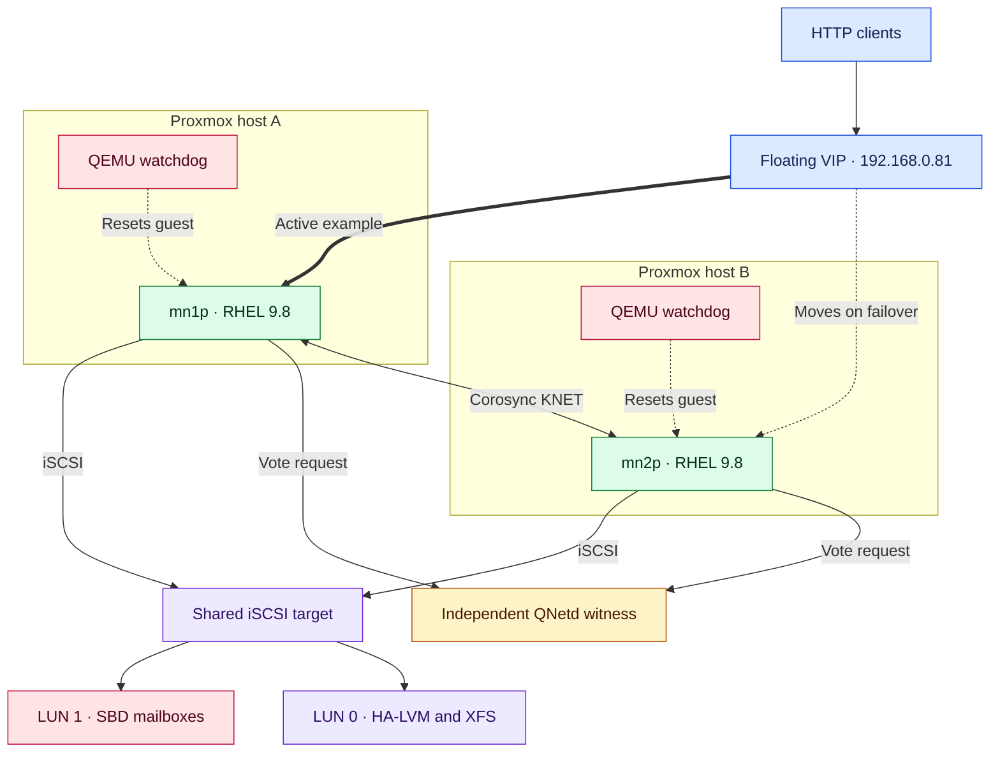
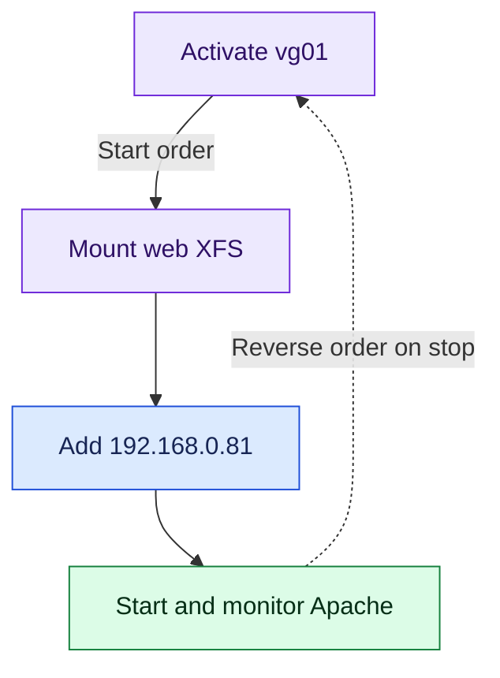
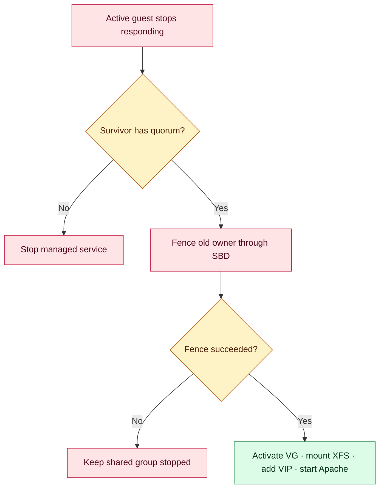

# Two-node Apache HA on RHEL 9.8 and Proxmox VE

Build an active/passive Apache service on two RHEL 9.8 VMs. Clients use **`192.168.0.81`** throughout a failover. Each VM has its own OS disk. Both VMs can see the same two iSCSI LUNs, and Pacemaker allows only the active node to mount the Apache XFS filesystem.

## 1. Architecture and failure domains

| System or endpoint | Service LAN | Corosync VLAN 61 | Storage VLAN 60 | Role |
| --- | --- | --- | --- | --- |
| `mn1p.openhelp.net`, VM 125 | `192.168.0.25/24` | `172.16.61.25/24` | `172.16.60.25/24` | RHEL 9.8 cluster member |
| `mn2p.openhelp.net`, VM 126 | `192.168.0.26/24` | `172.16.61.26/24` | `172.16.60.26/24` | RHEL 9.8 cluster member |
| `web-ha.openhelp.net` | `192.168.0.81/24` | | | Floating IPv4 address, HTTP on TCP 80 |
| `qnetd.openhelp.net` | `192.168.0.28/24` | | | External Corosync quorum witness |
| iSCSI SAN or Linux storage server | | | `172.16.60.10:3260` | Exports the same LUNs to both guests |
| Service-LAN router | `192.168.0.1` | | | Example default gateway |

The witness address, VM IDs, bridge names, VLANs, and iSCSI portal are examples. Reserve the VIP outside the DHCP pool and confirm that every chosen address is free. Point the DNS A record `web-ha.openhelp.net` at the VIP if you are using DNS. Only the two RHEL guests are Pacemaker members. Use existing infrastructure for iSCSI and QNetd if you want to create only two VMs. For a home lab, an existing Linux machine outside the two guests can host both services. That machine then becomes a shared failure point.



| Component | What it does |
| --- | --- |
| Corosync | Tracks which cluster members are communicating. Its votequorum service uses those votes and the QDevice vote to determine quorum. |
| QDevice and QNetd | Each guest runs a QDevice client. An external QNetd server arbitrates the extra vote when needed. It has no Apache resources or shared LUNs. |
| Pacemaker | Chooses where to run services and calls resource agents to start, check, and stop them. The designated controller, shown as DC, coordinates decisions and can be on either node. |
| `pcs` and `pcsd` | The administration CLI and its remote management daemon. Use them to configure the cluster and check its state. |
| STONITH and SBD | STONITH isolates a failed writer. For this lab, `fence_sbd` sends a fencing message through the SBD LUN. A virtual watchdog can reset a guest that stops refreshing its timer. |
| HA-LVM and XFS | Pacemaker transfers the volume group's LVM system ID and activates the volume on one node at a time. XFS holds the website and is mounted by that node alone. |
| IPaddr2 and Apache | IPaddr2 adds the VIP to the active node and announces it on the LAN. The Apache resource agent starts and monitors `httpd` on the same node. |

**One Proxmox host.** Both guests can run on your existing server for practice. You can test a guest reset, a resource failure, and a planned switchover. A physical host shutdown takes down both guests.

**Two Proxmox hosts.** Place one guest per host. Put QNetd on independent compute and power, and use storage and network paths that remain available when either host fails. The two example LUNs can come from one target for the lab. A single target or switch still creates a shared failure point. Proxmox host-cluster quorum, if you use it, is administered separately from the quorum inside the RHEL guests.

**Support.** Red Hat documents SBD with the libvirt/KVM emulated `i6300esb` watchdog. Proxmox exposes the same device model through QEMU. Confirm Red Hat High Availability Add-On coverage for your exact Proxmox, storage, and fencing combination before treating this design as vendor-supported. Validate failure handling on the hardware and network you will deploy. [Red Hat SBD policy] · [Red Hat hypervisor certification] · [Proxmox VM options]

## 2. What changes from the original notes

| Original step | RHEL 9.8 Proxmox procedure |
| --- | --- |
| Two-node title with three configured members | Create just `mn1p` and `mn2p`. QNetd supplies the extra vote from outside the cluster. |
| CentOS Stream `highavailability` repo | Enable the entitled RHEL 9 High Availability repository through Subscription Manager. |
| Disable SELinux and reuse a published password | Use SELinux enforcing and set a fresh secret interactively for `hacluster`. Rotate the example password anywhere it was used. |
| `pvcreate` on the SBD disk and start the standalone watchdog daemon | Write SBD metadata once to a dedicated raw LUN. Give SBD exclusive use of the Proxmox virtual watchdog. |
| `/dev/sdb` and `/dev/sdc` hard-coded | Match the LUNs by their persistent SCSI IDs on both guests. Device letters can change. |
| Inconsistent VIPs and repeated standby command | Test `192.168.0.81`. Use `pcs node unstandby` to return a node to service. |
| HPE iLO fence command | The walkthrough fences the individual QEMU guest. An iLO controller operates on the physical host, so model that failure domain separately if you use iLO in a physical design. |

## 3. Create the two Proxmox guests

**On Proxmox.** Use a maintained Proxmox VE release. Upload the RHEL 9.8 x86_64 DVD ISO to an ISO-enabled datastore. Check the version and available storage from the host shell.

```bash
pveversion
pvesm status
ip -br link
```

1. Select **Create VM** for VM `125`, name `mn1p`. Use the RHEL ISO, 2 vCPUs, 4 GiB RAM, a 32 GiB or larger private OS disk, and a VirtIO SCSI controller. Put `net0` on the service LAN using VirtIO. Repeat for VM `126`, name `mn2p`, with its own OS disk.
2. Start each guest from its ISO and install **RHEL 9.8 Minimal Install** to the private disk. Configure the service LAN from the address table in the installer. Use your own DNS settings. Each guest needs a unique hostname, MAC, machine ID, and iSCSI initiator IQN. Separate installs provide distinct guest identities.
3. Shut down each VM cleanly before adding the watchdog. In **Node → System → Network**, verify the bridges and uplinks. For this layout, enable **VLAN aware** on `vmbr0`, retain its existing management and uplink settings, and allow VLANs 60 and 61 on the switches. Use a host console for bridge changes on a management uplink. Add the remaining network devices in **VM → Hardware**. The service LAN must be in the same Layer 2 broadcast domain on both hosts so that the VIP can move between their MAC addresses.

| VM device | Model | Bridge | VLAN tag | Use |
| --- | --- | --- | --- | --- |
| `net0` | VirtIO | `vmbr0` | Service LAN, untagged in this example | Management, clients, VIP, and QNetd |
| `net1` | VirtIO | `vmbr0` | 61 | Corosync KNET |
| `net2` | VirtIO | `vmbr0` | 60 | iSCSI |

If the Proxmox firewall applies an IP filter to `net0`, permit the guest's fixed IP and `192.168.0.81` in that guest's IP filter. Ensure network security permits guest-originated ARP announcements for the VIP. Keep the data and SBD disks out of the Proxmox VM disk list. The guests log in directly to the storage target. Two independently created Proxmox virtual disks would contain different data. [Proxmox networking] · [Proxmox administration guide]

**On the owning Proxmox host of each powered-off VM.** Run the first pair for VM 125 and the second pair for VM 126. Boot each VM after verifying its watchdog setting.

```bash
qm set 125 --watchdog model=i6300esb,action=reset
qm config 125

qm set 126 --watchdog model=i6300esb,action=reset
qm config 126
```

**Home lab without a VLAN-capable switch.** With both VMs on one Proxmox host, create a Linux bridge such as `vmbr61` with the bridge-ports field empty and no host IP, using the Proxmox management console. Put `net1` on that bridge with no VLAN tag, and keep the Corosync IPs from the table. Use an existing NAS or Linux storage host on the service LAN, for example `192.168.0.31:3260`. Omit `net2` and its guest setup. Substitute that storage IP in all portal commands and use `192.168.0.25/32` and `192.168.0.26/32` as the target's allowed source IPs. The witness still needs an address separate from the two VMs.

## 4. Configure RHEL on both guests

Command blocks use a root shell. Run node-specific blocks only on the named system. Perform network changes from the Proxmox console so that a profile change cannot strand your SSH session.

**On `mn1p`.**

```bash
hostnamectl set-hostname mn1p.openhelp.net
```

**On `mn2p`.**

```bash
hostnamectl set-hostname mn2p.openhelp.net
```

**On both guests.** Add these lines to `/etc/hosts` or create equivalent DNS records. Keep the existing localhost entries. Remove any stale mapping for the same names.

```text
192.168.0.25 mn1p.openhelp.net mn1p
192.168.0.26 mn2p.openhelp.net mn2p
192.168.0.28 qnetd.openhelp.net qnetd
```

Find the interface names using the MAC addresses in `qm config`. The commands assume `ens18` for the service LAN, `ens19` for Corosync, and `ens20` for storage. Replace those example NIC names everywhere if yours differ. Keep the default route and DNS on `ens18` only. Create profiles for the two dedicated Ethernet devices. If Anaconda created competing wired profiles for those devices, disable autoconnect on those older profiles.

```bash
ip -br link
nmcli -f DEVICE,STATE,CONNECTION device status
```

**On `mn1p`.**

```bash
nmcli connection add type ethernet ifname ens19 con-name ha-heartbeat \
  ipv4.method manual ipv4.addresses 172.16.61.25/24 ipv4.never-default yes \
  ipv6.method disabled
nmcli connection add type ethernet ifname ens20 con-name ha-storage \
  ipv4.method manual ipv4.addresses 172.16.60.25/24 ipv4.never-default yes \
  ipv6.method disabled
```

**On `mn2p`.**

```bash
nmcli connection add type ethernet ifname ens19 con-name ha-heartbeat \
  ipv4.method manual ipv4.addresses 172.16.61.26/24 ipv4.never-default yes \
  ipv6.method disabled
nmcli connection add type ethernet ifname ens20 con-name ha-storage \
  ipv4.method manual ipv4.addresses 172.16.60.26/24 ipv4.never-default yes \
  ipv6.method disabled
```

**On both guests.** Bring up the profiles you created. Check the route to each network and the name resolution before running `pcs`.

```bash
nmcli connection up ha-heartbeat
nmcli connection up ha-storage
ip -br -4 addr
ip route
getent ahostsv4 mn1p.openhelp.net mn2p.openhelp.net qnetd.openhelp.net
hostname -f
getenforce
cat /etc/redhat-release
```

Expect `Enforcing` and a RHEL 9.8 release string. If reusing a guest with SELinux disabled, use Red Hat's SELinux re-enablement and relabeling procedure before continuing. Use the console to confirm port and address reachability after the initial network setup. [RHEL 9.8 release notes] · [RHEL SELinux guide]

### Register and install the packages

**On both guests.** Register if necessary. If your subscription uses Satellite, use the activation key and enabled content views from your administrator. Confirm that the content source has RHEL 9.8 and the HA Add-On.

```bash
subscription-manager register
subscription-manager identity
subscription-manager release --list
subscription-manager repos --enable=rhel-9-for-x86_64-baseos-rpms \
  --enable=rhel-9-for-x86_64-appstream-rpms \
  --enable=rhel-9-for-x86_64-highavailability-rpms
dnf repolist --enabled
```

If you must hold the minor version at 9.8 and your approved content provides it, run `subscription-manager release --set=9.8` before updating. For a pinned production system, verify continued errata coverage for BaseOS, AppStream, and the HA Add-On with your subscription or Satellite administrator.

```bash
dnf upgrade --refresh -y
dnf install -y pcs pacemaker corosync corosync-qdevice resource-agents \
  sbd fence-agents-sbd lvm2 xfsprogs iscsi-initiator-utils lsscsi \
  httpd firewalld chrony curl iputils
```

If the HA repository is missing, check the registration and entitled content before proceeding. If the update installed a new kernel, reboot now, before joining the cluster. Verify the release and package versions after the reboot.

```bash
cat /etc/redhat-release
rpm -q pcs pacemaker corosync corosync-qdevice sbd fence-agents-sbd
systemctl enable --now chronyd firewalld pcsd
chronyc tracking
passwd hacluster
```

Use the same freshly generated `hacluster` secret on the two cluster guests for the initial two-host authentication prompt. Keep it in your password manager. [RHEL HA setup] · [RHEL package manifest]

### Open the guest firewall paths

**On both guests.** First use `firewall-cmd --get-active-zones` to identify the zone that owns the service-LAN NIC. This example uses `public`. Set the peer variable for the node you are on, then run the shared commands in the same shell.

**On `mn1p`.**

```bash
PEER_LAN=192.168.0.26
```

**On `mn2p`.**

```bash
PEER_LAN=192.168.0.25
```

**On both guests.**

```bash
LAN_ZONE=public
firewall-cmd --get-active-zones
firewall-cmd --permanent --new-zone=ha-heartbeat
firewall-cmd --reload
nmcli connection modify ha-heartbeat connection.zone ha-heartbeat
nmcli connection up ha-heartbeat
firewall-cmd --permanent --zone=ha-heartbeat --add-service=high-availability
firewall-cmd --permanent --zone="$LAN_ZONE" --add-service=http
firewall-cmd --permanent --zone="$LAN_ZONE" \
  --add-rich-rule="rule family=ipv4 source address=$PEER_LAN/32 port port=2224 protocol=tcp accept"
firewall-cmd --reload
firewall-cmd --get-active-zones
firewall-cmd --zone=ha-heartbeat --list-all
firewall-cmd --zone="$LAN_ZONE" --list-all
```

The heartbeat zone permits the RHEL HA service on the dedicated cluster network. On the LAN, the peer needs TCP 2224 for `pcsd` and clients need TCP 80. Keep your approved admin access in the LAN zone. iSCSI and QNetd connections originate from the guests, so the corresponding inbound ports are opened on the target and witness below. If your LAN zone is public-facing, scope HTTP to the client network and use the approved ingress or TLS policy. [RHEL HA setup]

## 5. Present two shared iSCSI LUNs

| Export | Size in this lab | Same LUN on both guests | Guest contents |
| --- | --- | --- | --- |
| LUN 0 | 3 GiB | Same SCSI WWID | PV → `vg01` → `lv01` → XFS → `/var/www/html` |
| LUN 1 | 64 MiB | A different WWID, identical across guests | Raw SBD header and message slots |

You can use any approved SAN that presents these two LUNs read/write to the two initiator IQNs. Use the SAN's assigned LUN numbers, target IQN, and portal throughout. An IQN names the iSCSI initiator or target. A WWID identifies the logical disk even when Linux enumerates it under a different `/dev/sdX` name. On a multipath SAN, use the vendor-approved multipath device per LUN and retest SBD timing. The commands below assume one path per LUN. [RHEL iSCSI storage guide] · [Red Hat SBD policy]

### 5.1 Identify the initiators

**On both guests.**

```bash
cat /etc/iscsi/initiatorname.iscsi
```

Record only the value after `InitiatorName=` for each node. If these values are equal, correct the cloned identity before logging in anywhere. Map both unique IQNs to the same two LUNs on the storage system.

### 5.2 Build a Linux LIO target if you need one

**On the existing RHEL 9 storage server.** This example uses a dedicated storage IP `172.16.60.10/24` brought up through NetworkManager. It applies to a fresh iSCSI target configuration for this lab. If your NAS already exports the LUNs, proceed to §5.3.

```bash
dnf install -y targetcli firewalld lvm2
systemctl enable --now firewalld target
ip -br -4 addr
firewall-cmd --get-active-zones
targetcli ls
```

Use a storage server volume group with at least 4 GiB free and two new LV names. Here it is `vg_san`. Inspect its free space before creating the raw backstores. With a NAS, create the equivalent two LUNs in its own management interface.

```bash
vgs -o vg_name,vg_size,vg_free
lvcreate -L 3G -n apacheha_web vg_san
lvcreate -L 64M -n apacheha_sbd vg_san
targetcli /backstores/block create apacheha_web /dev/vg_san/apacheha_web
targetcli /backstores/block create apacheha_sbd /dev/vg_san/apacheha_sbd
BACKSTORE=/backstores/block
```

If you are building a small lab on an existing Linux storage server with a filesystem and no spare VG, use the following file-backed commands **in place of** the preceding block. Check free space and keep both image files on persistent storage. They represent two independent block devices from the initiators' perspective.

```bash
install -d -m 0700 /var/lib/iscsi-apache-ha
df -h /var/lib/iscsi-apache-ha
targetcli /backstores/fileio create apacheha_web \
  /var/lib/iscsi-apache-ha/web.img 3G write_back=false
targetcli /backstores/fileio create apacheha_sbd \
  /var/lib/iscsi-apache-ha/sbd.img 64M write_back=false
BACKSTORE=/backstores/fileio
```

Create the target and bind it to the storage address. The default wildcard portal on a new target is normally `0.0.0.0:3260`. Delete it for this target only if `portals ls` shows it. Keep the variables in the same root shell for the next commands.

```bash
TARGET_IQN=iqn.2026-11.net.openhelp:apache-ha
TARGET_IP=172.16.60.10
TPG="/iscsi/$TARGET_IQN/tpg1"

targetcli /iscsi create "$TARGET_IQN"
targetcli "$TPG/portals" ls
targetcli "$TPG/portals" delete 0.0.0.0 3260
targetcli "$TPG/portals" create "$TARGET_IP" 3260
targetcli "$TPG" set attribute generate_node_acls=0 authentication=1
targetcli "$TPG/luns" create "$BACKSTORE/apacheha_web" 0
targetcli "$TPG/luns" create "$BACKSTORE/apacheha_sbd" 1
```

Create the initiator ACLs after the LUNs so that targetcli's default automatic LUN mapping gives each ACL both LUNs. Enter the two exact IQNs when prompted and use a unique random CHAP secret for each node. Store the secrets for use on the corresponding initiators. CHAP authenticates the sessions, so keep the storage traffic on the private network.

```bash
read -r -p 'mn1p initiator IQN: ' IQN1
read -r -p 'mn2p initiator IQN: ' IQN2
targetcli "$TPG/acls" create "$IQN1"
targetcli "$TPG/acls" create "$IQN2"

read -r -s -p 'CHAP secret for mn1p: ' CHAP1
printf '\n'
targetcli "$TPG/acls/$IQN1" set auth userid=mn1p password="$CHAP1"
unset CHAP1
read -r -s -p 'CHAP secret for mn2p: ' CHAP2
printf '\n'
targetcli "$TPG/acls/$IQN2" set auth userid=mn2p password="$CHAP2"
unset CHAP2

targetcli "$TPG/acls" ls
targetcli saveconfig
ss -lnt '( sport = :3260 )'
```

Check each ACL for read/write mapped LUNs 0 and 1. If automatic mapping is off, add each missing mapping explicitly using `targetcli "$TPG/acls/$IQN1" create 0 0` for initiator 1 and LUN 0, then repeat for mapping 1 to 1 and for the other ACL. Save the target configuration again after changes. Keep `/etc/target/saveconfig.json` root-restricted because it contains the target configuration and CHAP credentials.

Restrict TCP 3260 to the initiators at the target firewall. Use the target interface's actual firewalld zone. Apply equivalent rules if the storage server uses a different firewall.

```bash
STORAGE_ZONE=public
firewall-cmd --permanent --zone="$STORAGE_ZONE" \
  --add-rich-rule='rule family=ipv4 source address=172.16.60.25/32 port port=3260 protocol=tcp accept'
firewall-cmd --permanent --zone="$STORAGE_ZONE" \
  --add-rich-rule='rule family=ipv4 source address=172.16.60.26/32 port port=3260 protocol=tcp accept'
firewall-cmd --reload
firewall-cmd --zone="$STORAGE_ZONE" --list-all
```

Verify that TCP 3260 is scoped to the intended initiators. If your Linux target binds the portal to a specific NIC, order restoration of the exported target after that network is up. The example assumes NetworkManager on the storage host.

```bash
install -d /etc/systemd/system/target.service.d
cat > /etc/systemd/system/target.service.d/10-network.conf <<'EOF'
[Unit]
Wants=network-online.target
After=network-online.target
EOF
systemctl enable NetworkManager-wait-online.service
systemctl daemon-reload
```

Check that the portal IP and saved exports return after a storage-host reboot before testing the cluster. [RHEL iSCSI storage guide] · [RHEL network startup] · [targetcli manual]

### 5.3 Log in from both RHEL guests and identify the shared disks

**On both guests.** Use that guest's login (`mn1p` or `mn2p`) and matching CHAP secret. Substitute the SAN's values if it supplies the LUNs.

```bash
PORTAL=172.16.60.10:3260
TARGET_IQN=iqn.2026-11.net.openhelp:apache-ha
ip route get "${PORTAL%:*}"
systemctl start iscsid
iscsiadm -m discovery -t sendtargets -p "$PORTAL"

CHAP_USER="$(hostname -s)"
read -r -s -p "CHAP secret for $CHAP_USER: " CHAP_SECRET
printf '\n'
iscsiadm -m node -T "$TARGET_IQN" -p "$PORTAL" -o update \
  -n node.session.auth.authmethod -v CHAP
iscsiadm -m node -T "$TARGET_IQN" -p "$PORTAL" -o update \
  -n node.session.auth.username -v "$CHAP_USER"
iscsiadm -m node -T "$TARGET_IQN" -p "$PORTAL" -o update \
  -n node.session.auth.password -v "$CHAP_SECRET"
unset CHAP_SECRET
iscsiadm -m node -T "$TARGET_IQN" -p "$PORTAL" --login
iscsiadm -m node -T "$TARGET_IQN" -p "$PORTAL" -o update \
  -n node.startup -v automatic
systemctl enable iscsi.service NetworkManager-wait-online.service
udevadm settle

iscsiadm -m session -P 3
lsscsi -i
lsblk -o NAME,TYPE,SIZE,MODEL,WWN,FSTYPE,MOUNTPOINTS
ls -l /dev/disk/by-path/*iscsi* /dev/disk/by-id/scsi-*
```

Match `lun-0` and `lun-1` in `/dev/disk/by-path/` to their `scsi-…` aliases under `/dev/disk/by-id/`. Check the mapping on both guests. For example, these commands list all aliases for the two exported LUNs.

```bash
udevadm info --query=symlink \
  --name="/dev/disk/by-path/ip-${PORTAL}-iscsi-${TARGET_IQN}-lun-0"
udevadm info --query=symlink \
  --name="/dev/disk/by-path/ip-${PORTAL}-iscsi-${TARGET_IQN}-lun-1"
```

Record the correct `/dev/disk/by-id/scsi-…` path for each LUN on both nodes. Both nodes must report the same WWID for a given role, with different WWIDs for web and SBD. Check that each disk is the expected size, has no mountpoints, and has no signatures. A clean signature check alone cannot prove the disk's identity.

```bash
read -r -p 'Full /dev/disk/by-id path of WEB LUN 0: ' WEB_LUN
read -r -p 'Full /dev/disk/by-id path of SBD LUN 1: ' SBD_LUN
readlink -e "$WEB_LUN" "$SBD_LUN"
lsblk -o NAME,SIZE,TYPE,FSTYPE,WWN,MOUNTPOINTS "$WEB_LUN" "$SBD_LUN"
wipefs --no-act "$WEB_LUN" "$SBD_LUN"
```

After comparing the WWIDs with the storage-system mapping, record these non-secret paths in `/root/apache-ha-disks.env` on each node for later commands. Proceed only after the check succeeds. Use new blank LUNs for this walkthrough.

```bash
test -b "$WEB_LUN" && test -b "$SBD_LUN" \
  && test "$(readlink -e "$WEB_LUN")" != "$(readlink -e "$SBD_LUN")" \
  && printf 'WEB_LUN=%q\nSBD_LUN=%q\n' "$WEB_LUN" "$SBD_LUN" \
  > /root/apache-ha-disks.env
cat /root/apache-ha-disks.env
```

### 5.4 Order iSCSI before cluster startup

**On both guests.** Plain iSCSI login and disk discovery must finish before SBD reads its LUN and before Pacemaker looks for the web VG. Use the RHEL `resource-agents-deps.target` facility for the data LUN, and a separate SBD service drop-in for its LUN. The device units wait for the actual persistent device paths as well as the iSCSI login service. An unavailable target can therefore block cluster startup, which is safer than starting the stack without its required storage.

```bash
. /root/apache-ha-disks.env
WEB_DEVICE_UNIT="$(systemd-escape --path --suffix=device "$WEB_LUN")"
SBD_DEVICE_UNIT="$(systemd-escape --path --suffix=device "$SBD_LUN")"
install -d /etc/systemd/system/resource-agents-deps.target.d \
  /etc/systemd/system/sbd.service.d

cat > /etc/systemd/system/resource-agents-deps.target.d/10-iscsi.conf <<EOF
[Unit]
Requires=iscsi.service $WEB_DEVICE_UNIT
After=iscsi.service $WEB_DEVICE_UNIT
EOF

cat > /etc/systemd/system/sbd.service.d/10-iscsi.conf <<EOF
[Unit]
Requires=iscsi.service $SBD_DEVICE_UNIT
After=iscsi.service $SBD_DEVICE_UNIT
EOF

systemctl daemon-reload
systemctl cat iscsi.service resource-agents-deps.target sbd.service
systemctl status "$WEB_DEVICE_UNIT" "$SBD_DEVICE_UNIT" --no-pager
```

Confirm the guest has an active systemd device unit for each alias. Reboot each guest before forming the cluster and verify `iscsiadm -m session` and both device paths return automatically. During later restarts, systemd waits for the network and storage first, SBD then owns the watchdog, and Corosync and Pacemaker come up with the required devices in place. [RHEL resource dependency ordering] · [SBD manual]

## 6. Prepare the independent quorum witness

**On an existing RHEL 9 witness host.** Use `qnetd.openhelp.net` at `192.168.0.28` in this example. Add the two node names to DNS or the host's `/etc/hosts` for troubleshooting. Use a separate known password for this host's `hacluster` account. If the host already runs QNetd, check its status and reuse it under your administration policy.

```bash
subscription-manager repos --enable=rhel-9-for-x86_64-highavailability-rpms
dnf install -y pcs corosync-qnetd firewalld
systemctl enable --now pcsd firewalld
passwd hacluster
pcs qdevice setup model net --enable --start
pcs qdevice status net --full
```

Allow TCP 2224 for PCS setup and TCP 5403 for QDevice clients. Check the actual service-LAN firewall zone on the witness first. With two guests connected, `pcs qdevice status net --full` later shows this cluster's clients.

```bash
QNETD_ZONE=public
firewall-cmd --get-active-zones
firewall-cmd --permanent --zone="$QNETD_ZONE" \
  --add-rich-rule='rule family=ipv4 source address=192.168.0.25/32 port port=2224 protocol=tcp accept'
firewall-cmd --permanent --zone="$QNETD_ZONE" \
  --add-rich-rule='rule family=ipv4 source address=192.168.0.26/32 port port=2224 protocol=tcp accept'
firewall-cmd --permanent --zone="$QNETD_ZONE" \
  --add-rich-rule='rule family=ipv4 source address=192.168.0.25/32 port port=5403 protocol=tcp accept'
firewall-cmd --permanent --zone="$QNETD_ZONE" \
  --add-rich-rule='rule family=ipv4 source address=192.168.0.26/32 port port=5403 protocol=tcp accept'
firewall-cmd --reload
ss -lnt '( sport = :2224 or sport = :5403 )'
```

QNetd may serve multiple clusters. Plan its placement so that loss of either Proxmox host leaves the other RHEL guest able to reach QNetd. [RHEL quorum-device guide]

## 7. Form the cluster and enable quorum arbitration

**On `mn1p` only.** Make sure both VMs are up, have working name resolution, and can reach each other on `172.16.61.0/24`. Use these setup commands for a new cluster on fresh VMs. If PCS reports an existing cluster configuration, investigate it before proceeding.

```bash
ping -c 3 172.16.61.26
pcs host auth mn1p.openhelp.net mn2p.openhelp.net -u hacluster
pcs cluster setup apache_ha --start \
  mn1p.openhelp.net addr=172.16.61.25 \
  mn2p.openhelp.net addr=172.16.61.26

pcs status --full
corosync-cfgtool -s
```

The cluster node names are the FQDNs. The `addr=` entries set the Corosync transport endpoints on the heartbeat network, separate from the LAN addresses used for `pcsd`. Confirm both nodes are online before proceeding. No application resources are defined yet. After initial validation you will enable automatic startup.

**On `mn1p` only.** Authenticate the witness with its own password and add it to the existing cluster.

```bash
pcs host auth qnetd.openhelp.net -u hacluster
pcs quorum device add model net host=qnetd.openhelp.net algorithm=ffsplit
pcs quorum config
pcs quorum status
pcs quorum device status
```

With both members and the witness healthy, expect **3 expected votes, quorum 2, and a connected QDevice**. PCS replaces the special two-node voting mode when adding the quorum device. Check that `2Node` is absent from the runtime flags, and recheck after the full restart in §8. In this configuration each guest has one vote and QNetd can contribute one vote to an eligible partition. The `ffsplit` algorithm helps choose one partition if the two guests cannot see one another. [RHEL quorum-device guide] · [PCS reference]

| Connected and eligible | Quorum | Result |
| --- | --- | --- |
| Both guests and QNetd | Yes, 3 of 3 | Normal service |
| Both guests, QNetd unavailable | Yes, 2 of 3 | Service stays up with reduced fault tolerance |
| One guest with the witness vote | Yes, 2 of 3 | Service can run after any required fencing succeeds |
| One guest without the witness vote | No, 1 of 3 | Pacemaker stops managed service resources under the configured policy |

Quorum answers **which partition can run the service**. Fencing answers **whether the previous owner has stopped writing**. Both checks matter after an abrupt failure.

## 8. Configure and prove SBD fencing

Storage-Based Death (SBD) uses a shared LUN as a mailbox. When Pacemaker requests a fence, `fence_sbd` writes a message to the target node's slot. The target's SBD daemon acts on the message if it can read it. The watchdog protects against loss of refreshes. Pacemaker waits for the configured fence outcome before recovering the group on the survivor. A quorum vote alone cannot stop an old writer.

### 8.1 Check the virtual watchdog

**On both guests.** Verify the driver and device advertised by Proxmox. Run these checks before SBD is active. On fresh RHEL guests the standalone watchdog daemon normally is absent. If you reused one of your previous lab VMs, stop and disable its `watchdog.service`, or another daemon that opens the same device. Ensure the systemd manager runtime watchdog is off for this guest device.

```bash
modprobe i6300esb
printf '%s\n' i6300esb > /etc/modules-load.d/ha-watchdog.conf
ls -l /dev/watchdog*
cat /sys/class/watchdog/watchdog*/identity
systemctl show --property=RuntimeWatchdogUSec
systemctl status watchdog.service --no-pager
```

Expect an Intel 6300ESB watchdog and `RuntimeWatchdogUSec=0`. The example below assumes `/dev/watchdog0` is the Intel device on **both** VMs. Use the correct device path if enumeration differs and verify the generated SBD configuration for each node. If a reused VM still loads `softdog` automatically, remove its old lab module-load setting and reboot before proceeding.

On a reused guest with a nonzero systemd runtime watchdog setting, set `RuntimeWatchdogSec=0` in the `[Manager]` section of a drop-in under `/etc/systemd/system.conf.d/`, then reboot while the web volume is still unmounted. Recheck the setting before giving SBD the device.

**On each idle guest, before enabling SBD.** This watchdog acceptance test deliberately causes a hard reset, so use a VM console and finish one guest at a time with no Apache data mounted. It checks the Proxmox reset path independently of the fence agent.

```bash
pcs stonith sbd watchdog test /dev/watchdog0
```

Confirm each guest genuinely rebooted using `uptime -s` or `journalctl --list-boots`. If the installed PCS asks for confirmation, read the prompt. If the virtual watchdog fails to reset the VM, stop here and correct it before enabling resources. Once both guests are back, run `pcs cluster start --all` from `mn1p` and confirm both nodes have rejoined. [Proxmox VM options] · [PCS reference] · [Red Hat SBD policy]

### 8.2 Initialize the shared SBD LUN and configure its daemon

**On `mn1p` only.** Confirm the cluster stack is running on both guests and both can see the same SBD LUN. The device setup command overwrites the SBD LUN. Read the prompt and confirm that its path matches the previously verified 64 MiB lab LUN. Run this initialization once for the shared device.

```bash
. /root/apache-ha-disks.env
lsblk -o NAME,SIZE,WWN,FSTYPE,MOUNTPOINTS "$SBD_LUN"
pcs stonith sbd device setup device="$SBD_LUN" \
  watchdog-timeout=15 msgwait-timeout=30
sbd -d "$SBD_LUN" dump

pcs stonith sbd enable device="$SBD_LUN" watchdog=/dev/watchdog0 \
  SBD_WATCHDOG_TIMEOUT=15 SBD_STARTMODE=always SBD_DELAY_START=yes
pcs cluster stop --all
```

**On both guests.** Verify the SBD configuration written by PCS. Then start `pcs cluster start` on each local console after both cluster stacks have stopped. This accommodates the SBD startup delay. Leave the iSCSI and QNetd services running.

```bash
. /root/apache-ha-disks.env
grep -E '^(SBD_DEVICE|SBD_PACEMAKER|SBD_WATCHDOG|SBD_STARTMODE|SBD_DELAY_START)' \
  /etc/sysconfig/sbd
pcs cluster start
systemctl is-active sbd corosync pacemaker
journalctl -b -u sbd --no-pager -n 40
sbd -d "$SBD_LUN" dump
sbd -d "$SBD_LUN" list
```

Expect the SBD daemon to start before the cluster services. Look for the same SBD UUID, both FQDNs in the slot list, `SBD_PACEMAKER=yes`, the configured watchdog device, and a connected QDevice. Slot numbers depend on allocation order. A newly initialized disk acquires slots when the guests start SBD.

| Setting | Example | Effect |
| --- | --- | --- |
| Watchdog timeout | 15 seconds | SBD must refresh the watchdog within this window. |
| SBD `msgwait` | 30 seconds | Allows time for delivery and self-fencing before the agent treats the message as delivered. |
| `SBD_DELAY_START=yes` | Uses the disk message window | Holds back rapid rejoin so the other node can finish the fence action. |
| Fence agent `power_timeout` | 60 seconds | Must exceed the on-disk `msgwait`. |
| Pacemaker `stonith-timeout` | 120 seconds | Gives the overall fence operation time to complete. |

These timeouts are starting values for the lab's low-latency storage. Validate them against storage failover behavior, iSCSI recovery, hypervisor load, and recovery-time objectives before production. With one SBD LUN, loss of the LUN can impair fencing and may cause self-fencing under additional failures. A healthy witness cannot restore shared storage. [RHEL SBD configuration example] · [SBD manual] · [Red Hat fence-agent timeout guidance]

### 8.3 Register the fence agent and test both directions

**On either online guest.** Use the same path that PCS recorded in `SBD_DEVICE`.

```bash
. /root/apache-ha-disks.env
pcs stonith describe fence_sbd
pcs property set stonith-enabled=true no-quorum-policy=stop \
  stonith-timeout=120s stonith-watchdog-timeout=0
pcs stonith create sbd_fencing fence_sbd devices="$SBD_LUN" \
  pcmk_host_check=static-list \
  pcmk_host_list="mn1p.openhelp.net mn2p.openhelp.net" power_timeout=60
pcs stonith config sbd_fencing
pcs stonith status
pcs property config
pcs quorum status
pcs stonith sbd status --full
```

`stonith-watchdog-timeout=0` leaves implicit watchdog fencing off. This cluster uses the explicit disk-backed `fence_sbd` resource with SBD still controlling the guest watchdog. Confirm the fence device has started and quorum is healthy. Once those checks pass, enable both guests to rejoin automatically after boot.

```bash
pcs cluster enable --all
```

**On `mn1p`.** The next command reboots `mn2p`. Record `uptime -s` on the target beforehand. Watch the target VM's Proxmox console and check fencing history from the survivor.

```bash
pcs stonith fence mn2p.openhelp.net
pcs stonith history
pcs status --full
```

Wait until both nodes and QDevice are healthy again. **On `mn2p`**, repeat in the reverse direction.

```bash
pcs stonith fence mn1p.openhelp.net
pcs stonith history
pcs status --full
pcs quorum status
```

Pass criteria are a successful fence event in each direction, a changed boot time on each target, and automatic recovery of its iSCSI sessions, SBD service, and membership. Resolve any fence failure before creating the shared filesystem and application resources. [Red Hat fencing requirements] · [RHEL SBD configuration example]

## 9. Prepare the shared HA-LVM and Apache content

### 9.1 Configure LVM ownership

**On both guests.** In the existing `global { … }` section of `/etc/lvm/lvm.conf`, set `system_id_source = "uname"`. In the existing `devices { … }` section check `use_devicesfile = 1`, the RHEL 9 default. If you previously disabled the devices file on a reused guest, account for all existing local PVs before enabling it. Leave the SBD LUN out of LVM.

```bash
lvmconfig --type full global/system_id_source devices/use_devicesfile
lvm systemid
lvmdevices
```

Each node must report its own unique system ID. When Pacemaker moves `web_lvm`, the LVM agent gains ownership of the VG on the new node. The passive node sees the underlying disk but keeps the logical volume inactive. Keep the hostnames stable after cluster creation. [RHEL Apache HA tutorial] · [RHEL LVM guide]

### 9.2 Initialize the filesystem once

**On `mn1p` only.** Verify the approved 3 GiB web LUN again. These commands create new LVM and XFS metadata. Proceed only with the correct, blank data LUN and with the VG and LV names unused.

```bash
. /root/apache-ha-disks.env
lsblk -o NAME,SIZE,WWN,FSTYPE,MOUNTPOINTS "$WEB_LUN"
wipefs --no-act "$WEB_LUN"
vgs
```

```bash
pvcreate "$WEB_LUN"
vgcreate --setautoactivation n vg01 "$WEB_LUN"
lvcreate -L 2G -n lv01 vg01
vgs -o +systemid vg01
lvs -o lv_name,vg_name,lv_size,lv_active vg01
mkfs.xfs /dev/vg01/lv01
```

`pvcreate` adds the new data PV to the primary node's devices file. **On `mn2p` only**, register the now-initialized shared PV in its devices file and verify that the VG is visible with the primary node's system ID.

```bash
. /root/apache-ha-disks.env
lvmdevices --adddev "$WEB_LUN"
lvmdevices
vgs --foreign -o vg_name,systemid vg01
```

`--setautoactivation n` preserves the group's single-owner design at boot. After initialization the web LV will be mounted only by Pacemaker. Add no `/etc/fstab` entry for it on either guest. [RHEL Apache HA tutorial]

### 9.3 Prepare Apache on both guests

**On both guests.** Give Pacemaker ownership of the Apache lifecycle. Keep the stock RHEL `DocumentRoot /var/www/html`. Only the web content is shared, while Apache configuration and logs live on each guest's OS disk.

```bash
systemctl disable --now httpd.service
install -d -m 0755 /var/www/html
cat > /etc/httpd/conf.d/ha-status.conf <<'EOF'
<Location "/server-status">
    SetHandler server-status
    Require local
</Location>
EOF
httpd -M | grep status_module
httpd -t
getenforce
```

The Apache monitor queries `http://127.0.0.1/server-status` on the same node. `Require local` limits the status handler to local requests. Keep this configuration consistent across the guests. [RHEL Apache HA tutorial]

**On `mn1p` only.** Seed the web page on the shared volume before Pacemaker takes control. Follow the commands in order. If the mount fails, resolve it before writing content.

```bash
mount -t xfs /dev/vg01/lv01 /var/www/html
findmnt --mountpoint /var/www/html
```

```bash
cat > /var/www/html/index.html <<'EOF'
<!doctype html>
<html lang="en">
<head><meta charset="utf-8"><title>Apache HA lab</title></head>
<body><h1>Apache HA on RHEL 9.8</h1><p>Served from the shared XFS volume.</p></body>
</html>
EOF
restorecon -RFv /var/www/html
ls -Zd /var/www/html /var/www/html/index.html
sync -f /var/www/html/index.html
umount /var/www/html
lvchange -an vg01/lv01
lvs -o lv_name,vg_name,lv_active vg01
```

Expect `httpd_sys_content_t` for the document root and content with the stock RHEL policy. The filesystem's SELinux labels persist on the volume when it moves. Keep the LV inactive until Pacemaker starts the group.

## 10. Deploy `webgroup`



The group colocates its members and supplies start order. Pacemaker reverses the order to stop, so Apache stops before the VIP is removed and before XFS is unmounted. This sequence is what makes standby and failover move the entire application stack.

**On either online guest.** Check both service NIC names first. The `IPaddr2` command uses `nic=ens18`. When the guests use different names, omit `nic` and first verify that the VIP subnet selects the correct route on each. Verify the VIP is unassigned on the LAN before giving it to the cluster. Stage the group in a copy of the cluster configuration database (CIB), then apply the four resources in one change. Run only once.

```bash
pcs status --full
pcs quorum status
pcs stonith history
pcs resource describe ocf:heartbeat:LVM-activate
pcs resource describe ocf:heartbeat:apache
arping -D -I ens18 -c 3 192.168.0.81
```

Confirm no reply to the duplicate address probe and verify the VIP reservation. Then stage the configuration.

```bash
ha_cib_dir="$(mktemp -d /root/apache-ha-cib.XXXXXX)"
pcs cluster cib "$ha_cib_dir/before.xml"
cp "$ha_cib_dir/before.xml" "$ha_cib_dir/web.xml"

pcs -f "$ha_cib_dir/web.xml" resource create web_lvm ocf:heartbeat:LVM-activate \
  vgname=vg01 vg_access_mode=system_id --group webgroup
pcs -f "$ha_cib_dir/web.xml" resource create web_fs ocf:heartbeat:Filesystem \
  device=/dev/vg01/lv01 directory=/var/www/html fstype=xfs --group webgroup
pcs -f "$ha_cib_dir/web.xml" resource create VirtualIP ocf:heartbeat:IPaddr2 \
  ip=192.168.0.81 cidr_netmask=24 nic=ens18 --group webgroup
pcs -f "$ha_cib_dir/web.xml" resource create Website ocf:heartbeat:apache \
  configfile=/etc/httpd/conf/httpd.conf \
  statusurl=http://127.0.0.1/server-status \
  op monitor interval=10s timeout=20s --group webgroup

pcs -f "$ha_cib_dir/web.xml" resource config
```

Check that the staged `webgroup` contains all four members in the displayed order. Push only after each resource creation succeeded.

```bash
pcs cluster cib-push "$ha_cib_dir/web.xml" diff-against="$ha_cib_dir/before.xml"
pcs status --full
pcs resource config
```

The healthy state has two online nodes, a healthy QDevice, a fence resource, and four started resources on the same guest. For example, if `mn1p` wins placement, the group portion of `pcs status` looks like this:

```text
Resource Group: webgroup
    web_lvm    Started mn1p.openhelp.net
    web_fs     Started mn1p.openhelp.net
    VirtualIP  Started mn1p.openhelp.net
    Website    Started mn1p.openhelp.net
```

**On both guests**, check the VIP and mount locally. Only the node listed as owner in `pcs status` should report either. On that node, the local status URL returns HTTP 200.

```bash
ip -4 addr show dev ens18
findmnt --mountpoint /var/www/html
curl --fail --silent --show-error http://127.0.0.1/server-status
```

**From a LAN client**, expect HTTP 200 with the same page whichever guest owns the VIP. Use DNS once the A record is in place.

```bash
curl --fail --silent --show-error http://192.168.0.81/
curl --fail --silent --show-error \
  --resolve web-ha.openhelp.net:80:192.168.0.81 http://web-ha.openhelp.net/
curl --silent --output /dev/null --write-out '%{http_code}\n' \
  http://192.168.0.81/server-status
```

Expect HTTP 403 for `/server-status` from a separate client. The cluster can use the local endpoint while the client-facing website remains accessible. HTTP on port 80 is the lab's test endpoint. Use a production HTTPS policy and a certificate for the service hostname when exposing the service to users. [RHEL Apache HA tutorial] · [PCS reference]

### Match log rotation to the Apache resource agent

**On both guests.** The RHEL Apache logrotate rule normally reloads the standalone systemd service. The Apache resource agent instead uses an instance-specific PID file. Check `pcs resource describe ocf:heartbeat:apache` and verify the PID file on the active node with `ls -l /run/httpd-Website.pid`. Use the actual resource agent PID filename if it differs. Replace the stock reload line in the `postrotate` section of `/etc/logrotate.d/httpd` with the following guarded graceful reload. Preserve the surrounding logrotate configuration.

```bash
if [ -s /run/httpd-Website.pid ] && \
   /usr/bin/ps -q "$(/usr/bin/cat /run/httpd-Website.pid)" >/dev/null 2>&1
then
    /usr/sbin/httpd -f /etc/httpd/conf/httpd.conf \
      -c 'PidFile /run/httpd-Website.pid' -k graceful >/dev/null 2>&1 || true
fi
```

Use `logrotate -d /etc/logrotate.conf` to check the resulting configuration on each guest. [RHEL Apache HA tutorial]

## 11. Run acceptance tests

Record the starting owner, fence history, and quorum status. Keep a separate LAN client watching the VIP during each test.

```bash
watch -n 1 'curl -sS --max-time 2 -o /dev/null -w "%{http_code} %{time_total}s\n" http://192.168.0.81/'
```

Short HTTP interruption is possible while the group moves. Record elapsed time and check the response body after recovery. The VIP will keep the same IP but may resolve through ARP to a new guest MAC.

### 11.1 Planned switchover and proof of shared content

**On the active guest.** Identify it with `pcs status`, then write a unique marker to the mounted filesystem and check it from the client.

```bash
findmnt --mountpoint /var/www/html
printf 'Shared content written on %s at %s\n' "$(hostname -f)" "$(date -Is)" \
  > /var/www/html/cluster-proof.txt
restorecon -v /var/www/html/cluster-proof.txt
sync -f /var/www/html/cluster-proof.txt
```

```bash
curl -fsS http://192.168.0.81/cluster-proof.txt
```

**On either online guest.** If `mn1p` is the owner, use the commands below. Substitute `mn2p.openhelp.net` if it owns the group.

```bash
pcs node standby mn1p.openhelp.net
pcs status --full
```

Expect all four resources to start on the peer. On the old node check that `findmnt --mountpoint /var/www/html` returns no mount and `ip -4 addr show dev ens18` lacks `192.168.0.81`. On the peer check the reverse and retrieve the same marker via the VIP. A clean standby move should produce no new fence event. Return the original node to eligibility.

```bash
pcs node unstandby mn1p.openhelp.net
pcs status --full
```

Unstandby makes the node eligible again. The running group can remain on its current owner.

### 11.2 Fence the active guest and verify failover

Run this disruptive test in a controlled window. Make sure both guests, QNetd, and iSCSI are healthy first. If `mn2p` now owns the group, run the following commands **on `mn1p`**. Reverse the roles if the working owner is `mn1p`.

```bash
pcs stonith fence mn2p.openhelp.net
pcs stonith history
pcs status --full
pcs quorum status
```

Confirm the previous owner rebooted, the survivor mounted XFS and took over the VIP, and the marker is still served. The returning node must rejoin with its iSCSI session and watchdog without mounting XFS while its peer owns the group. To exercise unexpected guest loss as a separate lab test, use **Stop** in Proxmox on the active guest and observe Pacemaker's automatic fence and takeover, then start the guest again. For physical-host failure, use the two-host layout and verify the surviving guest still has both storage and a witness vote.



### 11.3 Verify the witness-loss and no-quorum behavior

Use this test only with a dedicated lab QNetd instance because stopping it also affects any other clients it serves. Start with both guests healthy and the application mounted. Stop `corosync-qnetd` on the witness, and check `pcs quorum status` on the active guest. The two guests should remain quorate together and continue serving.

```bash
# Dedicated witness
pcs qdevice stop net
```

On the **passive guest only**, stop its cluster stack.

```bash
pcs cluster stop
```

On the active guest, use `pcs quorum status` and `pcs status` to verify loss of quorum and observe Pacemaker stopping the group. Start the witness again and verify the active guest becomes quorate with its vote. Then use `pcs cluster start` on the passive guest and verify all participants after recovery.

```bash
# Dedicated witness
pcs qdevice start net
```

```bash
# From an online cluster guest after recovery
pcs quorum status
pcs quorum device status
pcs status --full
```

## 12. Operate and troubleshoot the cluster

| Symptom or task | Check and action |
| --- | --- |
| Guest booted but cluster stayed down | Inspect `systemctl status sbd corosync pacemaker iscsi` and `journalctl -b -u iscsi -u sbd -u pacemaker`. Check the persistent device units and start the local cluster after required storage returns. |
| Peer offline or no quorum | Run `corosync-cfgtool -s`, `pcs quorum status`, and `pcs quorum device status`. Check the heartbeat VLAN, the node-to-node link and TCP 5403 to the witness. |
| Fencing action failed | Check `pcs stonith history`, `pcs stonith sbd status --full`, and SBD journals on both guests. Verify the shared UUID, exact node slot names, virtual watchdog identity, and agent timeouts. Keep the old owner isolated while investigating. |
| LVM not visible or refuses activation | Check `iscsiadm -m session -P 3`, `lvmdevices`, `lvm systemid`, and `vgs --foreign -o +systemid`. A passive guest can see a VG owned by the peer as foreign. Let Pacemaker handle ownership transfer. |
| VIP present locally but client cannot reach it | Verify the guest firewall zone, LAN/VLAN, Proxmox IP filter and ARP updates from the LAN client with `ip neigh show 192.168.0.81`. Check for a duplicate VIP. |
| Apache will not start or monitor | Use `httpd -t`, `httpd -M`, `ls -Zd /var/www/html`, and the active node's Apache error log. If SELinux reports a denial, check `ausearch -m AVC -ts recent`. Validate the local status URL. |
| Resource previously failed after the cause was repaired | Run `pcs status --full` and `pcs resource failcount show`. Use `pcs resource cleanup Website` for the affected resource after fixing it. This clears its failed operation history and triggers a fresh probe. |
| One guest needs maintenance | Standby that guest, check that the other owns the group and serves requests, and then patch or reboot. After checking storage, watchdog, and membership, use `pcs node unstandby <node-fqdn>`. Repeat for the peer after service is stable. |

For an orderly full shutdown, use `pcs cluster stop --all` before shutting down the shared storage. For recovery, bring back the target and QNetd first, check the guests have the LUNs, and start the clusters with `pcs cluster start --all` or start them locally on each guest if the SBD delay exceeds the remote request window. Avoid pausing the VMs, restoring saved RAM state, or rolling back guest snapshots while they participate in shared-storage HA.

If you want the VMs to start automatically after a Proxmox host reboot, set **Start at boot** on each VM after the acceptance tests, or use `qm set 125 --onboot 1` and `qm set 126 --onboot 1` on their owning hosts. Proxmox starts the guests and the enabled RHEL cluster services recover the application when the required storage, quorum, and fencing conditions are met.

Back up the CIB and `/etc/corosync/corosync.conf` and record the IQN-to-WWID mapping and SBD settings. Back up the web content separately from the Proxmox backups of the guest OS disks. Validate a restore on isolated storage before reconnecting it to the live LUNs. Before production, check the impact of a storage path loss, witness loss, switch or NIC failure, a guest crash, and loss of each physical hypervisor. For network redundancy use independent paths for Corosync and guest iSCSI where supported, with the storage vendor's failover settings and tested timers.

### Retire the lab

1. On a quorate node, run `pcs resource disable webgroup` and verify both guests have no VIP and no XFS mount. Back up any needed content and configuration.
2. Run `pcs quorum device remove` while the cluster is up to remove this cluster's QDevice configuration. Leave a shared QNetd instance running for its other clients.
3. Remove the lab fence resource with `pcs stonith delete sbd_fencing`. Use `pcs stonith sbd disable`, `pcs cluster disable --all`, and then `pcs cluster stop --all`. After checking that resources are stopped on both guests, run `pcs cluster destroy` **locally on each retired guest**. This permanently removes its cluster configuration.
4. Check SBD has stopped and remove the lab's startup drop-ins if repurposing the VMs. On each guest, log out from the lab target after confirming that no process is using the LUNs. Use `iscsiadm -m node -T "$TARGET_IQN" -p "$PORTAL" --logout`. After logout, delete only that target record with `iscsiadm -m node -T "$TARGET_IQN" -p "$PORTAL" -o delete` to prevent automatic login. Unmap the LUNs on the storage server after both initiators are disconnected. Keep or delete the underlying data according to your retention plan.

## References

- [RHEL 9.8 release notes] and [RHEL package manifest]
- [RHEL HA setup], [RHEL Apache HA tutorial], [RHEL quorum-device guide], and [RHEL resource dependency ordering]
- [RHEL iSCSI storage guide], [RHEL LVM guide], and [RHEL SELinux guide]
- [Red Hat fencing requirements], [Red Hat SBD policy], [Red Hat fence-agent timeout guidance], and [RHEL SBD configuration example]
- [Red Hat hypervisor certification], [Proxmox administration guide], [Proxmox VM options], and [Proxmox networking]
- [PCS reference], [SBD manual], and [targetcli manual]

[RHEL 9.8 release notes]: https://docs.redhat.com/en/documentation/red_hat_enterprise_linux/9/html/9.8_release_notes/index
[RHEL package manifest]: https://docs.redhat.com/en/documentation/red_hat_enterprise_linux/9/html-single/package_manifest/index
[RHEL HA setup]: https://docs.redhat.com/en/documentation/red_hat_enterprise_linux/9/html/configuring_and_managing_high_availability_clusters/assembly_creating-high-availability-cluster-configuring-and-managing-high-availability-clusters
[RHEL Apache HA tutorial]: https://docs.redhat.com/en/documentation/red_hat_enterprise_linux/9/html/configuring_and_managing_high_availability_clusters/assembly_configuring-active-passive-http-server-in-a-cluster-configuring-and-managing-high-availability-clusters
[RHEL quorum-device guide]: https://docs.redhat.com/en/documentation/red_hat_enterprise_linux/9/html/configuring_and_managing_high_availability_clusters/assembly_configuring-quorum-devices-configuring-and-managing-high-availability-clusters
[RHEL resource dependency ordering]: https://docs.redhat.com/en/documentation/red_hat_enterprise_linux/9/html-single/configuring_and_managing_high_availability_clusters/index#proc_configuring-startup-order-for-resource-dependencies-not-managed-by-pacemaker-determining-resource-order
[RHEL iSCSI storage guide]: https://docs.redhat.com/en/documentation/red_hat_enterprise_linux/9/html-single/managing_storage_devices/index
[RHEL LVM guide]: https://docs.redhat.com/en/documentation/red_hat_enterprise_linux/9/html-single/configuring_and_managing_logical_volumes/index
[RHEL SELinux guide]: https://docs.redhat.com/en/documentation/red_hat_enterprise_linux/9/html-single/using_selinux/index
[Red Hat fencing requirements]: https://access.redhat.com/articles/2881341
[Red Hat SBD policy]: https://access.redhat.com/articles/2800691
[Red Hat fence-agent timeout guidance]: https://access.redhat.com/solutions/6115821
[RHEL SBD configuration example]: https://cloud.ibm.com/docs/sap?topic=sap-ha-sbd
[Red Hat hypervisor certification]: https://access.redhat.com/kb/certified-hypervisors
[Proxmox administration guide]: https://pve.proxmox.com/pve-docs/pve-admin-guide.pdf
[Proxmox VM options]: https://pve.proxmox.com/pve-docs/qm.conf.5.html
[Proxmox networking]: https://pve.proxmox.com/wiki/Network_Configuration
[PCS reference]: https://manpages.debian.org/bookworm/pcs/pcs.8.en.html
[SBD manual]: https://manpages.debian.org/bookworm/sbd/sbd.8.en.html
[targetcli manual]: https://github.com/open-iscsi/targetcli-fb/blob/master/targetcli.8
[RHEL network startup]: https://docs.redhat.com/en/documentation/red_hat_enterprise_linux/9/html/configuring_and_managing_networking/systemd-network-targets-and-services_configuring-and-managing-networking
