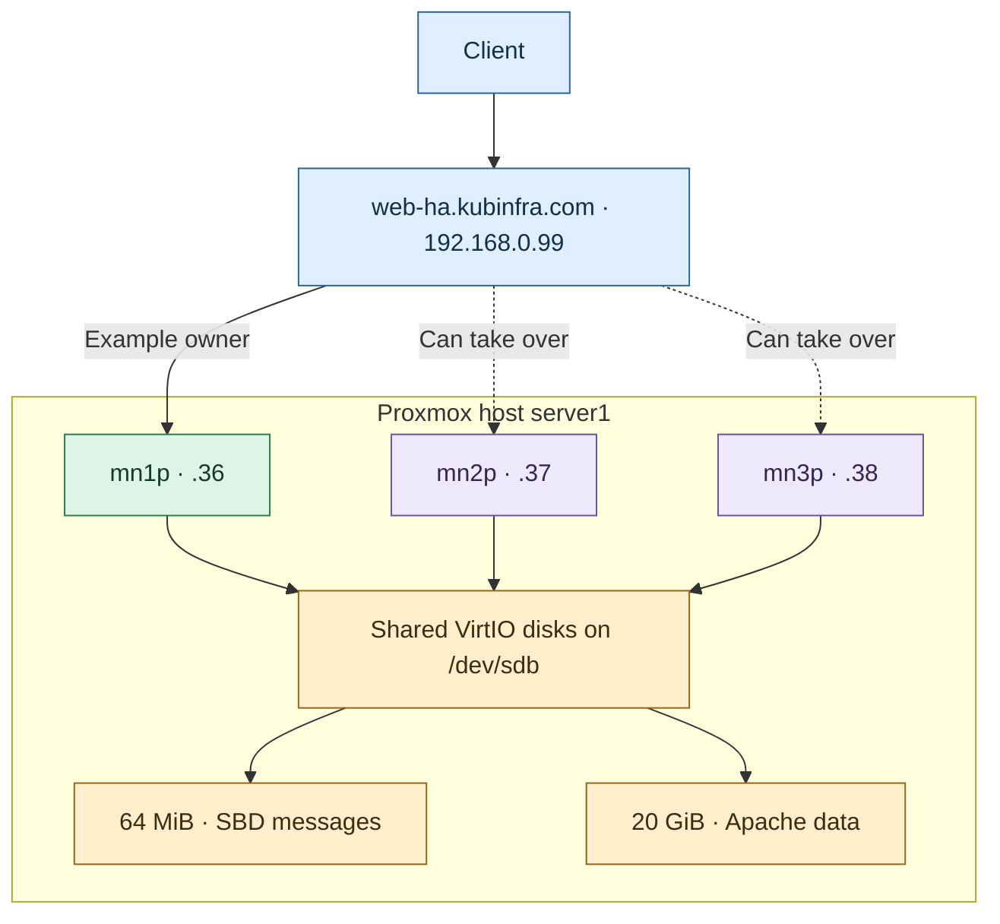
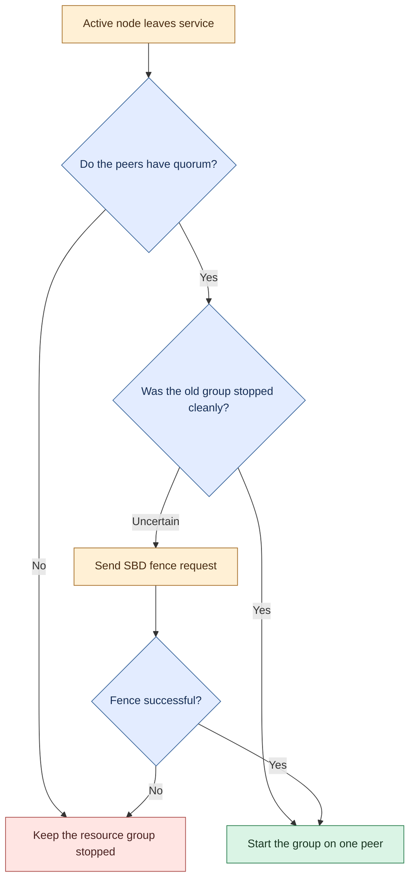

# Three-node RHEL 9.8 Apache HA on Proxmox

Manual build for `server1` using Pacemaker, Corosync, disk-based SBD fencing and two shared VirtIO disks backed by the 2 TB SSD at `/dev/sdb`.

**Start here on your current VMs.** You’ve attached the two shared disks to all three VMs. On `mn2p`, the 64 MiB disk appeared as `vda` and the 20 GiB disk as `vdb`. Use [section 2.1](#21-verify-the-attachments-you-already-have) to confirm their serials and host backing paths. Continue with [section 3](#3-prepare-the-three-rhel-nodes) once all three VMs pass. Sections 2.2 and 2.3 record the fresh-build steps.

**Scope.** This is a fresh-build runbook for guest-level failover. The three guests, their shared data and their SBD device depend on one physical Proxmox host and one SSD. This layout can recover from a **guest** failure with two guests and storage still available. A power loss on `server1` or a failure of the shared SSD makes the service unavailable. [Section 9](#9-production-deployment-requirements) covers the changes needed for host and storage availability.

## Contents

1. [Topology and concepts](#1-topology-and-concepts)
2. [Shared disks on the Proxmox SSD](#2-shared-disks-on-the-proxmox-ssd)
3. [Prepare the three RHEL nodes](#3-prepare-the-three-rhel-nodes)
4. [Build quorum and prove SBD fencing](#4-build-quorum-and-prove-sbd-fencing)
5. [Build the shared LVM and XFS filesystem](#5-build-the-shared-lvm-and-xfs-filesystem)
6. [Configure and start Apache under Pacemaker](#6-configure-and-start-apache-under-pacemaker)
7. [Verify failover and automatic startup](#7-verify-failover-and-automatic-startup)
8. [Configure HTTPS](#8-configure-https)
9. [Production deployment requirements](#9-production-deployment-requirements)
10. [Operations and troubleshooting](#10-operations-and-troubleshooting)
11. [Optional raw-file backing on the same SSD](#11-optional-raw-file-backing-on-the-same-ssd)

## 1. Topology and concepts

| System | Proxmox VM | Address | Role |
| --- | ---: | --- | --- |
| `server1` | Physical host | Existing management address | Runs the three RHEL guests and owns `/dev/sdb` |
| `mn1p.kubinfra.com` | `125` | `192.168.0.36/24` | Cluster member, one vote |
| `mn2p.kubinfra.com` | `126` | `192.168.0.37/24` | Cluster member, one vote |
| `mn3p.kubinfra.com` | `127` | `192.168.0.38/24` | Cluster member, one vote |
| `web-ha.kubinfra.com` | Active guest | `192.168.0.99/24` | Apache virtual IP address, called the VIP |

The VM IDs follow the lab plan. Verify them by name with `qm list` before changing Proxmox settings. Each guest has its own system disk and a permanent IP. All three guests attach to the same two shared block devices on `server1`.



| Term | What it does here |
| --- | --- |
| **Corosync** | Tracks which nodes can communicate and provides the vote count. Any two connected members have quorum. |
| **Pacemaker** | Decides where to run the workload, monitors resources and calls fencing when ownership is uncertain. |
| **`pcs` and `pcsd`** | `pcs` is the administration CLI. `pcsd` lets administrators manage the cluster configuration across the nodes. |
| **Quorum** | Requires at least two of the three votes. A lone node follows `no-quorum-policy=stop` and stops managed resources. |
| **Fencing / STONITH** | Removes a failed or isolated node's ability to keep using the shared resources before an unsafe takeover. This lab uses a VM reset. |
| **Disk-based SBD** | `fence_sbd` posts a message on the small shared disk. The `sbd` daemon on each guest watches its slot and uses the guest watchdog as part of its self-fencing protection. |
| **HA-LVM and XFS** | All nodes can see the Apache disk. `LVM-activate` with `system_id` gives the active node exclusive volume-group ownership. Only that node mounts XFS. |
| **Resource group** | Starts LVM, XFS, the VIP and Apache in that order on one node. It stops them in reverse order. |

**Split brain** is the situation where disconnected members both act as owners of the same service or data. Quorum tells Pacemaker which partition may make decisions. Fencing ensures that an unresponsive former owner loses access before recovery. Two nodes can keep the service running after one guest fails. A second guest failure removes quorum.

In the commands below, run **Proxmox host** steps in `server1`'s root shell. Run **all nodes** steps as root separately in each RHEL guest. Run **`mn1p` only** steps once on that node. Follow the order and read each verification before proceeding. For a running cluster or a disk with existing data, first inventory the resources and plan the change.

## 2. Shared disks on the Proxmox SSD

### 2.1 Verify the attachments you already have

**On Proxmox host `server1`**, confirm the VM mapping and inspect their command lines. The two backing paths must agree across all three VMs.

```bash
pveversion
qm list
qm showcmd 125 --pretty | grep -E 'ha-sbd|ha-apache|RHELHA-|share-rw'
qm showcmd 126 --pretty | grep -E 'ha-sbd|ha-apache|RHELHA-|share-rw'
qm showcmd 127 --pretty | grep -E 'ha-sbd|ha-apache|RHELHA-|share-rw'
```

For LVM-thin backing, the shared devices are `/dev/ssd2tb/rhelha-sbd` and `/dev/ssd2tb/rhelha-apache`. If you followed the earlier raw-file method, look for the same two file paths on `/mnt/backups` in all three commands. The host path confirms that the VMs share each disk. Verify `share-rw=on` on each attachment and use the serial and size to identify each device in RHEL.

**On all RHEL nodes**, inspect the disks without modifying them.

```bash
udevadm settle
lsblk -d -o NAME,SIZE,RO,TYPE,SERIAL,FSTYPE
ls -l /dev/disk/by-id/virtio-RHELHA-SBD /dev/disk/by-id/virtio-RHELHA-APACHE
blockdev --getsize64 /dev/disk/by-id/virtio-RHELHA-SBD
blockdev --getsize64 /dev/disk/by-id/virtio-RHELHA-APACHE
```

| Guest path used throughout this runbook | Expected size | Purpose |
| --- | --- | --- |
| `/dev/disk/by-id/virtio-RHELHA-SBD` | `67108864` bytes (64 MiB) | Dedicated raw SBD device with writable access from all three nodes |
| `/dev/disk/by-id/virtio-RHELHA-APACHE` | `21474836480` bytes (20 GiB) | Shared Apache data device, writable by the active volume owner |

This example adds the expected serials to the disk sizes observed on `mn2p`.

```text
NAME  SIZE RO TYPE SERIAL
sda    50G  0 disk
sr0  14.5G  0 rom
vda    64M  0 disk RHELHA-SBD
vdb    20G  0 disk RHELHA-APACHE
```

`RO=0` means the disk is writable. The RHEL kernel can assign a different `vd*` name on another guest or after a hardware change. Use the `/dev/disk/by-id/` paths. Resolve any mismatch at the Proxmox attachment before initializing disks. Keep the guest OS disk and installation media out of all cluster storage commands.

### 2.2 Fresh build only — create two logical volumes on `server1`

This records the setup for an empty deployment. For the attachments you already have, use the verification above.

In the supplied host layout, `/dev/sdb` is the physical device for volume group `ssd2tb`. That volume group already contains the `ssd2tb` thin pool and the `ssd2tb/backups` logical volume mounted at `/mnt/backups`. The thin pool and the two new logical volumes live on the Proxmox host. Inside RHEL, the SBD disk is a raw VirtIO device and only the Apache disk is added to a guest LVM volume group.

```bash
lsblk -o NAME,SIZE,TYPE,FSTYPE,MOUNTPOINTS
pvs -o pv_name,vg_name,pv_size,pv_free /dev/sdb
vgs ssd2tb
lvs -o vg_name,lv_name,segtype,lv_size,data_percent,metadata_percent ssd2tb/ssd2tb
df -hT /var/lib/vz /mnt/backups
findmnt -M /mnt/backups -o TARGET,SOURCE,FSTYPE
```

| Reading from `server1` | Interpretation |
| --- | --- |
| About **23 GiB** free under `/var/lib/vz` | That directory uses `/`. A fully allocated 20 GiB image would consume most of the remaining root space. |
| About **457 GiB** free under `/mnt/backups` | Filesystem space inside `ssd2tb/backups`, on the 2 TB SSD. |
| About **376 MiB** `VFree` for `ssd2tb` | Unassigned extents outside the thin pool. This limits expansion of the existing pool from the volume group. |
| Thin pool **`Data%`** and **`Meta%`** | Current use of the physical thin pool data and metadata. Check these values live, including when backups or other VMs grow. |

Confirm `segtype` is `thin-pool` and that physical data and metadata have room for both new disks and expected growth from all users of the pool. Thin volumes allocate backing blocks as they are used. A successful allocation of a virtual size by itself does not establish physical capacity. Exhausting the pool can affect unrelated VMs and the backup filesystem.

Create the two LVs if those names are free. The pool and volume group both happen to be called `ssd2tb`, which is why that name appears twice on each line.

```bash
lvcreate --type thin --virtualsize 64M --name rhelha-sbd --thinpool ssd2tb ssd2tb
lvcreate --type thin --virtualsize 20G --name rhelha-apache --thinpool ssd2tb ssd2tb
lvs -o lv_name,lv_size,pool_lv,lv_attr ssd2tb/rhelha-sbd ssd2tb/rhelha-apache
ls -l /dev/ssd2tb/rhelha-sbd /dev/ssd2tb/rhelha-apache
```

Use only the two dedicated LV paths for attachments. `/dev/sdb` itself contains existing Proxmox storage, and `ssd2tb/backups` contains the host's backup filesystem. For this direct block-device method, the host does not format or mount either new LV.

### 2.3 Fresh build only — attach each LV to all three VMs

**On the Proxmox host**, shut down the guests cleanly and confirm each shows `stopped` in `qm list`. Review the saved VM configurations before editing.

```bash
qm config 125
qm config 126
qm config 127
```

`qm set --args` replaces the complete custom argument string. If an `args:` entry exists, preserve unrelated arguments and review whether these disk entries are already present. With an empty entry, run this command on `server1` for `125`, then run it for `126` and `127` with only the VM ID changed.

```bash
qm set 125 --args="-drive if=none,id=ha-sbd,file=/dev/ssd2tb/rhelha-sbd,format=raw,cache=none \
  -device virtio-blk-pci,drive=ha-sbd,share-rw=on,serial=RHELHA-SBD \
  -drive if=none,id=ha-apache,file=/dev/ssd2tb/rhelha-apache,format=raw,cache=none \
  -device virtio-blk-pci,drive=ha-apache,share-rw=on,serial=RHELHA-APACHE"
```

QEMU's `share-rw=on` allows concurrent opens of the same raw disk. The guest cluster is responsible for disk ownership. These are custom disk attachments. Treat their contents as separately managed for backup and recovery, and keep all three guests on `server1` while they use these host-local paths. Start the VMs and repeat [section 2.1](#21-verify-the-attachments-you-already-have).

## 3. Prepare the three RHEL nodes

### 3.1 Verify addresses, DNS and time

Give each VM a supported, consistently patched RHEL 9.8 x86_64 installation, its own boot disk and a unique VM NIC MAC. Use the same Proxmox bridge and VLAN for the three addresses and the VIP in this lab. In IPA DNS or your authoritative DNS, create the A records from section 1. Verify that `.38` belongs to `mn3p`, and reserve `.99` outside the dynamic DHCP pool. At this stage `.99` must be free on the LAN. Check your DHCP reservations and ARP from the same VLAN before publishing the VIP.

Set each hostname on its matching node.

```bash
# VM 125
hostnamectl set-hostname mn1p.kubinfra.com
# VM 126
hostnamectl set-hostname mn2p.kubinfra.com
# VM 127
hostnamectl set-hostname mn3p.kubinfra.com
```

**On all three nodes**, check their interface and names. If you still need to set a static IPv4 address, set the matching address and `/24` prefix in the RHEL installer or in `nmtui` from the VM console. Use the LAN's existing gateway and DNS. The lab uses one Corosync link over this subnet.

```bash
hostnamectl --static
ip -br -4 address
ip -4 route
getent ahostsv4 mn1p.kubinfra.com mn2p.kubinfra.com mn3p.kubinfra.com web-ha.kubinfra.com
cat /etc/machine-id
```

Compare the three `/etc/machine-id` values and the three hostnames. Cloned nodes need distinct identities. Confirm peers can reach each other on their permanent IPs. Before using Proxmox interface IP filtering, allow `.99` on each cluster NIC as appropriate so the VIP and gratuitous ARP can move between guests.

### 3.2 Install the HA and application packages

**On all three nodes**, verify the OS and entitlement. Enable RHEL 9 BaseOS, AppStream and **High Availability** through your content source. For directly subscribed RHEL 9 x86_64 systems using the Red Hat CDN, enable the HA repository with the second command below. For Satellite, enable and expose the equivalent content through its content view and lifecycle environment. Use your approved RHEL 9.8 update stream if the nodes are pinned to that minor release.

```bash
cat /etc/redhat-release
subscription-manager repos --enable=rhel-9-for-x86_64-highavailability-rpms
dnf repolist --enabled
dnf install -y pcs pacemaker resource-agents sbd fence-agents-sbd \
  lvm2 xfsprogs httpd wget firewalld chrony policycoreutils-python-utils
rpm -q pcs pacemaker corosync resource-agents sbd fence-agents-sbd lvm2 httpd
command -v curl
```

Install `curl-minimal` if `curl` is missing. `httpd` is installed separately on each node so any node can start it. `wget` supports the Apache resource agent's local status check. Apply your approved updates and do any required kernel reboots before testing the watchdog.

### 3.3 Start management services and open the lab firewall

**On all three nodes**, start `pcsd`, `chronyd` and the firewall. Set the `hacluster` password on each node. For this lab use the same strong password on all three and enter it at the prompt when `pcs host auth` asks for it.

```bash
systemctl enable --now pcsd.service chronyd.service firewalld.service
passwd hacluster
firewall-cmd --get-active-zones
chronyc tracking
chronyc sources -v
getenforce
```

Keep SELinux enforcing. The examples use the `public` zone on the trusted lab interface. Use the actual active zone from the previous command. In production, scope cluster administration and membership traffic to the relevant networks and keep Apache's client access on the service interface.

```bash
firewall-cmd --permanent --zone=public --add-service=high-availability
firewall-cmd --permanent --zone=public --add-service=http
firewall-cmd --reload
firewall-cmd --zone=public --list-services
ss -lnt '( sport = :2224 )'
```

The HA service definition opens cluster ports including the `pcsd` management port, TCP `2224`. The `http` service opens port 80 for the later lab test. Configure trusted NTP sources if `chronyc tracking` shows that the node has not synchronized.

## 4. Build quorum and prove SBD fencing

### 4.1 Add and test the guest watchdog

SBD uses a watchdog inside each guest. A stuck guest stops servicing the timer, and an expired timer is configured to reset that VM. For this lab use the `i6300esb` device emulated by Proxmox/QEMU.

**On the Proxmox host**, check each `qm config` for an existing watchdog. With the VMs cleanly stopped, add this device to each VM unless it already has the correct watchdog. If a custom QEMU argument supplies a watchdog, resolve that duplication before adding a second one. Start the VMs again. A full stop and start applies the hardware configuration.

```bash
qm set 125 --watchdog model=i6300esb,action=reset
qm set 126 --watchdog model=i6300esb,action=reset
qm set 127 --watchdog model=i6300esb,action=reset
```

**On all three RHEL nodes**, verify the driver and watchdog device. Use `modprobe i6300esb` if the device has not appeared. Recheck after a guest reboot. If the kernel lacks the module, install the matching RHEL kernel modules package from your approved repositories.

```bash
modinfo i6300esb
ls -l /dev/watchdog*
cat /sys/class/watchdog/watchdog0/identity
systemctl show -p RuntimeWatchdogUSec
pcs stonith sbd watchdog list
```

The examples use `/dev/watchdog0`. Confirm its identity is the Intel ESB watchdog on each VM. A `RuntimeWatchdogUSec` value of `0` means systemd's runtime watchdog is disabled. Resolve any competing use of the device before testing, because SBD needs exclusive control of its watchdog.

**One empty lab VM at a time, before enabling SBD**, open the Proxmox console and run this test. The command deliberately resets the guest. Record the boot ID first and compare it again from the console after the guest returns.

```bash
cat /proc/sys/kernel/random/boot_id
pcs stonith sbd watchdog test --help
pcs stonith sbd watchdog test /dev/watchdog0
```

Complete this test on each VM before proceeding. If a VM fails to reset, check the guest driver, the selected device and `action=reset` on Proxmox.

### 4.2 Form the three-node cluster

Corosync uses the address after `addr=` for its link, and Pacemaker uses the FQDN as the member name. The names also need to match the names recorded by SBD. Leave Apache and the shared filesystem out of the cluster while proving fencing.

**On `mn1p` only**, authenticate and create the new cluster. If a node reports an existing cluster configuration, identify it before making changes.

```bash
pcs host auth mn1p.kubinfra.com mn2p.kubinfra.com mn3p.kubinfra.com -u hacluster
pcs cluster setup apache-ha \
  mn1p.kubinfra.com addr=192.168.0.36 \
  mn2p.kubinfra.com addr=192.168.0.37 \
  mn3p.kubinfra.com addr=192.168.0.38
pcs cluster start --all
pcs status nodes
pcs quorum status
pcs property set stonith-enabled=true no-quorum-policy=stop
```

Wait until all three nodes are online. With the stack running but before fence configuration, Pacemaker can report that no fencing device exists. The cluster is still being commissioned and should have no application resources.

```text
Nodes:            3
Quorate:          Yes
Expected votes:   3
Total votes:      3
Quorum:           2
```

### 4.3 Initialize the SBD header once, then enable SBD

The 64 MiB disk carries node slots and SBD messages. It stays dedicated to SBD, without a guest partition table, filesystem or guest LVM metadata. The initialization operation writes metadata shared by every VM.

| Timing in this lab | Value | Meaning |
| --- | ---: | --- |
| SBD watchdog | `20` seconds | Time the guest watchdog can go without being refreshed |
| SBD `msgwait` | `40` seconds | Disk header's message wait, set to twice the watchdog timeout |
| Pacemaker fencing timeout | `120s` | Allows the fence operation time to complete, above twice `msgwait` with margin |
| `fence_sbd` power timeout | `75` seconds | Agent-side example with room for the 40-second message wait |
| SBD start delay | `yes` | Lets SBD delay startup on a fast reboot using the disk timing |

These are lab values. Production timeouts depend on measured storage recovery and VM scheduling under load.

**On `mn1p` only**, stop the cluster stack across all three nodes. Confirm `systemctl is-active corosync pacemaker` reports both services inactive on each guest. Keep `pcsd` running for configuration. Check the disk serial and signatures before writing. `wipefs -n` inspects storage signatures. Use `sbd dump` to check specifically for an existing SBD header.

```bash
pcs cluster stop --all
lsblk -d -o NAME,SIZE,RO,SERIAL,FSTYPE /dev/disk/by-id/virtio-RHELHA-SBD
wipefs -n /dev/disk/by-id/virtio-RHELHA-SBD
sbd -d /dev/disk/by-id/virtio-RHELHA-SBD dump
```

Proceed with the next command only when the expected disk is confirmed fresh. An unreadable disk needs repair before initialization. A valid existing SBD header needs investigation and preservation.

```bash
pcs stonith sbd device setup device=/dev/disk/by-id/virtio-RHELHA-SBD \
  watchdog-timeout=20 msgwait-timeout=40
pcs stonith sbd enable \
  watchdog=/dev/watchdog0 \
  device=/dev/disk/by-id/virtio-RHELHA-SBD \
  SBD_WATCHDOG_TIMEOUT=20 SBD_DELAY_START=yes
```

**On all three nodes**, use `dump` to confirm the same SBD on-disk UUID and timeout values. Verify the local SBD configuration. Keep Pacemaker integration enabled. If the installed `/etc/sysconfig/sbd` explicitly disables it, set `SBD_PACEMAKER=yes` there on all nodes before starting the cluster. This is an SBD configuration setting.

```bash
sbd -d /dev/disk/by-id/virtio-RHELHA-SBD dump
grep -E '^SBD_(DEVICE|WATCHDOG_DEV|WATCHDOG_TIMEOUT|DELAY_START|PACEMAKER)=' /etc/sysconfig/sbd
```

**On `mn1p`**, start the cluster again. Allow time for the SBD start delay. Check that all three nodes are online and that the SBD disk has a slot for each exact FQDN. If the names differ, resolve that before defining the fence resource.

```bash
pcs cluster start --all
pcs status nodes
pcs quorum status
pcs stonith sbd status --full
sbd -d /dev/disk/by-id/virtio-RHELHA-SBD list
```

### 4.4 Register `fence_sbd` and verify real resets

**On `mn1p`**, check the installed agent metadata, then add one resource for the disk-based fence agent. Keep the agent's default `cycle` method. Leave `stonith-watchdog-timeout` unset or at zero for this explicit disk-based design. The watchdog configured in `/etc/sysconfig/sbd` remains essential.

```bash
pcs stonith describe fence_sbd
pcs property set stonith-enabled=true stonith-action=reboot stonith-timeout=120s
pcs stonith create sbd-fence fence_sbd \
  devices=/dev/disk/by-id/virtio-RHELHA-SBD \
  pcmk_host_check=static-list \
  pcmk_host_list="mn1p.kubinfra.com mn2p.kubinfra.com mn3p.kubinfra.com" \
  power_timeout=75 \
  op monitor interval=60s timeout=30s
pcs stonith config
pcs status --full
```

Wait for the fence device to show healthy. For each of the tests below, record the **target's** current boot ID in its console. Run the fence command from the indicated peer. After the target returns, confirm that its boot ID changed and check the fencing history from the peer. If the target comes back with the cluster stack stopped at this stage, run `pcs cluster start` **on that target**, then wait for all three guests to rejoin before the next test.

| Test order | Run from | Command |
| ---: | --- | --- |
| 1 | `mn1p` | `pcs stonith fence mn2p.kubinfra.com` |
| 2 | `mn1p` | `pcs stonith fence mn3p.kubinfra.com` |
| 3 | `mn2p` | `pcs stonith fence mn1p.kubinfra.com` |

```bash
# On the rebooted target
cat /proc/sys/kernel/random/boot_id
journalctl --list-boots
# On an online peer
pcs stonith history
pcs status nodes
pcs quorum status
```

Run each test separately. A successful agent response plus a changed guest boot ID, healthy SBD and three-node membership after recovery are the acceptance checks. Fix a failed test before creating shared workload resources. The SBD resource must have a working watchdog and a usable shared device on every eligible node.

## 5. Build the shared LVM and XFS filesystem

The 20 GiB disk holds one guest LVM physical volume (PV), one volume group (VG) and one logical volume (LV) with XFS. `system_id` limits activation to the owner. The filesystem and the web content move together because all three nodes see the same device.

### 5.1 Configure exclusive ownership on all nodes

**On all three RHEL nodes**, edit `/etc/lvm/lvm.conf`. In its existing `global` section, set the following key.

```ini
system_id_source = "uname"
```

Then check the effective configuration and prepare the mount directory. Apply the SELinux mapping on every node that may host Apache.

```bash
lvm systemid
lvmconfig --typeconfig full devices/use_devicesfile
install -d -m 0755 /srv/apache-ha
semanage fcontext -a -t httpd_sys_content_t '/srv/apache-ha(/.*)?'
restorecon -v /srv/apache-ha
```

Each node should report its own unique hostname as the system ID. If the SELinux mapping is already present, inspect it with `semanage fcontext -l` and keep a matching entry. `httpd_sys_content_t` allows Apache to read the static content while SELinux remains enforcing.

### 5.2 Create the PV, VG, LV and filesystem on `mn1p` only

First inspect the 20 GiB disk. Proceed only if the serial is `RHELHA-APACHE`, the device is the same shared data LV across all guests, and there are no existing contents to preserve. The disk in this section uses a different serial from the 64 MiB SBD disk.

```bash
lsblk -o NAME,SIZE,SERIAL,FSTYPE,MOUNTPOINTS /dev/disk/by-id/virtio-RHELHA-APACHE
wipefs -n /dev/disk/by-id/virtio-RHELHA-APACHE
pvs -o pv_name,vg_name,pv_uuid
```

The next commands write new disk metadata. Run them **once**, on `mn1p` only. Disabling VG autoactivation means a normal RHEL boot will leave activation to Pacemaker. The 16 GiB LV leaves space in the VG.

```bash
pvcreate /dev/disk/by-id/virtio-RHELHA-APACHE
vgcreate --setautoactivation n vg_apache /dev/disk/by-id/virtio-RHELHA-APACHE
lvcreate -L 16G -n lv_web vg_apache
mkfs.xfs /dev/vg_apache/lv_web
vgcfgbackup vg_apache
```

**On `mn2p` and `mn3p`**, add the data disk to the local LVM devices file if `use_devicesfile=1`. This is normally enabled in RHEL 9. `pvcreate` has already added the device on `mn1p` when the file is in use. The standby nodes can inspect foreign VG metadata while leaving it inactive.

```bash
lvmdevices --adddev /dev/disk/by-id/virtio-RHELHA-APACHE
vgs --foreign -o vg_name,systemid
```

At this stage `vg_apache` should report `mn1p.kubinfra.com` as owner. If the devices file is disabled, skip only `lvmdevices --adddev` and use `vgs --foreign` to check visibility. Never add the SBD device to LVM.

### 5.3 Put test content on the shared filesystem

**On `mn1p` only**, temporarily mount XFS while Pacemaker has no application resources. Verify `findmnt` reports the Apache LV mounted on `/srv/apache-ha` before writing files.

```bash
mount /dev/vg_apache/lv_web /srv/apache-ha
findmnt --mountpoint /srv/apache-ha
```

```bash
chmod 0755 /srv/apache-ha
cat > /srv/apache-ha/index.html <<'HTML'
<!doctype html>
<html lang="en">
<head>
  <meta charset="utf-8">
  <meta name="viewport" content="width=device-width, initial-scale=1">
  <title>Apache HA | kubinfra.com</title>
  <style>
    * { box-sizing: border-box; }
    h1, h2, p { margin: 0; }

    body {
      display: grid;
      place-items: center;
      min-height: 100vh;
      min-height: 100svh;
      margin: 0;
      padding: 1.25rem;
      color: #f0f6ff;
      background:
        radial-gradient(ellipse at 12% 0%, #1c3e66, transparent 58%),
        radial-gradient(ellipse at 100% 100%, #0d3939, transparent 52%),
        #08101c;
      font: 1rem/1.55 system-ui, sans-serif;
    }

    main {
      width: min(100%, 42rem);
      padding: clamp(1.5rem, 6vw, 3.75rem);
      border: 1px solid #2f455e;
      border-top: 3px solid #59d5be;
      border-radius: 1.5rem;
      background: #111e31;
      box-shadow: 0 1.5rem 5rem #0007;
    }

    .domain {
      color: #86ddfa;
      font-size: .875rem;
      font-weight: 750;
      letter-spacing: .14em;
    }

    h1 {
      margin-top: .5rem;
      font-size: clamp(2.35rem, 7vw, 4.25rem);
      line-height: 1.05;
      letter-spacing: -.045em;
      text-wrap: balance;
    }

    .intro { margin-top: 1rem; color: #bdcde0; }

    .node-banner {
      display: grid;
      grid-template-columns: auto minmax(0, 1fr);
      align-items: center;
      gap: .9rem;
      margin: 2rem 0 1.25rem;
      padding: 1rem 1.2rem;
      border: 1px solid #35536b;
      border-radius: .9rem;
      background: #102635;
    }

    .node-dot {
      width: .65rem;
      height: .65rem;
      border-radius: 50%;
      background: #91aec4;
    }

    .node-banner[data-status="ready"] .node-dot {
      background: #61e5b0;
      box-shadow: 0 0 0 .3rem #61e5b024;
    }

    .node-banner h2 {
      color: #acd6df;
      font-size: .79rem;
      letter-spacing: .08em;
      text-transform: uppercase;
    }

    #active-node {
      margin-top: .2rem;
      color: #e2fff6;
      font: 650 clamp(1rem, 4vw, 1.4rem)/1.4 ui-monospace, monospace;
      overflow-wrap: anywhere;
    }

    a { color: #9ce1fb; text-underline-offset: .2em; }
    a:focus-visible { outline: 2px solid currentColor; outline-offset: .25rem; }
  </style>
</head>
<body>
  <main>
    <header>
      <p class="domain">kubinfra.com</p>
      <h1>Apache HA Server</h1>
      <p class="intro">High-availability web service on shared XFS storage.</p>
    </header>

    <section id="node-banner" class="node-banner" aria-labelledby="node-title">
      <span class="node-dot" aria-hidden="true"></span>
      <div>
        <h2 id="node-title">Serving from</h2>
        <p id="active-node" role="status">Enable JavaScript to display the hostname.</p>
      </div>
    </section>

    <a href="/healthz.txt">View health check</a>
  </main>

  <script>
    window.addEventListener("pageshow", async () => {
      const banner = document.getElementById("node-banner");
      const label = document.getElementById("active-node");
      banner.removeAttribute("data-status");
      label.textContent = "Looking up hostname…";

      try {
        const response = await fetch("/healthz.txt", { method: "HEAD", cache: "no-store" });
        if (!response.ok) {
          label.textContent = `Health check returned HTTP ${response.status}`;
          return;
        }

        const hostname = response.headers.get("X-HA-Node")?.trim();
        label.textContent = hostname || "X-HA-Node header missing";
        if (hostname) {
          banner.dataset.status = "ready";
        }
      } catch {
        label.textContent = "Could not reach the health endpoint";
      }
    });
  </script>
</body>
</html>
HTML


printf '%s\n' 'apache-ha-shared-ok' > /srv/apache-ha/healthz.txt
chmod 0644 /srv/apache-ha/index.html /srv/apache-ha/healthz.txt
restorecon -Rv /srv/apache-ha
ls -lZ /srv/apache-ha
sha256sum /srv/apache-ha/healthz.txt
```

Keep the checksum for the failover test. Next, release the mount and deactivate the VG. Verify that the mount is gone and the shared LV is inactive before handing control to Pacemaker.

```bash
umount /srv/apache-ha
vgchange -an vg_apache
findmnt --mountpoint /srv/apache-ha
lvs vg_apache -o vg_name,lv_name,lv_active
```

An empty `findmnt --mountpoint` result is expected here. Keep the shared XFS mount out of `/etc/fstab`. Pacemaker will activate, mount and release it during the resource-group lifecycle.

## 6. Configure and start Apache under Pacemaker

### 6.1 Prepare Apache on all three nodes

**On all three RHEL nodes**, stop and disable standalone `httpd.service` for this new cluster service. Pacemaker's Apache agent will start and monitor the process on the owner node. Run these steps on VMs dedicated to this lab.

```bash
systemctl disable --now httpd.service
ss -lnt '( sport = :80 )'
vi /etc/httpd/conf.d/apache-ha.conf
```

Add the following configuration. Use the corresponding node's FQDN in `X-HA-Node` on `mn2p` and `mn3p`. Keep `ServerName` set to the shared service name on every node. The header identifies the current owner during testing. The health-monitoring handler is restricted to local requests.

```apache
ServerName web-ha.kubinfra.com
DocumentRoot "/srv/apache-ha"

<Directory "/srv/apache-ha">
    Options -Indexes
    AllowOverride None
    Require all granted
</Directory>

<Location "/server-status">
    SetHandler server-status
    Require local
</Location>

Header always set X-HA-Node "mn1p.kubinfra.com"
```

Check that both `status_module` and `headers_module` are loaded, the document root exists and Apache syntax is valid.

```bash
httpd -M | grep -E 'status_module|headers_module'
httpd -t
```

### 6.2 Stage and apply the Pacemaker resource group

**On `mn1p`**, first verify three-node membership and healthy SBD. Verify that `IPaddr2` can select the LAN NIC for the VIP. `ip -4 route get 192.168.0.99` on each node before the VIP exists should select the correct interface. If multiple interfaces match the subnet and the correct NIC is `ens18` on all three nodes, add `nic=ens18` to the `apache-vip` creation command. Confirm the interface names before making that change.

```bash
pcs status --full
pcs quorum status
pcs resource describe ocf:heartbeat:LVM-activate
pcs resource describe ocf:heartbeat:Filesystem
pcs resource describe ocf:heartbeat:IPaddr2
pcs resource describe ocf:heartbeat:apache
```

The resource group places every resource on the same node and applies the start order below. The saved CIB is Pacemaker's cluster configuration. `pcs -f` writes changes to the working copy. `cib-push` applies the difference from the original so all four members reach the live cluster in one change.

| Start order | Resource | What it does |
| ---: | --- | --- |
| 1 | `apache-vg` | Activates `vg_apache` using exclusive LVM `system_id` ownership. |
| 2 | `apache-fs` | Mounts `/dev/vg_apache/lv_web` at `/srv/apache-ha` as XFS. |
| 3 | `apache-vip` | Assigns `192.168.0.99/24` and announces the VIP on the LAN. |
| 4 | `apache-web` | Starts Apache and monitors the loopback `server-status` endpoint. |

```bash
pcs cluster cib /root/apache-ha-before.xml
cp /root/apache-ha-before.xml /root/apache-ha-build.xml
```

Run the following commands against the working file. Stop and correct any command error before pushing the CIB.

```bash
pcs -f /root/apache-ha-build.xml resource create apache-vg ocf:heartbeat:LVM-activate \
  vgname=vg_apache vg_access_mode=system_id \
  op monitor interval=30s timeout=90s \
  group apache-group --future

pcs -f /root/apache-ha-build.xml resource create apache-fs ocf:heartbeat:Filesystem \
  device=/dev/vg_apache/lv_web directory=/srv/apache-ha fstype=xfs \
  op monitor interval=20s timeout=40s \
  group apache-group --future

pcs -f /root/apache-ha-build.xml resource create apache-vip ocf:heartbeat:IPaddr2 \
  ip=192.168.0.99 cidr_netmask=24 \
  op monitor interval=10s timeout=20s \
  group apache-group --future

pcs -f /root/apache-ha-build.xml resource create apache-web ocf:heartbeat:apache \
  configfile=/etc/httpd/conf/httpd.conf statusurl=http://127.0.0.1/server-status \
  op monitor interval=15s timeout=20s \
  group apache-group --future

pcs -f /root/apache-ha-build.xml resource config
```

Review the four members and their order. Ensure the shared filesystem remains unmounted and `vg_apache` is inactive on the nodes. Applying the change allows Pacemaker to start the complete group.

```bash
pcs cluster cib-push /root/apache-ha-build.xml diff-against=/root/apache-ha-before.xml
pcs status --full
```

Example of a healthy start. The owner may be any of the three nodes.

```text
Resource Group: apache-group
  apache-vg   (ocf:heartbeat:LVM-activate): Started mn1p.kubinfra.com
  apache-fs   (ocf:heartbeat:Filesystem):   Started mn1p.kubinfra.com
  apache-vip  (ocf:heartbeat:IPaddr2):      Started mn1p.kubinfra.com
  apache-web  (ocf:heartbeat:apache):       Started mn1p.kubinfra.com
```

### 6.3 Verify the owner and the website

**On each RHEL node**, check the LV, mount and addresses.

```bash
findmnt --mountpoint /srv/apache-ha
lvs --foreign -o vg_name,lv_name,lv_active
ip -br -4 address
```

Exactly one node should show the mounted `/srv/apache-ha`, active `vg_apache/lv_web` and VIP `.99`. **On the active node**, verify Apache's local monitor.

```bash
curl -fsS http://127.0.0.1/server-status -o /dev/null
sha256sum /srv/apache-ha/healthz.txt
```

**From a separate LAN client**, verify access by DNS name and check the running node header. `--resolve` pins this one request to `.99` while retaining the correct HTTP host name. It is useful for diagnosing DNS separately.

```bash
curl -fsSi http://web-ha.kubinfra.com/healthz.txt
curl -fsSi --resolve web-ha.kubinfra.com:80:192.168.0.99 http://web-ha.kubinfra.com/healthz.txt
curl -sS -o /dev/null -w '%{http_code}\n' http://web-ha.kubinfra.com/server-status
```

Example response from a client. The last command should return `403` for a non-local request to the monitor endpoint.

```text
HTTP/1.1 200 OK
X-HA-Node: mn1p.kubinfra.com

apache-ha-shared-ok
```

## 7. Verify failover and automatic startup

Use console access and a lab change window. Run one test at a time. Verify three healthy nodes and a stable service before the next test. A client can watch the health body and owner header during each exercise.

```bash
watch -n 1 'date -Ins; curl -fsSi --max-time 2 http://web-ha.kubinfra.com/healthz.txt'
```



The diagram follows the recovery path for an owner that left service. A transient client error is expected during a move. The service passes when a peer serves the same body through the same VIP and there is only one active XFS mount.

### 7.1 Planned move using standby

**From an online RHEL node**, use `pcs status --full` to identify the current owner. This example assumes the current owner is `mn1p`. Replace that FQDN with the actual owner if needed.

```bash
pcs node standby mn1p.kubinfra.com
pcs status --full
```

From the client, the health body should stay `apache-ha-shared-ok` and `X-HA-Node` should change to the new owner. Confirm `.99` and the XFS mount moved together. `standby` keeps the node in cluster membership while moving its managed resources away. Restore scheduling eligibility after checking the move.

```bash
pcs node unstandby mn1p.kubinfra.com
pcs status --full
```

The workload may remain on its current owner after `unstandby`. Both eligible peers satisfy the design. If you want to test a particular destination, use standby on the other eligible node in a controlled lab test and restore both after the test.

### 7.2 Fence the active owner and measure recovery

After the earlier fencing tests on idle nodes pass, test the same mechanism with Apache live in the isolated lab. If `mn2p` is active, run the following from `mn1p` or `mn3p`. Substitute the actual owner when needed. Capture the active owner's boot ID before the test. The command intentionally resets that VM.

```bash
pcs stonith fence mn2p.kubinfra.com
pcs stonith history
pcs status --full
pcs quorum status
```

Record the last successful HTTP response before the reset and the first success on a new owner. Confirm the target boot ID changed, the surviving pair retained quorum, the recovered owner mounted XFS, and the health checksum agrees with section 5. If the reset target comes back without the cluster stack, start it locally with `pcs cluster start` and wait for all three to be online. Repeat on a separate test run until every node has hosted the service and been fenced successfully as owner.

With disposable test data and console access, you can use the hypervisor's **Stop** action on the active VM to simulate an abrupt guest power loss. Leave both surviving guests running. Observe whether fencing and recovery happen without an operator-driven move. After the surviving pair finishes recovery, start the VM again and start its cluster stack locally if required.

### 7.3 Test isolation of the active guest

Use this test on the lab network after the active-owner reset has passed. Identify the current owner in `pcs status --full`. Open its Proxmox console and keep the other two nodes connected to each other. In the active VM's **Hardware → Network Device → Edit** panel, set **Disconnect** for the NIC that carries Corosync. In this lab the same NIC carries client traffic. The VM retains the direct VirtIO storage path, so the surviving pair can use SBD.

From a surviving node verify `pcs quorum status`, `pcs stonith history` and `pcs status --full`. Check that the pair fences the isolated guest as needed, and that the new owner serves the expected content and has the only active XFS mount. Clear **Disconnect**, start the cluster stack locally if required, and check that the isolated VM rejoins. If the NIC setting shows as a pending change, cancel the pending change and arrange a live one-guest network isolation test through your virtualization or switching platform.

### 7.4 Check loss of quorum

Plan an outage for this test. From `mn1p`, gracefully stop the cluster stack on the other two guests. Check that the one-node partition reports no quorum and stops the resource group.

```bash
pcs cluster stop mn2p.kubinfra.com
pcs cluster stop mn3p.kubinfra.com
pcs quorum status
pcs status --full
findmnt --mountpoint /srv/apache-ha
ip -br -4 address
```

`.99` and the XFS mount should be absent when `mn1p` is alone and converged. Restore the peer stacks and recheck the health endpoint.

```bash
pcs cluster start mn2p.kubinfra.com mn3p.kubinfra.com
pcs quorum status
pcs status --full
```

### 7.5 Prove boot ordering

**From an online RHEL node**, enable cluster startup after successful guest-level tests.

```bash
pcs cluster enable --all
pcs status --full
```

On the Proxmox host, verify the backing devices are active before a VM starts. If a host reboot leaves either manually managed thin LV inactive, activate the named LVs and confirm their device paths before starting a guest. For the optional raw-file method, verify `/mnt/backups` is mounted and both files exist before starting the guests.

```bash
lvchange -ay ssd2tb/rhelha-sbd ssd2tb/rhelha-apache
ls -l /dev/ssd2tb/rhelha-sbd /dev/ssd2tb/rhelha-apache
```

Cold-start one guest at a time and verify that its stable devices, SBD and cluster stack recover. During a planned host maintenance window, verify both LVs come online before enabling Proxmox guest autostart. Use a clean host shutdown and account for the effect on other VMs hosted by `server1`. Manual guest start is appropriate until boot ordering has been proven.

```bash
# In the guest after boot
ls -l /dev/disk/by-id/virtio-RHELHA-SBD /dev/disk/by-id/virtio-RHELHA-APACHE
systemctl status sbd.service pacemaker.service
journalctl -b -u sbd -u corosync -u pacemaker --no-pager
pcs status --full
```

### Acceptance record

| Check | Pass condition |
| --- | --- |
| Normal service | Three nodes online, two votes required, one VIP, one active data LV and one XFS mount |
| Every fence target | SBD fence succeeds and the target's boot ID changes |
| Planned standby | Same VIP and health content, ownership moves to an eligible peer |
| Active-owner failure | Surviving pair keeps quorum, fences or verifies isolation of the old owner, and recovers the service |
| Active-owner network isolation | The pair retains quorum, the old owner loses access before recovery, and a single peer mounts XFS |
| One-node partition | No quorum and the workload remains stopped |
| Guest reboot | Both block devices appear, SBD is active, the cluster member rejoins |
| Host reboot | Both backing devices are active before the guest start sequence |
| Recovery time | Recorded from the client probe and inside the agreed recovery target |

## 8. Configure HTTPS

Complete this step before exposing the application to production users. Obtain a certificate with **`web-ha.kubinfra.com` in its DNS SAN** and the matching key through your approved CA, such as your IPA CA where that CA is trusted. Prepare the leaf certificate plus any intermediates, leaf first. All eligible guests need access to a valid certificate and matching local key. Install through a secure path and keep key access restricted.

**On each RHEL node**, stage the signed full chain as `/root/web-ha-fullchain.pem` and its private key as `/root/web-ha.key`. Then install them at the paths used by Apache.

```bash
dnf install -y mod_ssl openssl
install -o root -g root -m 0644 /root/web-ha-fullchain.pem /etc/pki/tls/certs/web-ha-fullchain.pem
install -o root -g root -m 0600 /root/web-ha.key /etc/pki/tls/private/web-ha.key
restorecon -v /etc/pki/tls/certs/web-ha-fullchain.pem /etc/pki/tls/private/web-ha.key
openssl x509 -in /etc/pki/tls/certs/web-ha-fullchain.pem -noout -dates -ext subjectAltName
openssl x509 -in /etc/pki/tls/certs/web-ha-fullchain.pem -noout -pubkey | sha256sum
openssl pkey -in /etc/pki/tls/private/web-ha.key -pubout | sha256sum
```

The two public-key hashes should agree. The key has to be usable for unattended Apache startup under Pacemaker. Keep the packaged global `mod_ssl` settings in `/etc/httpd/conf.d/ssl.conf`. In the stock `<VirtualHost _default_:443>` block, set or replace these values. Keep one certificate definition and one key definition in the block.

```apache
ServerName web-ha.kubinfra.com
DocumentRoot "/srv/apache-ha"
SSLEngine on
SSLCertificateFile /etc/pki/tls/certs/web-ha-fullchain.pem
SSLCertificateKeyFile /etc/pki/tls/private/web-ha.key
```

Validate syntax and virtual-host selection on all three guests. Permit HTTPS in the client-zone firewall. In the sample the client interface is in `public`.

```bash
httpd -t
httpd -S
firewall-cmd --permanent --zone=public --add-service=https
firewall-cmd --reload
```

During a lab change window, restart Apache under Pacemaker on its current owner. For an in-service rollout, stage and validate the passive guests first, move the group during an approved change window, then update the former owner.

```bash
pcs resource restart apache-web --wait=120
pcs status --full
```

**From a client that trusts your CA**, verify the TLS certificate, content and active node. Repeat this check after a planned move.

```bash
curl -fsSi https://web-ha.kubinfra.com/healthz.txt
curl -fsSi --resolve web-ha.kubinfra.com:443:192.168.0.99 https://web-ha.kubinfra.com/healthz.txt
```

After HTTPS works, you can remove the externally allowed HTTP service from the client zone if a redirect is unnecessary. Retain the local listener for the resource agent's loopback check on port 80.

```bash
firewall-cmd --permanent --zone=public --remove-service=http
firewall-cmd --reload
```

## 9. Production deployment requirements

This runbook applies production practices to the RHEL stack. The current host and disk placement provide a lab for those practices. Production availability across physical failures depends on the following infrastructure and commissioning checks.

| Area | Production requirement |
| --- | --- |
| Compute | Place the three guests across independent physical hosts. Account for maintenance, host failure, power and switching. Size each guest for the full service load. |
| Storage | Use a supported block storage design that presents the same data device to all eligible nodes and survives the intended disk, controller and path failures. Validate durable writes, device identity and I/O recovery. Local `server1` LVM-thin devices follow `server1`. |
| Fencing | Verify the exact Proxmox, RHEL and watchdog combination against the Red Hat support policies and your subscription. Prove that each fence action removes the target's access. If requirements include fencing during shared-array loss, validate a fence path independent of that array. |
| SBD and timeouts | Use dedicated devices and a tested watchdog. Size watchdog and fencing intervals for measured storage recovery and VM scheduling delays. Exercise loss of storage access and restoration on the production platform. |
| Network | Use redundant, independently routed or switched Corosync paths according to your design. Scope cluster, administration and service traffic. Confirm new ownership of the VIP reaches clients and the expected firewall policy follows it. |
| Service and data | Verify CA trust, certificate renewal, external HTTPS monitoring, and application-level data correctness. Define the maximum acceptable recovery time and data loss. |
| Operations | Store and test backups away from the failure domain. Test planned failover, active failure, loss of communication, host failure, and each storage failure you intend to tolerate. Record timestamps, fence evidence and recovery behavior. |

A single host or SSD outage currently removes both the website data path and the SBD message path. Red Hat's SBD policy requires a dedicated raw block device and excludes using an LVM-managed device for SBD. In this lab the guest sees a dedicated raw VirtIO device, with LVM-thin backing on Proxmox. Confirm eligibility of that exact backing, attachment and watchdog combination with Red Hat and check its Proxmox-specific HA policy before production use.

## 10. Operations and troubleshooting

### Routine operations

- **Controlled maintenance.** Put one node in standby, verify Apache on the remaining owner, then service or reboot the standby. Before working on another node, verify the first has rejoined, SBD is healthy and all three are eligible again.
- **Capacity.** Check `lvs -o lv_name,lv_size,data_percent,metadata_percent ssd2tb/ssd2tb` on `server1`. Alert on thin-pool consumption, metadata consumption and storage errors. The backup volume and other VMs compete for this pool's physical capacity.
- **Backups.** Use `pcs config backup /root/apache-ha-pcs-backup` for cluster configuration. Back up Apache configuration, SELinux mappings, SBD configuration, and TLS material securely as required. Back up website content from the active filesystem to a destination outside `server1` and the 2 TB SSD. Treat the custom QEMU-backed devices as separate from ordinary VM-disk backups. Test restores in an isolated environment.
- **Monitoring.** Probe the VIP using the intended client network and protocol. Alert on changes in membership, quorum, fencing failures, pool health, host health and certificate expiry. Check the expected content as well as the HTTP status.
- **Configuration changes.** Keep a baseline CIB, make resource changes with `pcs`, and validate failover after material changes to storage, networking, fencing or Apache.

### Common problems

| Symptom | Check and corrective action |
| --- | --- |
| A VM cannot open the shared device | On Proxmox check `ls -l /dev/ssd2tb/rhelha-sbd /dev/ssd2tb/rhelha-apache`, then `lvs`. Activate the two intended LVs if needed. Check matching QEMU paths and `share-rw=on` on every attachment. |
| RHEL displays only one shared disk | Compare `qm showcmd VMID --pretty` with section 2. Stage any missing arguments and do a clean stop and start. Use `udevadm settle` and check serials again. |
| The watchdog is missing or the wrong type | Review `qm config VMID`, the driver, and `/sys/class/watchdog/watchdog0/identity`. Make sure the VM configuration asks for an Intel ESB watchdog with reset action. |
| SBD will not start | Check `/etc/sysconfig/sbd`, the watchdog identity and `journalctl -b -u sbd`. Verify the SBD path is writable and each node can read the same header. Check for a competing watchdog owner. |
| Fencing times out | Check `pcs stonith history`, `pcs stonith config`, SBD slot names, watchdog operation, storage health and the actual timing budget. Resolve the fault and re-test. Keep STONITH enabled while diagnosing. |
| Node appears as one vote or cannot join | Run `pcs quorum status`, `pcs status nodes`, compare addresses and check `journalctl -u corosync`. Confirm the VM bridge, LAN connectivity, firewall zone, and node name. |
| LVM will not activate | Confirm the `system_id` of each guest, that `vg_apache` is visible on each through `vgs --foreign`, and that the right disk is listed by `lvmdevices` when the devices file is enabled. Use `pcs status --full` to check the failure reason. |
| XFS fails to mount or the VIP fails to move | Check the failed resource in `pcs status --full`. Confirm the VG is active only where the group is scheduled. Check the service NIC, duplicate VIPs and Proxmox filtering for `.99`. |
| Apache returns `403` or `503` for the website | Check that the active node has the XFS mount. Check `httpd -t`, `ls -lZ /srv/apache-ha`, `/var/log/httpd/error_log` and `ausearch -m AVC -ts recent`. A remote `403` for `/server-status` is expected. |
| A failed action stays visible after the repair | Run `pcs resource cleanup apache-web` only after correcting the underlying fault and confirming it is the affected resource. Cleanup triggers fresh resource detection. |

If the cluster cannot verify safe ownership after a failure, investigate the old owner's state, SBD and storage on the surviving nodes. Manually mounting the data elsewhere before ownership is established can corrupt XFS.

## 11. Optional raw-file backing on the same SSD

This is the earlier file-backed method, included for a fresh build on `/mnt/backups` or to recognize VMs that already use it. Both disk files would still be on `/dev/sdb`. Use only one backing method per cluster. An existing initialized disk needs a planned, offline migration if changing its backing.

**On Proxmox**, confirm the exact mount is `ssd2tb/backups`, its filesystem supports preallocation, and both the filesystem and thin pool have capacity for the files and backup growth.

```bash
findmnt -M /mnt/backups -o TARGET,SOURCE,FSTYPE
df -hT /mnt/backups
lvs -o lv_name,lv_size,data_percent,metadata_percent ssd2tb/ssd2tb
```

For empty lab disks, create the new files. The mount check prevents creating them on the Proxmox root filesystem if the backup mount is absent. The new-directory check helps avoid overwriting a previous pair.

```bash
mountpoint -q /mnt/backups &&
mkdir -m 0700 /mnt/backups/rhel-ha-shared &&
qemu-img create -f raw -o preallocation=falloc /mnt/backups/rhel-ha-shared/sbd.raw 64M &&
qemu-img create -f raw -o preallocation=falloc /mnt/backups/rhel-ha-shared/apache.raw 20G
```

Use the same `qm set` syntax and serials as section 2.3. Replace the two QEMU `file=` values as shown. Once attached, guest-side paths and steps are identical.

| Disk | File path used by all three VMs |
| --- | --- |
| SBD | `/mnt/backups/rhel-ha-shared/sbd.raw` |
| Apache data | `/mnt/backups/rhel-ha-shared/apache.raw` |

## References

- [Red Hat RHEL 9.8 release notes](https://docs.redhat.com/en/documentation/red_hat_enterprise_linux/9/html-single/9.8_release_notes/index)
- [Red Hat RHEL 9 cluster creation, networking and configuration backup](https://docs.redhat.com/en/documentation/red_hat_enterprise_linux/9/html/configuring_and_managing_high_availability_clusters/assembly_creating-high-availability-cluster-configuring-and-managing-high-availability-clusters)
- [Red Hat RHEL 9 quorum](https://docs.redhat.com/en/documentation/red_hat_enterprise_linux/9/html/configuring_and_managing_high_availability_clusters/assembly_configuring-cluster-quorum-configuring-and-managing-high-availability-clusters)
- [Red Hat RHEL 9 active/passive Apache, HA-LVM and XFS example](https://docs.redhat.com/en/documentation/red_hat_enterprise_linux/9/html/configuring_and_managing_high_availability_clusters/assembly_configuring-active-passive-http-server-in-a-cluster-configuring-and-managing-high-availability-clusters)
- [Red Hat support policy for LVM in a cluster](https://access.redhat.com/kb/3071171)
- [Red Hat RHEL 9 saving and pushing a CIB change](https://docs.redhat.com/en/documentation/red_hat_enterprise_linux/9/html/configuring_and_managing_high_availability_clusters/assembly_pcs-operation-configuring-and-managing-high-availability-clusters)
- [Red Hat SBD and fence_sbd support policy](https://access.redhat.com/kb/2800691)
- [ClusterLabs fence_sbd agent implementation and timeout checks](https://github.com/ClusterLabs/fence-agents/blob/main/agents/sbd/fence_sbd.py)
- [Red Hat SBD design guidance](https://access.redhat.com/kb/2941601)
- [Red Hat disk-based SBD and stonith-watchdog-timeout](https://access.redhat.com/solutions/7127536)
- [Red Hat support policy for Proxmox VMs as RHEL HA members](https://access.redhat.com/kb/7133850)
- [PCS command reference, including SBD and watchdog subcommands](https://manpages.debian.org/trixie/pcs/pcs.8.en.html)
- [ClusterLabs SBD documentation, including on-disk format and timeouts](https://github.com/ClusterLabs/sbd/blob/main/man/sbd.8.pod.in)
- [Proxmox qm command reference, including custom arguments and watchdog configuration](https://github.com/proxmox/pve-docs/blob/master/generated/qm.1-synopsis.adoc)
- [Proxmox LVM-thin backend](https://github.com/proxmox/pve-docs/blob/master/pve-storage-lvmthin.adoc)
- [LVM-thin capacity and monitoring](https://man7.org/linux/man-pages/man7/lvmthin.7.html)
- [QEMU disk formats and share-rw](https://www.qemu.org/docs/master/system/images.html)
- [QEMU raw disk preallocation](https://www.qemu.org/docs/master/tools/qemu-img.html)
- [Red Hat RHEL 9 Apache TLS configuration](https://docs.redhat.com/en/documentation/red_hat_enterprise_linux/9/html/deploying_web_servers_and_reverse_proxies/setting-apache-http-server_deploying-web-servers-and-reverse-proxies)
