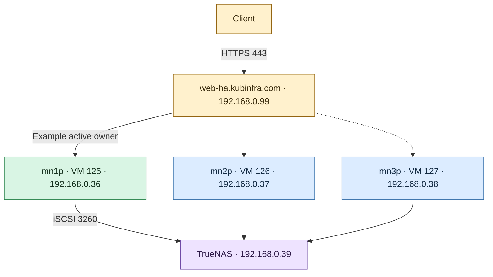
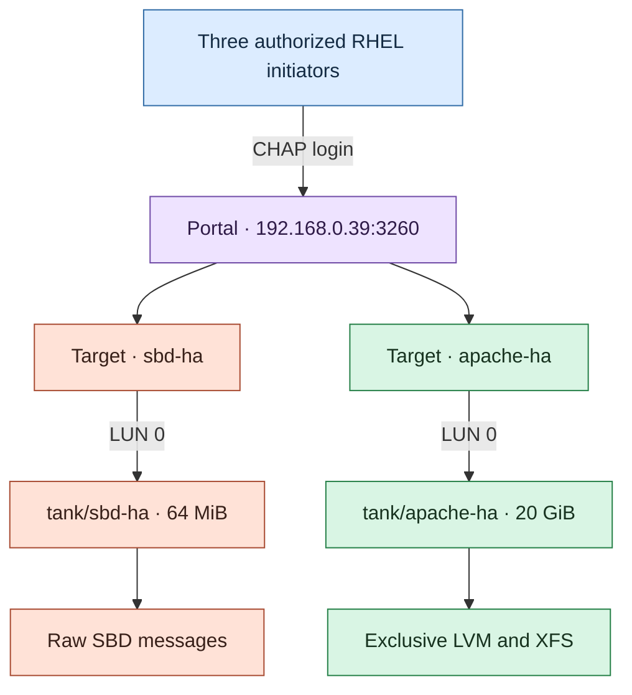
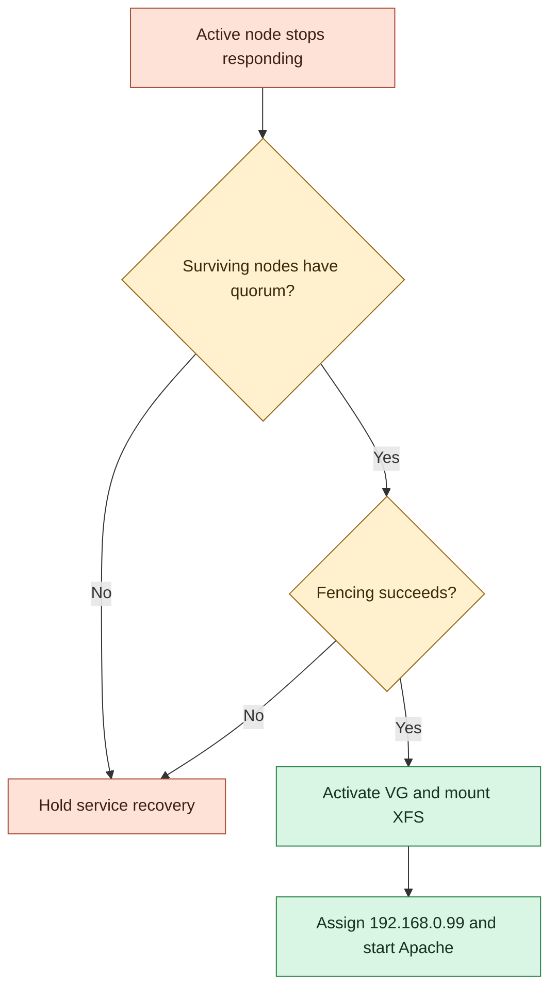
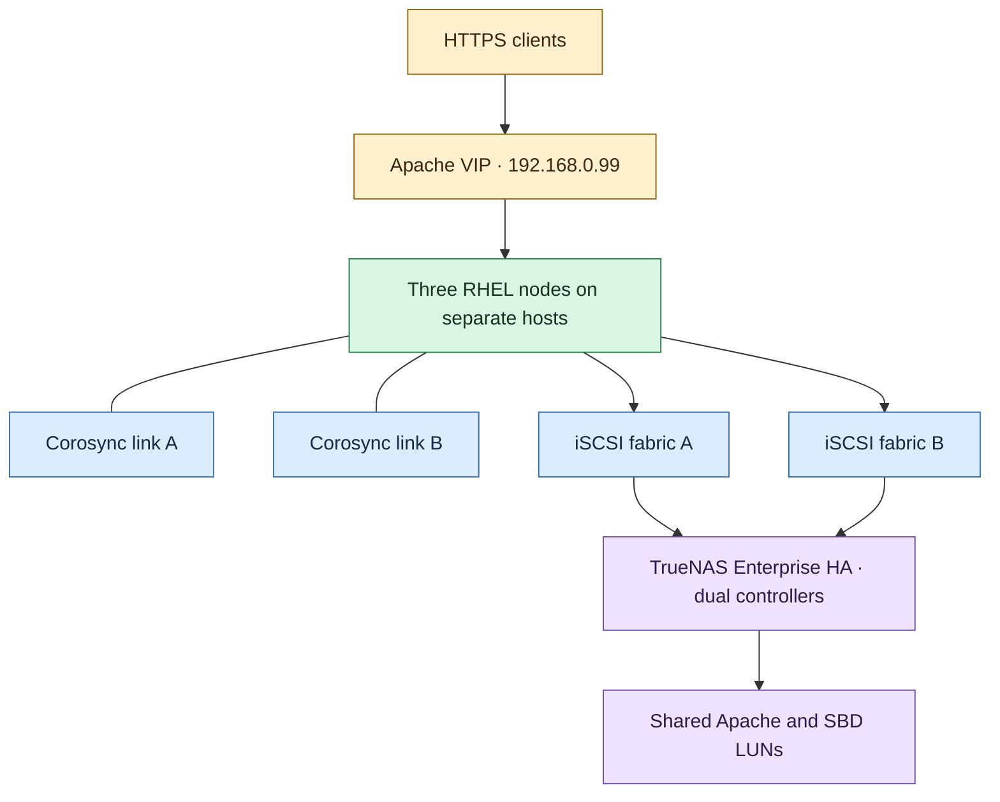

# RHEL 9.8 three-node Apache HA with Pacemaker, SBD and TrueNAS iSCSI

Build an active/passive Apache service on three RHEL 9.8 nodes. TrueNAS provides two shared iSCSI disks. Pacemaker uses one for the Apache filesystem and reserves the other for SBD fencing. Clients use the same HTTPS name and floating IP whichever node owns the service.

The commands use a **fresh cluster and empty LUNs**. If Apache or shared disks are already in use, schedule a migration and take verified backups before reassigning IPs or preparing disks.

**Deployment scope.** The exact addresses below build the single-network Proxmox lab. A single Proxmox host and single TrueNAS VM can demonstrate RHEL node failover. They are each a single point of failure. For production, apply the storage, host and network changes in [section 12](#12-production-deployment-and-sign-off) before commissioning. The procedure uses TrueNAS Community Edition 25.10 screens for the lab and TrueNAS Enterprise HA as the production storage design.

## 1. Reserve IP addresses and add DNS records

| System | DNS name | IPv4 address |
| --- | --- | --- |
| Node 1, Proxmox VM 125 | `mn1p.kubinfra.com` | `192.168.0.36/24` |
| Node 2, Proxmox VM 126 | `mn2p.kubinfra.com` | `192.168.0.37/24` |
| Node 3, Proxmox VM 127 | `mn3p.kubinfra.com` | `192.168.0.38/24` |
| TrueNAS storage server | `storage.kubinfra.com` | `192.168.0.39/24` |
| Apache floating IP (VIP) | `web-ha.kubinfra.com` | `192.168.0.99/24` |

Create these five A records in IPA DNS. Reserve the addresses outside DHCP and verify they are free before assigning them. Create PTR records for the three cluster nodes and TrueNAS if you manage the reverse zone. Keep `192.168.0.99` out of all static interface profiles. Pacemaker will add it to whichever node owns Apache.

For new records, run these commands on your IPA admin host with a DNS administrator ticket. For an existing name, edit its existing A value in IPA and confirm the name has only the intended address. [RHEL 9 IdM DNS records](https://docs.redhat.com/en/documentation/red_hat_enterprise_linux/9/html-single/working_with_dns_in_identity_management/index)

```bash
ipa dnsrecord-add kubinfra.com mn1p --a-rec=192.168.0.36
ipa dnsrecord-add kubinfra.com mn2p --a-rec=192.168.0.37
ipa dnsrecord-add kubinfra.com mn3p --a-rec=192.168.0.38
ipa dnsrecord-add kubinfra.com storage --a-rec=192.168.0.39
ipa dnsrecord-add kubinfra.com web-ha --a-rec=192.168.0.99
```

In the lab, connect the four VMs to the same Proxmox bridge and VLAN for `192.168.0.0/24`. Use the gateway and DNS servers for that subnet. The commands below use `192.168.0.1` as the gateway and `192.168.0.30` as the IPA DNS resolver. Change those two values if this subnet uses different settings. Verify that the bridge, switch and VM firewall permit the VIP and gratuitous ARP on all three nodes.



Each RHEL node has one Corosync vote. Any two connected nodes make quorum. The third node can host Apache and can vote, so this three-node design needs no external qdevice. TrueNAS supplies storage and has no Corosync vote. The dotted lines show that nodes 2 and 3 are also eligible to take the VIP.

## 2. Prepare the three RHEL nodes

### Set permanent hostnames and addresses

Run the appropriate block from each VM console as root. Use `nmcli -f NAME,DEVICE connection show --active` to identify the client interface profile. Replace `LAB_CONNECTION` with that profile name. Keep console access because reactivating the profile can disconnect SSH. If the IP settings are already correct, verify them with the commands that follow.

**Node 1, VM 125**

```bash
hostnamectl set-hostname mn1p.kubinfra.com
nmcli connection modify "LAB_CONNECTION" ipv4.method manual ipv4.addresses 192.168.0.36/24 ipv4.gateway 192.168.0.1 ipv4.dns 192.168.0.30 ipv4.dns-search kubinfra.com connection.autoconnect yes
nmcli connection up "LAB_CONNECTION"
```

**Node 2, VM 126**

```bash
hostnamectl set-hostname mn2p.kubinfra.com
nmcli connection modify "LAB_CONNECTION" ipv4.method manual ipv4.addresses 192.168.0.37/24 ipv4.gateway 192.168.0.1 ipv4.dns 192.168.0.30 ipv4.dns-search kubinfra.com connection.autoconnect yes
nmcli connection up "LAB_CONNECTION"
```

**Node 3, VM 127**

```bash
hostnamectl set-hostname mn3p.kubinfra.com
nmcli connection modify "LAB_CONNECTION" ipv4.method manual ipv4.addresses 192.168.0.38/24 ipv4.gateway 192.168.0.1 ipv4.dns 192.168.0.30 ipv4.dns-search kubinfra.com connection.autoconnect yes
nmcli connection up "LAB_CONNECTION"
```

**All three nodes**

```bash
hostnamectl --static
ip -br -4 address
ip route get 192.168.0.39
getent ahostsv4 mn1p.kubinfra.com mn2p.kubinfra.com mn3p.kubinfra.com storage.kubinfra.com web-ha.kubinfra.com
cat /etc/machine-id
```

Verify that the route uses the intended source IP on each node, DNS returns the IPs in the table, and the machine IDs are unique. Correct cloned identities before continuing.

### Install the cluster, storage and Apache packages

Review the RHEL release and entitled repositories on all three nodes. On Satellite, confirm BaseOS, AppStream and High Availability are published in the assigned content view and lifecycle environment. Use the supported update channel for your subscribed release. Confirm that a node pinned to 9.8 keeps receiving security and HA updates. [RHEL 9.8 release notes](https://docs.redhat.com/en/documentation/red_hat_enterprise_linux/9/html/9.8_release_notes/index) · [Red Hat lifecycle and EUS](https://access.redhat.com/support/policy/updates/errata)

```bash
cat /etc/redhat-release
subscription-manager release --show
dnf repolist --enabled
```

On directly subscribed x86_64 nodes using the standard CDN channel, enable the HA repository with the following command. On Satellite, enable the applicable repository from your assigned content view.

```bash
subscription-manager repos --enable=rhel-9-for-x86_64-highavailability-rpms
```

On all three nodes, install the packages and start the administrative services.

```bash
dnf install -y pcs pacemaker resource-agents sbd fence-agents-sbd iscsi-initiator-utils lvm2 xfsprogs httpd openssl wget curl policycoreutils-python-utils firewalld chrony
rpm -q pcs pacemaker sbd fence-agents-sbd
systemctl enable --now chronyd firewalld pcsd
passwd hacluster
chronyc tracking
chronyc sources -v
getenforce
firewall-cmd --get-active-zones
```

Set a strong `hacluster` password on each node. Use the same strong commissioning password on all three if you want one password prompt during initial `pcs host auth`. Keep SELinux enforcing and confirm chrony is synchronized.

Apply the following on all three nodes if the lab interface is in the `public` firewalld zone. Use the actual active zone if it differs. These rules give the three node IPs access to the cluster ports. The temporary VIP-only HTTP rule supports the lab verification in section 9. Admin access from a separate management subnet requires its own explicitly scoped SSH and, if used, TCP 2224 rule.

```bash
firewall-cmd --permanent --zone=public --add-rich-rule='rule family="ipv4" source address="192.168.0.36/32" service name="high-availability" accept'
firewall-cmd --permanent --zone=public --add-rich-rule='rule family="ipv4" source address="192.168.0.37/32" service name="high-availability" accept'
firewall-cmd --permanent --zone=public --add-rich-rule='rule family="ipv4" source address="192.168.0.38/32" service name="high-availability" accept'
firewall-cmd --permanent --zone=public --add-rich-rule='rule family="ipv4" source address="192.168.0.0/24" destination address="192.168.0.99/32" service name="http" accept'
firewall-cmd --reload
firewall-cmd --zone=public --list-all
```

### Record a unique iSCSI initiator name for every node

On each node, run `cat /etc/iscsi/initiatorname.iscsi`. An initiator IQN identifies a storage client. If these are fresh VMs, you can use the explicit IQNs below. Edit the existing `InitiatorName=` line on each node before discovering targets or starting iSCSI sessions. Reuse existing unique IQNs for nodes already using iSCSI and enter those exact strings on TrueNAS. Changing a live initiator's IQN breaks target access.

| Node | Example line in `/etc/iscsi/initiatorname.iscsi` | CHAP user used below |
| --- | --- | --- |
| `mn1p.kubinfra.com` | `InitiatorName=iqn.2026-11.com.kubinfra:mn1p` | `mn1p-ha` |
| `mn2p.kubinfra.com` | `InitiatorName=iqn.2026-11.com.kubinfra:mn2p` | `mn2p-ha` |
| `mn3p.kubinfra.com` | `InitiatorName=iqn.2026-11.com.kubinfra:mn3p` | `mn3p-ha` |

## 3. Install and configure TrueNAS

### Install the lab VM and set its address

1. Download the stable Community Edition ISO. In Proxmox create a dedicated TrueNAS VM with 2 vCPUs, 8 GiB of fixed RAM or more, a 32 GiB boot disk, two empty 50 GiB data disks and a bridged NIC on the lab network. Use a separate boot disk so reinstalling the OS and creating a pool are different operations. [TrueNAS download](https://www.truenas.com/download/) · [TrueNAS VM installation](https://www.truenas.com/docs/scale/25.10/gettingstarted/install/installingscale/)
2. Boot the ISO. Choose **Install/Upgrade**, select only the 32 GiB boot disk and set the local admin credentials. Installation erases the selected boot disk. Eject the ISO and boot the VM. Open the address shown on the console to sign in.
3. In **Network**, edit the lab NIC, turn off DHCP and add the static address `192.168.0.39/24` under **Aliases**. Save, select **Test Changes**, reconnect at `192.168.0.39` and confirm **Save Changes** before the timer expires. Keep the console open to recover access if the test rolls back. [TrueNAS interface settings](https://www.truenas.com/docs/scale/25.10/scaleuireference/network/networkinterfacescreens/)
4. Under **Network → Global Configuration**, set hostname `storage` and domain `kubinfra.com`. Use `192.168.0.1` for the IPv4 default gateway and `192.168.0.30` for the DNS resolver if those are your lab values. Verify DNS and time synchronization. Restrict Web UI access to trusted management clients. [TrueNAS global network settings](https://www.truenas.com/docs/scale/25.10/scaleuireference/network/globalconfigurationscreens/)
5. From each RHEL node, verify `getent ahostsv4 storage.kubinfra.com` resolves to `192.168.0.39` and `ip route get 192.168.0.39` selects the correct source address.

### Create a ZFS pool and two ZFS volumes

In **Storage → Create Pool**, name the pool `tank`. Choose **Mirror** for the data vdev and select both empty 50 GiB disks. Verify disk identities and sizes before confirming the pool creation. The selected disks are erased. If TrueNAS already has a suitable pool, create the two new volumes there and substitute that pool name in the extent settings. [TrueNAS pool creation](https://www.truenas.com/docs/scale/25.10/scaletutorials/storage/createpoolwizard/)

Under **Datasets**, select `tank` and choose **Add Zvol** twice. A zvol is a ZFS-backed block device that TrueNAS can present to RHEL as a disk.

| Zvol | Size | iSCSI extent | Target IQN | LUN |
| --- | --- | --- | --- | --- |
| `tank/sbd-ha` | 64 MiB | `sbd-ha-extent` | `iqn.2026-11.com.kubinfra:sbd-ha` | `0` |
| `tank/apache-ha` | 20 GiB | `apache-ha-extent` | `iqn.2026-11.com.kubinfra:apache-ha` | `0` |

Leave **Sparse** off so space is reserved. Keep sync at **Standard** to honor synchronous writes from the initiators. Preserve free capacity for normal ZFS operation and snapshots. Use the SBD volume exclusively for fencing metadata. Leave it raw and outside LVM. The Apache volume will hold the shared LVM and XFS stack. [TrueNAS zvol settings](https://www.truenas.com/docs/scale/25.10/scaleuireference/datasets/zvolsscreensscale/) · [Red Hat SBD device requirements](https://access.redhat.com/articles/2800691)

### Create and secure the iSCSI exports

In **Shares**, open the **Block (iSCSI) Shares Targets** screen. Use its manual tabs for this setup so the access policies and LUN associations are explicit. [TrueNAS iSCSI walkthrough](https://www.truenas.com/docs/scale/25.10/scaletutorials/shares/iscsi/addingiscsishares/) · [TrueNAS iSCSI field reference](https://www.truenas.com/docs/scale/25.10/scaleuireference/shares/iscsisharesscreens/)

1. In **Portals → Add**, create a portal with description `kubinfra-ha` and listen IP `192.168.0.39`. The iSCSI port is `3260/TCP`. Record the portal group ID TrueNAS assigns. Use this specific IP as the listener.
2. In **Initiators → Add**, clear **Allow All Initiators**. Add the three real IQNs from section 2, one per entry, and save. Record the initiator group ID. This allows the same three nodes to reach both targets.
3. In **Authorized Access → Add**, create three CHAP credential entries in one unused group, for example **Group ID 10**. Use one credential per node (`mn1p-ha`, `mn2p-ha`, `mn3p-ha`), each with its own randomly generated 12–16 character secret. Keep these in your password manager. Use **Discovery Authentication = None** for this lab and leave the peer fields empty. The next step requires CHAP for target login. Limit discovery to the cluster network.
4. In **Targets → Add**, create one target per row in the zvol table. Enter the **full IQN** as **Target Name** so these examples work even if you already use another global IQN prefix. Add a target group with the portal and initiator group IDs from steps 1–2. Set **Authentication Method** to **CHAP** and **Authentication Group Number** to `10` or the group you used. Under **Authorized Networks**, add `192.168.0.36/32`, `192.168.0.37/32` and `192.168.0.38/32` to both targets. Apply the matching TCP 3260 allowlist at the VM firewall or storage network access layer, especially on a shared VLAN.
5. In **Extents → Add**, create `sbd-ha-extent` and `apache-ha-extent`. Set each **Extent Type** to **Device** and select its own zvol from the table. Enable the extent and leave **Read-only** and **Enable TPC** off. Keep the default logical block size (`512`) for this lab. Keep the serial and device identity stable once clients are using a LUN.
6. In **Targets**, select each target and use **Extents → Associate** to attach its matching extent as **LUN ID 0**. These LUN numbers are scoped to the target. The two `LUN 0` entries refer to different disks with different identities.
7. Under **System → Services**, start **iSCSI** and enable **Start Automatically**. Confirm both targets and extents are enabled. Once RHEL logs in, check **iSCSI Connections** for three authorized initiators on each target.

CHAP authenticates logins. Use an isolated storage network in production to protect the iSCSI traffic. The lab's two virtual pool disks still depend on the Proxmox host and its underlying storage.



## 4. Log in from all three RHEL initiators

On these dedicated fresh nodes, set session CHAP defaults before discovery. Edit `/etc/iscsi/iscsid.conf` on each node and uncomment or set the three keys below. Enter the user and secret for **that node**. Keep discovery CHAP at its default for this lab. Protect the configuration and persistent node database as credentials. On a node with other iSCSI targets, scope credentials to the two new node records using `iscsiadm` per-target updates instead of changing global defaults. [RHEL 9 iSCSI initiator configuration](https://docs.redhat.com/en/documentation/red_hat_enterprise_linux/9/html/managing_storage_devices/configuring-an-iscsi-initiator_managing-storage-devices)

```ini
node.session.auth.authmethod = CHAP
node.session.auth.username = NODE_CHAP_USER
node.session.auth.password = NODE_CHAP_SECRET
```

Run the following on **all three** nodes. Discovery creates persistent records from the defaults for newly discovered targets. If you discovered these two targets before adding credentials, update those specific inactive records or remove just those unused records before rediscovering. Verify the IQNs match the two targets you created before logging in.

```bash
chmod 600 /etc/iscsi/iscsid.conf
systemctl start iscsid.service
iscsiadm -m discovery -t sendtargets -p 192.168.0.39:3260
iscsiadm -m node -T iqn.2026-11.com.kubinfra:sbd-ha -p 192.168.0.39:3260 --login
iscsiadm -m node -T iqn.2026-11.com.kubinfra:apache-ha -p 192.168.0.39:3260 --login
iscsiadm -m node -T iqn.2026-11.com.kubinfra:sbd-ha -p 192.168.0.39:3260 --op update -n node.startup -v automatic
iscsiadm -m node -T iqn.2026-11.com.kubinfra:apache-ha -p 192.168.0.39:3260 --op update -n node.startup -v automatic
systemctl enable --now iscsid.service iscsi.service
udevadm settle
iscsiadm -m session -P 3
ls -l /dev/disk/by-path/*iscsi*
lsblk -o NAME,SIZE,TYPE,FSTYPE,RO,WWN,SERIAL,MOUNTPOINTS
```

Example discovery output. The portal group tag after the comma can vary.

```text
192.168.0.39:3260,1 iqn.2026-11.com.kubinfra:sbd-ha
192.168.0.39:3260,1 iqn.2026-11.com.kubinfra:apache-ha
```

| Use | Expected single-portal device path | Capacity |
| --- | --- | --- |
| SBD | `/dev/disk/by-path/ip-192.168.0.39:3260-iscsi-iqn.2026-11.com.kubinfra:sbd-ha-lun-0` | 64 MiB |
| Apache data | `/dev/disk/by-path/ip-192.168.0.39:3260-iscsi-iqn.2026-11.com.kubinfra:apache-ha-lun-0` | 20 GiB |

Compare the serial or WWID of each LUN across all three nodes. Each LUN must have one consistent identity on every node, distinct from the other LUN, and `RO=0`. Resolve the two symlinks with `readlink -e`. The local `/dev/sdX` letters can differ across nodes and reboots. If a path is missing, check TrueNAS mapping, authorization and session details before touching any disk.

Reboot one RHEL node at a time before creating the cluster. Confirm both sessions and both disk paths return automatically. For production multipath, use the stable device-mapper paths from section 12 in place of all single-portal paths, including in the SBD configuration, LVM device list and fence agent.


## 5. Order iSCSI before the cluster

On **all three** RHEL nodes, keep iSCSI logins persistent and order Pacemaker after them. Create the following drop-in with `systemctl edit resource-agents-deps.target`. This follows the Red Hat procedure for a Pacemaker resource with an external iSCSI dependency. [RHEL 9 resource dependency ordering](https://docs.redhat.com/en/documentation/red_hat_enterprise_linux/9/html/configuring_and_managing_high_availability_clusters/assembly_determining-resource-order.adoc-configuring-and-managing-high-availability-clusters)

```ini
[Unit]
Requires=iscsi.service
After=iscsi.service
```

Also run `systemctl edit sbd.service` on each node and add the following. This orders the SBD startup after iSCSI login. The block device check makes startup fail if the raw fencing LUN is still missing. `Wants=` orders and requests login without binding the running SBD watchdog to the iSCSI unit's lifetime. Keep the watchdog running during a storage-path fault so SBD can react to it.

```ini
[Unit]
Wants=iscsi.service
After=iscsi.service

[Service]
ExecStartPre=/usr/bin/udevadm settle --timeout=20 --exit-if-exists=/dev/disk/by-path/ip-192.168.0.39:3260-iscsi-iqn.2026-11.com.kubinfra:sbd-ha-lun-0
ExecStartPre=/usr/bin/test -b /dev/disk/by-path/ip-192.168.0.39:3260-iscsi-iqn.2026-11.com.kubinfra:sbd-ha-lun-0
```

```bash
systemctl daemon-reload
systemctl cat resource-agents-deps.target sbd.service
systemctl status iscsi.service
iscsiadm -m session
```

On a multipath build, order the two drop-ins after both `iscsi.service` and `multipathd.service` and change the SBD preflight commands to the approved mapper device. Verify the installed vendor units and cold boot with both storage available and storage unavailable. A green iSCSI service status alone cannot prove that either LUN is present.

## 6. Create the cluster and prove SBD fencing

### Expose and test a watchdog on each RHEL VM

For the lab, with the guests shut down, add **Watchdog** under each VM's **Hardware** tab, choose model **i6300esb** and select **Reset**. The equivalent commands on the **Proxmox host** are below. Each RHEL node needs its own watchdog. The TrueNAS VM does not need a cluster watchdog. [Proxmox VM watchdog options](https://pve.proxmox.com/pve-docs/qm.conf.5.html) · [Red Hat SBD watchdog support policy](https://access.redhat.com/articles/2800691)

```bash
qm set 125 --watchdog model=i6300esb,action=reset
qm set 126 --watchdog model=i6300esb,action=reset
qm set 127 --watchdog model=i6300esb,action=reset
```

Boot the three guests. In each guest, confirm the device and its identity. If it is absent, check the VM hardware and load the lab driver with `modprobe i6300esb`. Check that the driver returns after a reboot. If it needs explicit boot-time loading, add `i6300esb` on its own line in `/etc/modules-load.d/sbd-watchdog.conf`.

```bash
ls -l /dev/watchdog*
cat /sys/class/watchdog/watchdog0/identity
systemctl show --property=RuntimeWatchdogUSec
pcs stonith sbd watchdog list
pcs stonith sbd watchdog test --help
```

Make the identified device exclusive to SBD. Check that systemd's runtime watchdog or any other watchdog daemon is not holding it. For production use a hardware watchdog or a supported virtual watchdog for the exact RHEL and hypervisor combination. Red Hat documents the libvirt/KVM i6300esb configuration. Confirm the support scope separately for Proxmox.

Run the watchdog test on each **empty lab or commissioning node**, one at a time, with console access and before SBD takes ownership of the device. It intentionally resets the guest. Use the device verified above.

```bash
pcs stonith sbd watchdog test /dev/watchdog0
```

After each reset, verify `uptime -s`, the iSCSI sessions and both disk paths. Resolve failures before commissioning SBD.

### Configure Corosync and verify quorum

Run from **node 1**. This setup uses one Corosync link on the requested subnet. Configure the redundant links in section 12 at initial setup for production. Cluster node names must match the hostnames on the three nodes.

```bash
pcs host auth mn1p.kubinfra.com mn2p.kubinfra.com mn3p.kubinfra.com -u hacluster
pcs cluster setup apache-ha mn1p.kubinfra.com addr=192.168.0.36 mn2p.kubinfra.com addr=192.168.0.37 mn3p.kubinfra.com addr=192.168.0.38
pcs cluster start --all
pcs property set stonith-enabled=true startup-fencing=true no-quorum-policy=stop
pcs status nodes
pcs quorum status
```

Example healthy output. Two connected members retain quorum when one member goes down. A node alone has one vote and cannot maintain the service.

```text
Nodes:            3
Quorate:          Yes
Expected votes:   3
Total votes:      3
Quorum:           2
```

### Initialize the raw SBD disk

SBD uses the shared block device as a mailbox. A survivor sends a reset message to the failed node's slot. SBD and the node's watchdog provide the reset mechanism. Pacemaker waits for fencing before it can safely recover the failed owner's workload. Use a hardware or supported virtual watchdog and keep `stonith-enabled=true`.

The commissioning example uses a 20-second watchdog, 40-second SBD message wait, 70-second agent power timeout and 90-second Pacemaker fencing deadline. Validate those values against the watchdog's supported range and observed iSCSI path recovery and I/O timeouts. The message wait must allow at least two watchdog intervals. The fence operation needs enough time for the message wait plus storage and scheduling delays. [Red Hat SBD support policy](https://access.redhat.com/articles/2800691) · [Red Hat fence_sbd timeout guidance](https://access.redhat.com/solutions/6115821)

Run from **node 1**. Stop the empty cluster first. Check the SBD disk's serial and capacity against the TrueNAS mapping and the other nodes. The next initialization writes to the chosen disk. Confirm it is the new 64 MiB `sbd-ha` zvol and that `wipefs -n` shows no signatures. An existing SBD disk can also have no recognized signature, so use the new zvol identity as the primary check.

```bash
pcs cluster stop --all
lsblk -o NAME,SIZE,TYPE,FSTYPE,RO,WWN,SERIAL,MOUNTPOINTS
wipefs -n /dev/disk/by-path/ip-192.168.0.39:3260-iscsi-iqn.2026-11.com.kubinfra:sbd-ha-lun-0
pcs stonith sbd device setup --help
pcs stonith sbd enable --help
```

Initialize SBD **once**, from node 1, and enable it across the three nodes. This example uses `/dev/watchdog0` on all three. If a supported watchdog has a different local path, use `watchdog=/dev/watchdogN@NODE_NAME` for that node as shown by the local pcs help.

```bash
pcs stonith sbd device setup \
  device=/dev/disk/by-path/ip-192.168.0.39:3260-iscsi-iqn.2026-11.com.kubinfra:sbd-ha-lun-0 \
  watchdog-timeout=20 msgwait-timeout=40

pcs stonith sbd enable \
  watchdog=/dev/watchdog0 \
  device=/dev/disk/by-path/ip-192.168.0.39:3260-iscsi-iqn.2026-11.com.kubinfra:sbd-ha-lun-0 \
  SBD_WATCHDOG_TIMEOUT=20 SBD_DELAY_START=yes
```

Run `pcs cluster start` **locally on each of the three nodes** and allow the SBD startup delay. Then use the following from node 1. A healthy SBD status reports installed, enabled and running on each node. Check that the shared header shows watchdog 20 and msgwait 40 and that all three SBD slots match the cluster node names.

```bash
pcs stonith sbd config
pcs stonith sbd status --full
sbd -d /dev/disk/by-path/ip-192.168.0.39:3260-iscsi-iqn.2026-11.com.kubinfra:sbd-ha-lun-0 list
pcs quorum status
```

### Add the fencing resource and verify all three reset paths

Run on node 1. Keep the fence agent's cycle method and use the explicit shared-disk fence messages. Leave `stonith-watchdog-timeout` at its default of zero for this design. Pacemaker's watchdog-only fencing uses a different configuration.

```bash
pcs stonith describe fence_sbd
pcs property set stonith-action=reboot stonith-timeout=90s
pcs stonith create sbd-fence fence_sbd \
  devices=/dev/disk/by-path/ip-192.168.0.39:3260-iscsi-iqn.2026-11.com.kubinfra:sbd-ha-lun-0 \
  pcmk_host_check=static-list \
  pcmk_host_list="mn1p.kubinfra.com mn2p.kubinfra.com mn3p.kubinfra.com" \
  power_timeout=70 pcmk_reboot_timeout=90s op monitor interval=60s timeout=30s
pcs stonith config
pcs status --full
```

If the agent or Pacemaker reports a timeout mismatch, compare the disk header, the local `fence_sbd` metadata and the effective Pacemaker timeout. Validate the whole timing chain in fault tests. The example values are starting points for commissioning.

Run these tests **one at a time**. Wait for all three nodes to rejoin, reach quorum and report healthy SBD before starting the next test.

| From | Command | Expected observation |
| --- | --- | --- |
| Node 1 | `pcs stonith fence mn2p.kubinfra.com` | Node 2 resets and rejoins |
| Node 1 | `pcs stonith fence mn3p.kubinfra.com` | Node 3 resets and rejoins |
| Node 2 | `pcs stonith fence mn1p.kubinfra.com` | Node 1 resets and rejoins |

Check fencing history from a surviving node and verify the reboot independently in the target VM console or hardware event log. On the rebooted node, check `uptime -s` and both persistent iSCSI sessions. Build the Apache resources only after all three targets pass.

```bash
pcs stonith history
pcs status nodes
pcs quorum status
journalctl --list-boots
journalctl -b -u iscsi -u sbd -u corosync -u pacemaker
```



## 7. Create exclusive LVM and XFS on the Apache disk

Edit the existing `global` section of `/etc/lvm/lvm.conf` on **all three** nodes. Set `system_id_source` as shown. This uses the node's kernel hostname as its LVM system ID. Each node must report its own nonempty ID. [RHEL 9 active/passive Apache and HA-LVM](https://docs.redhat.com/en/documentation/red_hat_enterprise_linux/9/html/configuring_and_managing_high_availability_clusters/assembly_configuring-active-passive-http-server-in-a-cluster-configuring-and-managing-high-availability-clusters)

```text
global {
    system_id_source = "uname"
}
```

```bash
lvm systemid
lvmconfig --type full devices/use_devicesfile
```

On **node 1 only**, verify the `apache-ha` LUN's 20 GiB identity. The commands below write metadata. Run them only against the confirmed new Apache volume. `--setautoactivation n` leaves activation to Pacemaker once the filesystem has been created.

```bash
wipefs -n /dev/disk/by-path/ip-192.168.0.39:3260-iscsi-iqn.2026-11.com.kubinfra:apache-ha-lun-0
lsblk -o NAME,SIZE,TYPE,FSTYPE,WWN,SERIAL,MOUNTPOINTS
pvcreate /dev/disk/by-path/ip-192.168.0.39:3260-iscsi-iqn.2026-11.com.kubinfra:apache-ha-lun-0
vgcreate --setautoactivation n vg_apache /dev/disk/by-path/ip-192.168.0.39:3260-iscsi-iqn.2026-11.com.kubinfra:apache-ha-lun-0
lvcreate -L 16G -n lv_web vg_apache
mkfs.xfs /dev/vg_apache/lv_web
vgcfgbackup vg_apache
```

On **nodes 2 and 3**, add the same Apache PV if the devices file is enabled, as it normally is on RHEL 9. The other nodes should see the foreign VG and must leave it inactive. `pvcreate` or `mkfs` on another node would overwrite the shared volume.

```bash
lvmdevices --adddev /dev/disk/by-path/ip-192.168.0.39:3260-iscsi-iqn.2026-11.com.kubinfra:apache-ha-lun-0
vgs --foreign -o vg_name,systemid
```

Create the directory and persistent SELinux mapping on **all three** nodes.

```bash
mkdir -p /srv/apache-ha
semanage fcontext -a -t httpd_sys_content_t '/srv/apache-ha(/.*)?'
restorecon -v /srv/apache-ha
```

On **node 1 only**, mount XFS once to seed it. Apply the labels to the files **while the shared filesystem is mounted**, then unmount and deactivate the VG.

```bash
mount /dev/vg_apache/lv_web /srv/apache-ha
printf '%s\n' '<h1>Kubinfra Apache HA</h1>' > /srv/apache-ha/index.html
printf '%s\n' 'apache-ha-shared-ok' > /srv/apache-ha/healthz.txt
restorecon -Rv /srv/apache-ha
ls -lZ /srv/apache-ha
umount /srv/apache-ha
vgchange -an vg_apache
```

Keep this XFS filesystem out of `/etc/fstab`. Pacemaker owns activation and mounting. XFS is a single-node filesystem here. LVM system IDs control which node can activate the VG and fencing protects against an old owner still writing.

## 8. Configure Apache on all three nodes

On each node, disable standalone systemd startup so Pacemaker can manage Apache. The resource agent uses the loopback HTTP listener and local `/server-status` endpoint. Keep the status endpoint restricted to local requests.

```bash
systemctl disable --now httpd
httpd -M
```

Create `/etc/httpd/conf.d/apache-ha.conf`. Enter the current node's hostname in `X-HA-Node`. The example shows node 1. Use `mn2p.kubinfra.com` on node 2 and `mn3p.kubinfra.com` on node 3. This header lets you identify which VM served a request during failover tests. Use it only where exposing hostnames to the service's clients is acceptable.

```apache
ServerName web-ha.kubinfra.com
DocumentRoot "/srv/apache-ha"

<Directory "/srv/apache-ha">
    Options -Indexes
    AllowOverride None
    Require all granted
</Directory>

<Location "/server-status">
    SetHandler server-status
    Require local
</Location>

Header always set X-HA-Node "mn1p.kubinfra.com"
```

Check `httpd -M` for `status_module` and `headers_module`, then run `httpd -t` on every node. Leave Apache stopped until PCS starts it.

## 9. Create the PCS group and test HTTP in the lab

Run from **node 1**. Confirm the client NIC with `ip -br -4 address`. `IPaddr2` can select the interface from the subnet route in this topology. If more than one interface matches, set `nic=` to the correct common interface name or plan node-specific attributes.

Group members start in order and stop in reverse order. The initially disabled VG keeps the group stopped while you define all its members. Stickiness favors the current owner after a previously failed node returns.

```bash
pcs resource defaults update resource-stickiness=100
pcs resource create apache-vg ocf:heartbeat:LVM-activate \
  vgname=vg_apache vg_access_mode=system_id op monitor interval=30s \
  --group apache-group --disabled
pcs resource create apache-fs ocf:heartbeat:Filesystem \
  device=/dev/vg_apache/lv_web directory=/srv/apache-ha fstype=xfs \
  op monitor interval=20s --group apache-group
pcs resource create apache-vip ocf:heartbeat:IPaddr2 \
  ip=192.168.0.99 cidr_netmask=24 op monitor interval=10s --group apache-group
pcs resource create apache-web ocf:heartbeat:apache \
  configfile=/etc/httpd/conf/httpd.conf statusurl=http://127.0.0.1/server-status \
  op monitor interval=15s meta migration-threshold=2 failure-timeout=300s \
  --group apache-group
pcs resource enable apache-vg
pcs status --full
pcs resource config
```

Example healthy output. Any one node can own the whole group. The Apache migration threshold in this example allows a local restart for the first monitor failure and can move the group after repeated failures on a node.

```text
Resource Group: apache-group
  apache-vg   (ocf:heartbeat:LVM-activate): Started mn1p.kubinfra.com
  apache-fs   (ocf:heartbeat:Filesystem):   Started mn1p.kubinfra.com
  apache-vip  (ocf:heartbeat:IPaddr2):      Started mn1p.kubinfra.com
  apache-web  (ocf:heartbeat:apache):       Started mn1p.kubinfra.com
```

Compare `findmnt --mountpoint /srv/apache-ha`, `lvs -o vg_name,lv_name,lv_active` and `ip -br -4 address` across the three nodes. Exactly one node should own the shared mount, active LV and VIP. On the active node, verify the resource agent's local HTTP monitor.

```bash
curl -fsS 'http://127.0.0.1/server-status?auto'
```

From a separate client on the lab subnet, verify a successful request for the file on the shared XFS volume.

```bash
curl -fsSi --resolve web-ha.kubinfra.com:80:192.168.0.99 http://web-ha.kubinfra.com/healthz.txt
```

The VIP can respond to ARP before Apache and XFS are ready to serve the application. Use the HTTP status and expected health body to judge service readiness.

```text
HTTP/1.1 200 OK
X-HA-Node: mn1p.kubinfra.com

apache-ha-shared-ok
```

## 10. Deploy HTTPS before opening the service to production clients

Obtain a trusted server certificate whose Subject Alternative Name includes `web-ha.kubinfra.com`. You can use the IPA CA at `ipa.kubinfra.com` for internal clients that trust that CA. Use your CA's approved issuance and renewal process. For a manual enrollment, run the CSR commands below from a secure admin host or one node. Use new paths and store the resulting private key securely. Submit only the CSR to the CA.

```bash
umask 077
openssl req -new -newkey rsa:3072 -noenc \
  -keyout /root/web-ha.key -out /root/web-ha.csr \
  -subj '/CN=web-ha.kubinfra.com' \
  -addext 'subjectAltName=DNS:web-ha.kubinfra.com'
openssl req -in /root/web-ha.csr -noout -verify -text
```

On **all three nodes**, install `mod_ssl` with `dnf install -y mod_ssl`. Put the issued leaf certificate followed by any intermediate certificates in `/etc/pki/tls/certs/web-ha-fullchain.pem`. Deploy the matching private key through your approved secret-handling process to `/etc/pki/tls/private/web-ha.key`. Set owner `root:root`, key mode `0600` and certificate mode `0644`. Install the issuing CA in the relevant client trust stores. Keep the key and configs local on each node so a service start can validate them.

```bash
chown root:root /etc/pki/tls/certs/web-ha-fullchain.pem /etc/pki/tls/private/web-ha.key
chmod 0644 /etc/pki/tls/certs/web-ha-fullchain.pem
chmod 0600 /etc/pki/tls/private/web-ha.key
restorecon -v /etc/pki/tls/certs/web-ha-fullchain.pem /etc/pki/tls/private/web-ha.key
openssl x509 -in /etc/pki/tls/certs/web-ha-fullchain.pem -noout -subject -issuer -dates -ext subjectAltName
```

In the package-provided `/etc/httpd/conf.d/ssl.conf` retain the `Listen 443 https` line and global SSL settings. Remove the packaged sample `<VirtualHost _default_:443>` block or configure a deliberate rejecting fallback. Create `/etc/httpd/conf.d/web-ha-tls.conf`.

```apache
<VirtualHost *:443>
    ServerName web-ha.kubinfra.com
    DocumentRoot "/srv/apache-ha"
    SSLEngine on
    SSLCertificateFile /etc/pki/tls/certs/web-ha-fullchain.pem
    SSLCertificateKeyFile /etc/pki/tls/private/web-ha.key
</VirtualHost>
```

Run `httpd -t` and `httpd -S` on all nodes and check the named HTTPS virtual host. During initial commissioning, open the VIP-only client HTTPS rule, remove the temporary HTTP rule and restart only the Apache resource from an online cluster node. Loopback port 80 still serves the local monitor. On a live cluster, stage and verify changes on the passive nodes, migrate to a prepared node in a change window, then finish the former owner. Use your approved client networks for production.

```bash
firewall-cmd --permanent --zone=public --add-rich-rule='rule family="ipv4" source address="192.168.0.0/24" destination address="192.168.0.99/32" service name="https" accept'
firewall-cmd --permanent --zone=public --remove-rich-rule='rule family="ipv4" source address="192.168.0.0/24" destination address="192.168.0.99/32" service name="http" accept'
firewall-cmd --reload
```

```bash
pcs resource restart apache-web
pcs status --full
```

Verify from a separate client with CA trust configured. The first request checks the exact VIP. The second also checks client DNS. When using a CA outside the system trust store, add `--cacert /path/to/ca.pem` to curl.

```bash
curl -fsSi --resolve web-ha.kubinfra.com:443:192.168.0.99 https://web-ha.kubinfra.com/healthz.txt
curl -fsS https://web-ha.kubinfra.com/healthz.txt
```


## 11. Verify failover and record acceptance results

Run these tests with console access, disposable data and a client on the service network. Use one failure at a time until the cluster is back to a healthy baseline. Record the starting owner, timestamps, fence or reset evidence, new owner, and time until a trusted HTTPS request returns the expected health body.

| Test | Action | Pass criteria |
| --- | --- | --- |
| Planned move | Put the active node in standby. | The resources stop in reverse order and restart together on an eligible peer. HTTPS keeps the same VIP and health body. |
| Fence each active owner | From another node, run the applicable `pcs stonith fence` command from section 6. Repeat until each node has hosted the group and been fenced as owner. | The old owner resets, fence history records success, and one surviving node mounts XFS and serves HTTPS. |
| Abrupt RHEL node loss | Power off only the active RHEL VM from the lab hypervisor console. | The connected pair stays quorate. Recovery waits for fencing and leaves one owner. Check the console, fence history and resource timestamps. |
| Corosync partition | Isolate one node on every Corosync link while keeping its iSCSI paths and the other two nodes' connection. | The connected pair stays quorate. By the time the service is recovered, the isolated node has been excluded from service and the shared VG and XFS have one owner. |
| Loss of majority | In the isolated test environment, gracefully stop the cluster stack on two nodes. | The last node has one vote and stops Apache, VIP and storage resources. Restore a peer and verify recovery. |
| One storage path or controller fails | On the production topology, fail each fabric and controller separately using the approved test plan. | The same devices remain available through surviving paths and fencing stays healthy. Service meets the recovery objective. |
| A node loses all storage paths | Remove storage connectivity to one node in a controlled test. Test both an active owner and a passive node. | The cluster never activates the same XFS volume on both sides. Validate watchdog, I/O recovery and fencing behavior against the agreed failure matrix. |
| TrueNAS outage | In the lab, stop the TrueNAS VM after recording healthy state. Restore it and verify both sessions and both LUN identities before recovering the service. | The single-target lab loses shared storage. Surviving RHEL votes alone cannot provide Apache data during that outage. Verify safe recovery after TrueNAS is back. |
| Cold boot and delayed target | Reboot a RHEL node with TrueNAS online. Then test delayed or unavailable storage at boot, including a missing SBD LUN in the commissioning environment. | Both iSCSI disks return automatically on normal boot. SBD is healthy before the node serves clients. An unprotected node never brings up the group. |

Planned move example with node 1 active. From an online node, put node 1 in standby and wait for the group to start on another node. Confirm HTTPS from the client, then bring node 1 back into eligibility. To exercise a specific destination in a test, temporarily put the third, passive node in standby as well. Standby nodes still participate in Corosync quorum. Restore all standby flags after the test.

```bash
pcs node standby mn1p.kubinfra.com
pcs status --full
pcs node unstandby mn1p.kubinfra.com
pcs status --full
```

Repeat these checks from the client during the move. The `X-HA-Node` header changes with the owner. The health body stays `apache-ha-shared-ok`.

```bash
watch -n 1 'date -Ins; curl -fsSi --max-time 3 --resolve web-ha.kubinfra.com:443:192.168.0.99 https://web-ha.kubinfra.com/healthz.txt'
```

Once the tests pass, enable cluster startup on boot. Repeat a staged reboot of one node at a time with autostart enabled. The Proxmox lab can start the TrueNAS VM first. Verify actual iSCSI login and device readiness when the RHEL nodes boot.

```bash
pcs cluster enable --all
pcs status --full
systemd-analyze critical-chain sbd.service pacemaker.service
```

If a clean boot occurred before storage was ready, verify storage is back and reconnect the two automatic sessions with `iscsiadm -m node --loginall=automatic` on the affected dedicated node. Verify both paths and the watchdog before running `pcs cluster start` locally. Check `pcs stonith sbd status --full` and `pcs status --full` from a surviving node. If a fence or XFS recovery is still unresolved, follow section 13 before restarting the workload.

## 12. Production deployment and sign-off

Retain the requested client-facing node addresses and Apache VIP if the production network uses this subnet. Reserve separate storage and Corosync addresses during design. The production commands must use those addresses and the actual LUN WWIDs from the certified design.



### Select independent failure domains

- **RHEL hosts and watchdogs.** Place the three nodes on separate physical hosts and distribute power and network failure domains. Size every node to carry the entire Apache workload after failover. Validate the hypervisor, guest, watchdog, iSCSI network and maintenance procedures with Red Hat for your exact versions. [Red Hat virtualized HA support](https://access.redhat.com/articles/3131111) · [Red Hat SBD watchdog requirements](https://access.redhat.com/articles/2800691)
- **TrueNAS storage.** Use a supported TrueNAS Enterprise HA system with redundant controllers, redundant media, power and separate iSCSI fabrics. Use the TrueNAS-supported firmware and storage design. TrueNAS documents virtual pool disks for proof-of-concept use. [TrueNAS hardware and virtualization guidance](https://www.truenas.com/docs/scale/gettingstarted/tnhardwareguide/) · [TrueNAS Enterprise networking](https://www.truenas.com/docs/solutions/optimizations/networking/)
- **Network separation.** Isolate management, client, Corosync and iSCSI traffic. Use two independent Corosync links and two storage paths with their own NICs and switch failure domains. Configure the dedicated static addresses and firewall rules for each network. Verify that the two iSCSI portal routes leave from their intended NICs and source IPs.
- **SBD availability.** Both lab zvols share one storage system. Two zvols in one array still share that array's failure domain. If the service must fence through complete loss of that system, validate an independent fencing path or an independently backed SBD device design with Red Hat. Where three SBD devices are chosen for storage fault tolerance, place them in independent failure domains and validate device-majority behavior. Apache also needs reachable data storage to survive a total array failure. [Red Hat storage-based fencing policy](https://access.redhat.com/articles/2800691) · [Red Hat general fencing policy](https://access.redhat.com/articles/2881341)

### Bring up redundant Corosync and iSCSI

1. At fresh setup, replace the single-link `pcs cluster setup` in section 6 with two addresses per node. Use the actual names and addresses from your approved production network plan. Register each address on the intended interface and open the cluster traffic between peers on both links. This template illustrates the `addr=` order. [RHEL 9 cluster creation](https://docs.redhat.com/en/documentation/red_hat_enterprise_linux/9/html-single/configuring_and_managing_high_availability_clusters/index)

   ```bash
   pcs cluster setup apache-ha \
     mn1p.kubinfra.com addr=LINK_A_NODE1 addr=LINK_B_NODE1 \
     mn2p.kubinfra.com addr=LINK_A_NODE2 addr=LINK_B_NODE2 \
     mn3p.kubinfra.com addr=LINK_A_NODE3 addr=LINK_B_NODE3
   ```

2. Configure TrueNAS Enterprise HA networking and iSCSI with the vendor-approved portal addresses on both fabrics. Present the same two writable extents with consistent LUN identities on all paths. Apply initiator and CHAP policy on every path. Enable ALUA on the Enterprise HA system according to TrueNAS guidance and use the supported RHEL initiator settings. [TrueNAS Enterprise HA network settings](https://www.truenas.com/docs/scale/25.10/scaletutorials/network/managenetworksettingsha/) · [TrueNAS iSCSI and ALUA](https://www.truenas.com/docs/solutions/optimizations/networking/)
3. On every RHEL node, install `device-mapper-multipath` and apply TrueNAS and Red Hat's supported device profile in `/etc/multipath.conf`. Use the approved path grouping, path checker, I/O recovery and bounded all-paths-down behavior. Indefinite I/O queueing can prevent a clean stop or delay fencing. Validate the profile and enable `multipathd`. [RHEL 9 DM Multipath configuration](https://docs.redhat.com/en/documentation/red_hat_enterprise_linux/9/html/configuring_device_mapper_multipath/configuring-dm-multipath_configuring-device-mapper-multipath) · [RHEL 9 DM Multipath troubleshooting](https://docs.redhat.com/en/documentation/red_hat_enterprise_linux/9/html/configuring_device_mapper_multipath/troubleshooting-dm-multipath)

   ```bash
   dnf install -y device-mapper-multipath
   multipath -t
   systemctl enable --now multipathd.service
   ```

4. Run the discovery, login and `node.startup=automatic` commands in section 4 for each target on each approved portal. Use the per-fabric portal IP in each `-p` argument. If multiple NICs can reach the same portal, use the vendor-approved iSCSI interface binding. Confirm multiple healthy paths per WWID and the same WWIDs on all nodes.

   ```bash
   iscsiadm -m session -P 3
   multipath -ll
   ls -l /dev/disk/by-id/dm-uuid-mpath-*
   corosync-cfgtool -s
   ```

   Keep the two mapper identities recorded in the build inventory. For each LUN use its `/dev/disk/by-id/dm-uuid-mpath-<WWID>` or its explicit common mapper alias in the SBD, fencing and LVM steps. Resolve the symlinks and verify the expected mapper before initializing either volume. Use the raw component paths only for diagnostics. In section 5, add `multipathd.service` to the storage unit ordering and point the SBD block check at the mapper.
5. Test continuity and safe fencing when each path, switch, TrueNAS controller and RHEL host fails independently. Measure controller failover and all-paths-down behavior before setting SBD and Pacemaker deadlines. Confirm the recovery behavior with your storage and HA support contacts.

**Production handover.** Record the supported versions and subscriptions, node-to-host placements, portal IPs, LUN WWIDs, tested fencing deadlines, backup restore evidence, certificate renewal owner, and the agreed recovery time and recovery point objectives. Sign off only after section 11 passes on the production topology and your monitoring can detect each fault that matters to the service.

## 13. Operate and troubleshoot the cluster

| Symptom | Checks and recovery |
| --- | --- |
| Discovery returns no targets | Verify the TrueNAS iSCSI service, the listen IP and port, the initiator IQN and allowed source IP, and any firewall or VLAN rules. |
| Discovery works but login fails | Compare the target group, CHAP group, and that node's CHAP credentials. Existing RHEL node records may predate the credential changes. Correct only the affected records and preserve authorization on working nodes. |
| iSCSI login works but a disk is missing | In TrueNAS check target-to-extent association, LUN ID and extent enabled status. Compare `iscsiadm -m session -P 3`, `lsblk` and, where used, `multipath -ll`. |
| SBD fails at boot | Verify the true device path, auto-login, watchdog exclusivity, storage unit ordering, and `journalctl -b -u iscsi -u sbd`. Correct the underlying fault before retrying local cluster start. |
| Fencing fails or XFS will not move | Inspect `pcs stonith history` and `pcs stonith sbd status --full`, then verify the old owner's actual state from its console and check that both LUNs are healthy. Keep fencing enabled. Leave VG activation and filesystem recovery to Pacemaker until the old owner is isolated. |
| Apache is started but HTTPS fails | Check the group owner, `findmnt --mountpoint /srv/apache-ha`, `ip -br -4 address`, `httpd -S`, the Apache error log, SELinux AVCs and certificate trust. Run `pcs resource cleanup apache-web` only after correcting the fault. |

- **Patching.** Confirm all three nodes, storage paths and fencing are healthy. Put one node in standby, verify that the service runs on a different node, then stop the local stack with `pcs cluster stop` on the node being patched. Patch and reboot it. Check its storage, SBD and membership before unstandby. Repeat one node at a time. Schedule TrueNAS controller and pool maintenance separately from RHEL maintenance.
- **Backups.** Keep encrypted off-host copies of the TrueNAS configuration, applicable key material, PCS configuration, Apache config and certificates, LVM metadata and website data. Use `pcs config backup --help` for the local backup syntax. Coordinate application-consistent data snapshots and test a restore on isolated storage. Treat the SBD LUN as live fencing state. Recreate it only in a planned cluster recovery with all nodes safely stopped. Avoid rolling back a live SBD zvol.
- **Monitoring.** Alert on loss of quorum or a member, failed STONITH, SBD/watchdog errors, path loss, failed iSCSI sessions, TrueNAS pool degradation or low capacity, and expired or soon-to-expire certificates. Use an independent HTTPS health check for the expected body and measured response time. Keep cluster diagnostics and reset logs long enough to correlate an incident.

## References

- [Red Hat RHEL 9 active/passive Apache cluster](https://docs.redhat.com/en/documentation/red_hat_enterprise_linux/9/html/configuring_and_managing_high_availability_clusters/assembly_configuring-active-passive-http-server-in-a-cluster-configuring-and-managing-high-availability-clusters)
- [Red Hat RHEL 9 High Availability administration guide](https://docs.redhat.com/en/documentation/red_hat_enterprise_linux/9/html-single/configuring_and_managing_high_availability_clusters/index)
- [Red Hat RHEL 9 iSCSI initiator](https://docs.redhat.com/en/documentation/red_hat_enterprise_linux/9/html/managing_storage_devices/configuring-an-iscsi-initiator_managing-storage-devices)
- [Red Hat SBD and fence_sbd support policy](https://access.redhat.com/articles/2800691)
- [Red Hat general fencing policy](https://access.redhat.com/articles/2881341)
- [Red Hat fence_sbd timeout advisory](https://access.redhat.com/solutions/6115821)
- [TrueNAS 25.10 installation](https://www.truenas.com/docs/scale/25.10/gettingstarted/install/installingscale/)
- [TrueNAS 25.10 iSCSI block shares](https://www.truenas.com/docs/scale/25.10/scaletutorials/shares/iscsi/addingiscsishares/)
- [TrueNAS 25.10 iSCSI share screen reference](https://www.truenas.com/docs/scale/25.10/scaleuireference/shares/iscsisharesscreens/)
- [TrueNAS Enterprise network and storage path recommendations](https://www.truenas.com/docs/solutions/optimizations/networking/)
