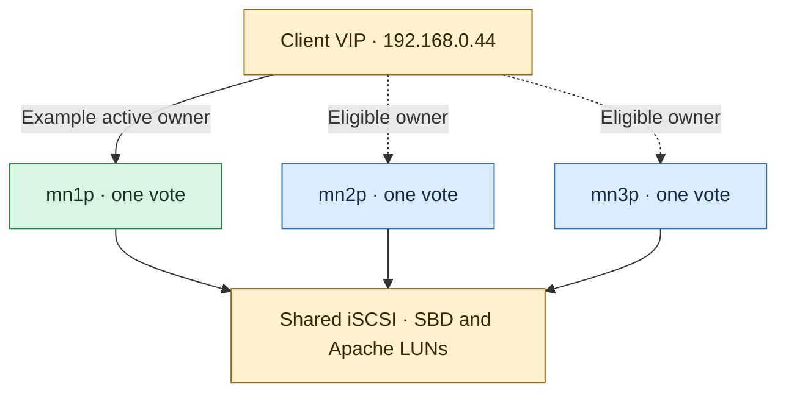
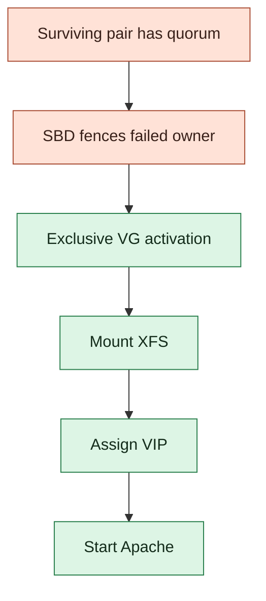

# RHEL 9.8 three-node Apache HA with Pacemaker, SBD and iSCSI

Build an active/passive Apache service with one floating IP and one XFS filesystem. Pacemaker starts the resources in order and stops them in reverse order. All three nodes can see the same data LUN. Only the active node may activate the volume group and mount XFS. If the active node disappears without a clean stop, the surviving partition must have quorum and successfully fence the old owner before taking over.

This is a fresh-build procedure. If the two-node cluster already exists or the LUNs contain data, keep the running cluster and existing LUNs intact. Adding a node to an existing cluster requires a separate change plan.

## 1. Reserve addresses and choose the production platform

The examples use your Kubinfra lab addresses. Verify the VIP is free and each node has its own management console.

| Role | DNS name | Address |
| --- | --- | --- |
| Node 1, VM 125 in the lab | mn1p.kubinfra.com | 192.168.0.35/24 |
| Node 2, VM 126 in the lab | mn2p.kubinfra.com | 192.168.0.36/24 |
| Node 3, VM 127 in the lab | mn3p.kubinfra.com | 192.168.0.37/24 |
| Example iSCSI target | storage.kubinfra.com | 192.168.0.38/24 |
| Apache VIP | web-ha.kubinfra.com | 192.168.0.44/24 |

Create the DNS A records in IPA. Keep the VIP out of DHCP and out of the nodes’ NetworkManager profiles. The nodes need permanent addresses on the same client subnet as the VIP. Verify that the switching or virtualization layer allows gratuitous ARP and the VIP on all three nodes.



Each node has one Corosync vote. **Any two connected nodes form quorum.** The cluster uses ordinary majority quorum with no qdevice. Any of the three nodes can host Apache.

**Production prerequisites**

- Place the three nodes on separate physical hosts and distribute power and switching failure domains. Size each node to run the full Apache workload.
- Use a redundant iSCSI array, independent storage paths, and vendor-supported DM Multipath settings. Give each LUN a stable WWID. Use persistent multipath device names on all three nodes. Keep client, cluster, management and storage networks isolated. Use two independent Corosync links where the platform permits and test each link separately.
- Use a hardware watchdog or a supported virtual implementation. Red Hat documents libvirt/KVM with the emulated i6300esb. Where you use Proxmox, confirm the exact guest, hypervisor and watchdog support with Red Hat before production. A single Proxmox host plus a single RHEL iSCSI target VM is a lab topology. A target outage there can remove both Apache storage and the SBD fencing channel.
- If the service must still fence nodes when the SBD array becomes inaccessible, engineer a fencing path independent of that array and validate the full fencing topology with Red Hat. A fallback fence can isolate a node while the array is down. Apache still needs accessible data storage.
- Verify HA Add-On entitlement and the applicable RHEL 9.8 maintenance channel on all three nodes. For a minor release pinned to 9.8, verify the subscription and repositories still supply security fixes. When using Satellite, verify BaseOS, AppStream and High Availability are synchronized, published and available to each node through the appropriate content view and lifecycle environment.

## 2. Prepare all three cluster nodes

Run as root on each node. Set the appropriate hostname on each.

```bash
# Node 1
hostnamectl set-hostname mn1p.kubinfra.com
# Node 2
hostnamectl set-hostname mn2p.kubinfra.com
# Node 3
hostnamectl set-hostname mn3p.kubinfra.com
```

For directly subscribed x86_64 hosts using Red Hat CDN, enable the HA repository shown below. For Satellite, use the equivalent repository exposed by your content view.

```bash
cat /etc/redhat-release
subscription-manager release --show
subscription-manager repos --list-enabled
subscription-manager repos --enable=rhel-9-for-x86_64-highavailability-rpms
dnf install -y pcs pacemaker resource-agents sbd fence-agents-sbd iscsi-initiator-utils lvm2 xfsprogs httpd wget policycoreutils-python-utils firewalld chrony
systemctl enable --now chronyd firewalld pcsd
passwd hacluster
firewall-cmd --get-active-zones
```

These firewall examples assume the lab interfaces use the public zone. Substitute the actual zone. In production, scope cluster and pcsd traffic to cluster peers and authorized management hosts. Scope HTTP/HTTPS to the intended clients or load balancer.

```bash
firewall-cmd --permanent --zone=public --add-service=high-availability
firewall-cmd --permanent --zone=public --add-service=http
firewall-cmd --reload
chronyc tracking
getent hosts mn1p.kubinfra.com mn2p.kubinfra.com mn3p.kubinfra.com storage.kubinfra.com web-ha.kubinfra.com
getenforce
cat /etc/iscsi/initiatorname.iscsi
```

Keep SELinux enforcing. Record all three initiator IQNs. If the VMs were cloned and share an IQN, assign a unique IQN to each before creating sessions or ACLs. Keep hostnames and machine IDs unique.

## 3. Provision the shared LUNs

| LUN | Example size | Use |
| --- | --- | --- |
| 0 | 64 MiB | Dedicated raw SBD metadata. Keep it out of LVM and free of partitions and filesystems. |
| 1 | 20 GiB | Apache data. The cluster nodes put one LVM PV, VG, LV and XFS filesystem on it. |

All three initiator IQNs need read/write access to the **same** LUNs. In production, use your array's provisioning interface, enable initiator ACLs and CHAP as applicable, and map both LUNs through each redundant portal with consistent identities. Validate vendor guidance for path loss, controller failover and I/O recovery, particularly the handling of I/O when every path is down. Indefinitely queued I/O can stall cluster stop operations.

### Lab target using RHEL targetcli

Use this section on the separate storage host if you are building the lab target from scratch. Provision two dedicated blank block devices to the storage VM. In the commands below, replace /dev/vdb and /dev/vdc with their verified persistent paths if available, and replace the three example IQNs with the values read from the nodes. On an existing target, inspect its configuration and avoid editing another service's portals or LUNs.

```bash
dnf install -y targetcli firewalld
systemctl enable --now target firewalld
lsblk -o NAME,SIZE,TYPE,FSTYPE,MOUNTPOINTS,MODEL,SERIAL
wipefs -n /dev/vdb /dev/vdc
targetcli /backstores/block create sbd_lun /dev/vdb
targetcli /backstores/block create apache_lun /dev/vdc
targetcli /iscsi create iqn.2026-11.com.kubinfra:apache-ha
targetcli /iscsi/iqn.2026-11.com.kubinfra:apache-ha/tpg1/portals ls
```

If the target created the default 0.0.0.0:3260 portal, remove it for this target. Add the dedicated lab portal, then map LUNs and create ACLs.

```bash
targetcli /iscsi/iqn.2026-11.com.kubinfra:apache-ha/tpg1/portals delete 0.0.0.0 3260
targetcli /iscsi/iqn.2026-11.com.kubinfra:apache-ha/tpg1/portals create 192.168.0.38 3260
targetcli /iscsi/iqn.2026-11.com.kubinfra:apache-ha/tpg1 set attribute generate_node_acls=0 authentication=0
targetcli /iscsi/iqn.2026-11.com.kubinfra:apache-ha/tpg1/luns create /backstores/block/sbd_lun 0
targetcli /iscsi/iqn.2026-11.com.kubinfra:apache-ha/tpg1/luns create /backstores/block/apache_lun 1
targetcli /iscsi/iqn.2026-11.com.kubinfra:apache-ha/tpg1/acls create iqn.2026-11.com.kubinfra:mn1p
targetcli /iscsi/iqn.2026-11.com.kubinfra:apache-ha/tpg1/acls create iqn.2026-11.com.kubinfra:mn2p
targetcli /iscsi/iqn.2026-11.com.kubinfra:apache-ha/tpg1/acls create iqn.2026-11.com.kubinfra:mn3p
targetcli saveconfig
targetcli ls
firewall-cmd --permanent --zone=public --add-rich-rule='rule family="ipv4" source address="192.168.0.35/32" port port="3260" protocol="tcp" accept'
firewall-cmd --permanent --zone=public --add-rich-rule='rule family="ipv4" source address="192.168.0.36/32" port port="3260" protocol="tcp" accept'
firewall-cmd --permanent --zone=public --add-rich-rule='rule family="ipv4" source address="192.168.0.37/32" port port="3260" protocol="tcp" accept'
firewall-cmd --reload
ss -lnt '( sport = :3260 )'
```

Confirm each ACL has writable mappings for LUNs 0 and 1. This lab example uses static ACLs and IP filtering on a trusted storage segment. For authenticated access, set CHAP per initiator ACL on the target, enable authentication on the TPG, and configure the matching initiator credentials before login. Apply separate discovery credentials if your target requires them. CHAP authenticates the session. Isolate or encrypt the storage network where needed.

## 4. Connect all three initiators

Run on all three nodes. These commands use the single lab portal. In production, discover and log in to each vendor-approved portal, configure recovery and boot persistence for each path, and use the multipath devices throughout sections 6 and 7.

```bash
systemctl enable --now iscsid.service
iscsiadm -m discovery -t sendtargets -p 192.168.0.38:3260
iscsiadm -m node -T iqn.2026-11.com.kubinfra:apache-ha -p 192.168.0.38:3260 --login
iscsiadm -m node -T iqn.2026-11.com.kubinfra:apache-ha -p 192.168.0.38:3260 --op update -n node.startup -v automatic
systemctl enable --now iscsi.service
udevadm settle
iscsiadm -m session -P 3
ls -l /dev/disk/by-path/*iscsi*
lsblk -o NAME,SIZE,TYPE,FSTYPE,WWN,SERIAL,MOUNTPOINTS
```

The expected lab paths end in -lun-0 for SBD and -lun-1 for Apache data. Compare reported WWIDs or SCSI serials and capacities on all three nodes. For production, install device-mapper-multipath, configure it per array vendor guidance and use the same stable mapper name on every node. Verify each WWID and its paths with multipath -ll. Keep the SBD mapper path stable with the same explicit alias on all three nodes or use the persistent /dev/disk/by-id/dm-uuid-mpath- path. Cold reboot each node before building the cluster and confirm automatic logins and correct device identity.

## 5. Create the three-node cluster

Run these commands once from **node 1**. Authentication lets pcs configure the three hosts. The lab uses one Corosync link. For independent Corosync networks, supply each node’s second address as a second `addr=` argument immediately after its first address at setup time.

```bash
pcs host auth mn1p.kubinfra.com mn2p.kubinfra.com mn3p.kubinfra.com -u hacluster
pcs cluster setup apache-ha mn1p.kubinfra.com addr=192.168.0.35 mn2p.kubinfra.com addr=192.168.0.36 mn3p.kubinfra.com addr=192.168.0.37
pcs cluster start --all
pcs property set stonith-enabled=true no-quorum-policy=stop
pcs status nodes
pcs quorum status
```

Example excerpt from `pcs quorum status` when all three members are online. During a single-node failure, `Total votes` drops to 2 and the remaining pair stays quorate. An isolated node with only one vote cannot run Apache.

```text
Nodes:            3
Quorate:          Yes

Votequorum information
----------------------
Expected votes:   3
Total votes:      3
Quorum:           2
```

Leave Apache and the shared XFS resources out of the cluster until fencing works on all three nodes.

## 6. Configure disk-based SBD fencing

On all three nodes, identify the watchdog exposed by the platform. For an i6300esb VM, expose the device with reset behavior in the hypervisor and load the guest driver if needed. Confirm SBD has exclusive use, including checking for systemd runtime watchdog use and other watchdog daemons. Run the watchdog test on one empty lab node at a time with console access. It is intended to reset the system. Check the local pcs help for the available test command.

```bash
ls -l /dev/watchdog*
cat /sys/class/watchdog/watchdog0/identity
pcs stonith sbd watchdog list
pcs stonith sbd watchdog test --help
# On a lab node with one watchdog, before enabling SBD
pcs stonith sbd watchdog test
```

Disk-based SBD uses the storage header to coordinate delivery and the target's watchdog to bound self-fencing. The values below are commissioning examples for the single-path lab. The example uses a 20-second watchdog, 40-second message wait and 90-second fencing deadline. For production, validate the watchdog timeout against measured path recovery, I/O failure handling and scheduling delays. Verify the hardware accepts the value, keep the message wait at least twice the watchdog interval and allow the fencing deadline to exceed it with margin. Do not shorten values to meet an RTO before testing the full failure matrix.

On all three nodes, ensure SBD starts after persistent iSCSI login. Review the existing unit with systemctl cat sbd.service first. If the unit does not already order after and require your storage stack, use systemctl edit sbd.service with this drop-in. On multipath systems include multipathd.service in Requires and After, and verify that the actual multipath device is present before SBD starts. Run systemctl daemon-reload and test cold boot with storage available and unavailable. Inspect systemctl status iscsi sbd pacemaker and systemd-analyze critical-chain sbd.service after boot. If the target became available after a failed boot, verify the persistent logins and block devices first, then start the local cluster stack with pcs cluster start.

```ini
[Unit]
Requires=iscsi.service
After=iscsi.service
```

On node 1, stop the cluster and inspect the exact LUN before initializing it. The setup command overwrites the selected LUN's SBD area. Run it only once on the intended empty SBD LUN. Confirm pcs options on RHEL with pcs stonith sbd device setup --help. Confirm /dev/watchdog0 is the intended device on all three nodes, or specify node-qualified paths.

```bash
pcs cluster stop --all
lsblk -o NAME,SIZE,TYPE,FSTYPE,WWN,SERIAL,MOUNTPOINTS
wipefs -n /dev/disk/by-path/ip-192.168.0.38:3260-iscsi-iqn.2026-11.com.kubinfra:apache-ha-lun-0
pcs stonith sbd device setup device=/dev/disk/by-path/ip-192.168.0.38:3260-iscsi-iqn.2026-11.com.kubinfra:apache-ha-lun-0 watchdog-timeout=20 msgwait-timeout=40
pcs stonith sbd enable watchdog=/dev/watchdog0 device=/dev/disk/by-path/ip-192.168.0.38:3260-iscsi-iqn.2026-11.com.kubinfra:apache-ha-lun-0 SBD_WATCHDOG_TIMEOUT=20 SBD_DELAY_START=yes SBD_PACEMAKER=true SBD_SYNC_RESOURCE_STARTUP=true
pcs cluster start --all
pcs stonith sbd status --full
```

Allow for the SBD startup delay. Verify all three nodes are online and the SBD header reports the intended values. Confirm all three node slots with sbd list. The names in the slots must match the cluster's node names. Then install the fencing resource from node 1.

```bash
sbd -d /dev/disk/by-path/ip-192.168.0.38:3260-iscsi-iqn.2026-11.com.kubinfra:apache-ha-lun-0 list
pcs stonith describe fence_sbd
pcs property set stonith-action=reboot stonith-timeout=90s
pcs stonith create sbd-fence fence_sbd \
  devices=/dev/disk/by-path/ip-192.168.0.38:3260-iscsi-iqn.2026-11.com.kubinfra:apache-ha-lun-0 \
  pcmk_host_check=static-list pcmk_host_list="mn1p.kubinfra.com mn2p.kubinfra.com mn3p.kubinfra.com" \
  power_timeout=70 pcmk_reboot_timeout=90s op monitor interval=60s
pcs stonith config
pcs status --full
```

Leave the fence agent's default cycle method in place. This design uses explicit shared-disk fence messages. Leave stonith-watchdog-timeout unset or at its default of zero for this design. Review logs for timeouts. Some fence-agents versions let Pacemaker control the deadline by suppressing agent-side timeouts. If the installed agent warns that the power timeout is below msgwait or fails the test, check the matching Red Hat advisory and local fence-agent metadata before changing timeout handling.

**Prove fencing before creating the workload.** Use the console to verify that each target actually reboots. Exercise one target at a time and wait until all three nodes are online and quorate after each test.

```bash
# From node 1, fence node 2
pcs stonith fence mn2p.kubinfra.com
pcs stonith history
pcs status nodes
```

```bash
# Once all three nodes are healthy, from node 1 fence node 3
pcs stonith fence mn3p.kubinfra.com
pcs stonith history
pcs status nodes
```

```bash
# Once all three nodes are healthy, from node 2 fence node 1
pcs stonith fence mn1p.kubinfra.com
pcs stonith history
pcs status nodes
```

On each rebooted node, verify the boot timestamp changed. Read the local SBD log and compare the timestamp with the fencing history. Resolve any failure before moving on.

```bash
uptime -s
journalctl --list-boots
journalctl -b -u sbd -u corosync -u pacemaker
```

## 7. Create exclusive LVM and XFS on the Apache LUN

On **all three** nodes, edit the existing global section of /etc/lvm/lvm.conf. The LVM system ID must be unique and stable on each node.

```ini
global {
    system_id_source = "uname"
}
```

The snippet shows the setting and its section. Add or edit the setting inside your existing global block. Run lvm systemid on all three and confirm three distinct IDs.

On **node 1 only**, inspect LUN 1. Confirm it is the empty Apache data LUN and that no filesystem, partition or VG needs to be preserved. The next commands write LVM and filesystem metadata. Replace the paths with the approved mapper path in production.

```bash
lvm systemid
wipefs -n /dev/disk/by-path/ip-192.168.0.38:3260-iscsi-iqn.2026-11.com.kubinfra:apache-ha-lun-1
pvcreate /dev/disk/by-path/ip-192.168.0.38:3260-iscsi-iqn.2026-11.com.kubinfra:apache-ha-lun-1
vgcreate --setautoactivation n vg_apache /dev/disk/by-path/ip-192.168.0.38:3260-iscsi-iqn.2026-11.com.kubinfra:apache-ha-lun-1
lvcreate -L 16G -n lv_web vg_apache
mkfs.xfs /dev/vg_apache/lv_web
vgcfgbackup vg_apache
```

On **nodes 2 and 3**, add the same data PV if the LVM devices file is enabled, as it is by default on RHEL 9. Verify the foreign VG without activating it.

```bash
lvm systemid
lvmdevices --adddev /dev/disk/by-path/ip-192.168.0.38:3260-iscsi-iqn.2026-11.com.kubinfra:apache-ha-lun-1
vgs --foreign -o vg_name,systemid
```

Create the mountpoint and persistent SELinux mapping on **all three** nodes.

```bash
mkdir -p /srv/apache-ha
semanage fcontext -a -t httpd_sys_content_t '/srv/apache-ha(/.*)?'
restorecon -v /srv/apache-ha
```

On **node 1 only**, seed the filesystem, unmount it and deactivate the VG before Pacemaker takes ownership.

```bash
mount /dev/vg_apache/lv_web /srv/apache-ha
printf '%s\n' '<h1>Kubinfra Apache HA</h1>' > /srv/apache-ha/index.html
printf '%s\n' 'apache-ha-shared-ok' > /srv/apache-ha/healthz.txt
restorecon -Rv /srv/apache-ha
ls -lZ /srv/apache-ha
umount /srv/apache-ha
vgchange -an vg_apache
```

Keep the data filesystem out of /etc/fstab. After commissioning, use Pacemaker for VG activation and filesystem mounting. LVM system ID provides exclusive activation. Fencing is still required to stop a previous owner that may be writing.

## 8. Configure Apache on all three nodes

Disable standalone Apache startup. Use the following configuration on each node. Apache's normal port 80 listener must accept the local status probe on 127.0.0.1. Install the same config on all three nodes, with the node-specific header noted below. The /server-status endpoint is restricted to local requests.

```bash
systemctl disable --now httpd
httpd -M
```

Create /etc/httpd/conf.d/apache-ha.conf.

```apache
ServerName web-ha.kubinfra.com
DocumentRoot "/srv/apache-ha"

<Directory "/srv/apache-ha">
    Options -Indexes
    AllowOverride None
    Require all granted
</Directory>

<Location "/server-status">
    SetHandler server-status
    Require local
</Location>

<IfModule headers_module>
    Header always set X-HA-Node "mn1p.kubinfra.com"
</IfModule>
```

Use mn2p.kubinfra.com on node 2 and mn3p.kubinfra.com on node 3 for the header. In the stock configuration, mod_status and mod_headers are normally loaded. Confirm with httpd -M. Verify httpd -t on each node. Apache may report that the document root is temporarily empty while the cluster filesystem is unmounted.

## 9. Create the PCS resource group

Run on node 1. Confirm the client-facing interface with ip -br address. These commands let IPaddr2 infer it from the subnet route. If more than one interface matches, add nic= with a consistent interface name on all three nodes.

The initial disabled LVM resource holds the group until all four resources are defined. Stickiness favors the current owner after a failed node rejoins. The threshold is an example for recurring Apache failures. A first failure may trigger a local restart. If the group relocates, investigate the original node before clearing failure history.

```bash
pcs resource defaults update resource-stickiness=100
pcs resource create apache-vg ocf:heartbeat:LVM-activate vgname=vg_apache vg_access_mode=system_id op monitor interval=30s --group apache-group --disabled
pcs resource create apache-fs ocf:heartbeat:Filesystem device=/dev/vg_apache/lv_web directory=/srv/apache-ha fstype=xfs op monitor interval=20s --group apache-group
pcs resource create apache-vip ocf:heartbeat:IPaddr2 ip=192.168.0.44 cidr_netmask=24 op monitor interval=10s --group apache-group
pcs resource create apache-web ocf:heartbeat:apache configfile=/etc/httpd/conf/httpd.conf statusurl=http://127.0.0.1/server-status op monitor interval=15s meta migration-threshold=2 failure-timeout=300s --group apache-group
pcs resource enable apache-vg
pcs status --full
pcs resource config
```

All four resources should be Started on the same node. The VIP is added after XFS mounts and before Apache starts. Example excerpt from `pcs status --full`. The owner can be any one of the three nodes.

```text
Resource Group: apache-group
  apache-vg   (ocf:heartbeat:LVM-activate): Started mn1p.kubinfra.com
  apache-fs   (ocf:heartbeat:Filesystem):   Started mn1p.kubinfra.com
  apache-vip  (ocf:heartbeat:IPaddr2):      Started mn1p.kubinfra.com
  apache-web  (ocf:heartbeat:apache):       Started mn1p.kubinfra.com
```



The IP may answer ARP before the web service is ready. Measure recovery with HTTP or HTTPS requests that read the shared filesystem.

On each node, compare findmnt --mountpoint /srv/apache-ha, lvs -o vg_name,lv_name,lv_active and ip -br address. Only one node should own the mount, active LV and VIP. On the active node, verify Apache's local monitor.

```bash
curl -fsS http://127.0.0.1/server-status?auto
```

From a separate client, verify that both the expected body and node header are returned.

```bash
curl -fsSi --resolve web-ha.kubinfra.com:80:192.168.0.44 http://web-ha.kubinfra.com/healthz.txt
```

Example excerpt before the planned migration. After migration, the header changes to the new owner and the health body stays the same.

```text
HTTP/1.1 200 OK
X-HA-Node: mn1p.kubinfra.com

apache-ha-shared-ok
```

## 10. Enable HTTPS before exposing production traffic

On all three nodes install mod_ssl and deploy a trusted certificate for web-ha.kubinfra.com plus its key. Use your organizational CA, such as IPA where appropriate, or a public CA. If issuing from IPA, clients must trust the IPA CA. Keep identical virtual host settings on all three nodes. Use local files, root ownership, restricted private key permissions and default SELinux contexts. Restart Apache under Pacemaker control after changes. For a live cluster, stage the change on the two passive nodes first, validate and fail over to one of them in a change window, then update the former active node.

```bash
dnf install -y mod_ssl
restorecon -v /etc/pki/tls/certs/web-ha-fullchain.pem /etc/pki/tls/private/web-ha.key
```

Create /etc/httpd/conf.d/web-ha-tls.conf. RHEL's mod_ssl package supplies the port 443 listener in ssl.conf. Ensure the shipped sample default TLS virtual host is removed or deliberately configured as a rejecting fallback, while retaining the listener and global TLS settings. Run httpd -t and httpd -S on all three nodes.

```apache
<VirtualHost *:443>
    ServerName web-ha.kubinfra.com
    DocumentRoot "/srv/apache-ha"
    SSLEngine on
    SSLCertificateFile /etc/pki/tls/certs/web-ha-fullchain.pem
    SSLCertificateKeyFile /etc/pki/tls/private/web-ha.key
</VirtualHost>
```

On each node allow HTTPS in the client zone and remove external HTTP access if you do not require a redirect. The Apache resource's loopback monitor on port 80 continues to work.

```bash
firewall-cmd --permanent --zone=public --add-service=https
firewall-cmd --permanent --zone=public --remove-service=http
firewall-cmd --reload
```

If doing this before opening service to users, run pcs resource restart apache-web from a cluster node to load the config. From a client with the correct CA trust, run the following. An automated external probe should verify the certificate, response code and exact health body.

```bash
curl -fsSi --resolve web-ha.kubinfra.com:443:192.168.0.44 https://web-ha.kubinfra.com/healthz.txt
```

## 11. Acceptance tests and controlled failover

Use a change window, console access and a client on the real service network. Record the last successful request, recovery time, the old owner's fence/reset evidence and the new owner's mount and VIP. These tests intentionally interrupt service. Use disposable data during fault injection.

| Test | Action | Pass criteria |
| --- | --- | --- |
| Planned move | Put the active node into standby. | Orderly stop and restart on the peer. Same VIP and health body, different node header. |
| Fail over from each eligible owner | Fence the active node from another node. Restore full health after each test and repeat until each node has hosted Apache and been fenced as owner. | The fence has independent reset evidence. One of the two surviving nodes mounts XFS after fencing. The VIP and health body stay the same. |
| Abrupt active node failure | Power off the active VM from its host console in the lab, with the other two nodes connected. | The pair retains quorum and recovers service after fencing is confirmed. Verify no concurrent activation. |
| Corosync partition | Isolate one node from both peers on every Corosync link while preserving the peers’ connection and the iSCSI paths. | The connected pair retains quorum. The isolated node cannot continue to serve the VIP or keep shared XFS active after recovery converges. |
| Majority loss | Gracefully stop the cluster stack on two nodes in the isolated test environment. | The remaining node reports one vote and no quorum. Apache, the VIP and the shared mount stop. Restore at least one peer to recover. |
| One iSCSI path or controller loss | On a redundant array, fail one approved path or controller. | Surviving paths retain stable devices, acceptable I/O and a working fence channel within tested deadlines. |
| All storage paths lost | Test one node losing all paths and total array loss separately. | No unsafe takeover. Surviving storage and fencing paths determine whether service can recover. If the array is inaccessible to all three nodes, expect service loss. |
| Boot ordering | Cold boot a node with storage available, then test delayed or missing storage. | SBD becomes healthy before workloads operate. Missing storage does not yield a node serving the VIP without protection. |

Planned move example with node 1 active. Run from an online cluster node.

```bash
pcs node standby mn1p.kubinfra.com
pcs status --full
pcs node unstandby mn1p.kubinfra.com
pcs status --full
```

If you want a deliberate move back, place the current active node in standby after the intended destination is online, then unstandby the old owner after the move. This avoids leaving a manual resource location constraint behind.

From the client, use a repeatable probe. Adjust the scheme and remove the explicit port override if real DNS is already configured.

```bash
watch -n 1 'date -Ins; curl -fsSi --max-time 2 --resolve web-ha.kubinfra.com:443:192.168.0.44 https://web-ha.kubinfra.com/healthz.txt'
```

After acceptance checks, enable automatic cluster start from a cluster node.

```bash
pcs cluster enable --all
pcs status --full
```

Repeat a staged reboot with autostart enabled and verify the iSCSI and SBD dependency order. Apache must remain disabled at the systemd level and under Pacemaker control.

## 12. Day-two operations

- **Rolling patching.** Confirm all three nodes, storage and fencing are healthy. Standby the node to patch and confirm service on the peer. Run pcs cluster stop on the node being serviced if taking the local stack down intentionally, patch and reboot it. Verify sessions, SBD, quorum, membership and resource health before unstandby and before proceeding to the next node. Service only one node at a time. Review version-specific upgrade guidance before changing major releases.
- **Backups.** Use pcs config backup with a named output file and check pcs config backup --help for local syntax. Keep off-host backups of the cluster state, Apache config and TLS material, LVM metadata and website data. Back up privileged material securely. Test restoration with isolated node and storage identities.
- **Monitoring.** Alert on node loss, quorum loss, failed fence operations, degraded multipath, iSCSI session loss, SBD failures and externally failed HTTPS checks. Track certificate expiration and storage latency. Compare tested failover times with your agreed RTO.
- **Diagnostics.** Check pcs status --full, pcs quorum status, pcs quorum device status, pcs stonith history, pcs stonith sbd status --full and journalctl -u sbd -u pacemaker -u corosync. For storage use iscsiadm -m session -P 3, multipath -ll where applicable, and lsblk. Review the Apache error log and SELinux AVCs if HTTP fails after mount.
- **Failed fence or stuck group.** Verify the old owner is isolated and the storage paths are healthy. Resolve the watchdog, quorum, storage or agent failure. Keep STONITH enabled and avoid manually activating the VG or mounting the filesystem to bypass a blocked recovery. Clear a resource failure only after correcting the cause, for example pcs resource cleanup apache-web.

## References

- [Red Hat RHEL 9 active/passive Apache cluster](https://docs.redhat.com/en/documentation/red_hat_enterprise_linux/9/html/configuring_and_managing_high_availability_clusters/assembly_configuring-active-passive-http-server-in-a-cluster-configuring-and-managing-high-availability-clusters)
- [Red Hat SBD and fence_sbd support policy](https://access.redhat.com/articles/2800691)
- [Red Hat general fencing support policy](https://access.redhat.com/articles/2881341)
- [Red Hat RHEL 9 high availability guide and quorum configuration](https://docs.redhat.com/en/documentation/red_hat_enterprise_linux/9/html-single/configuring_and_managing_high_availability_clusters/index)
- [Red Hat RHEL 9 iSCSI target configuration](https://docs.redhat.com/en/documentation/red_hat_enterprise_linux/9/html/managing_storage_devices/configuring-an-iscsi-target_managing-storage-devices)
- [Red Hat fence_sbd timeout advisory](https://access.redhat.com/solutions/6115821)
- [Red Hat third-party platform support policy](https://access.redhat.com/articles/third-party-software-support)
